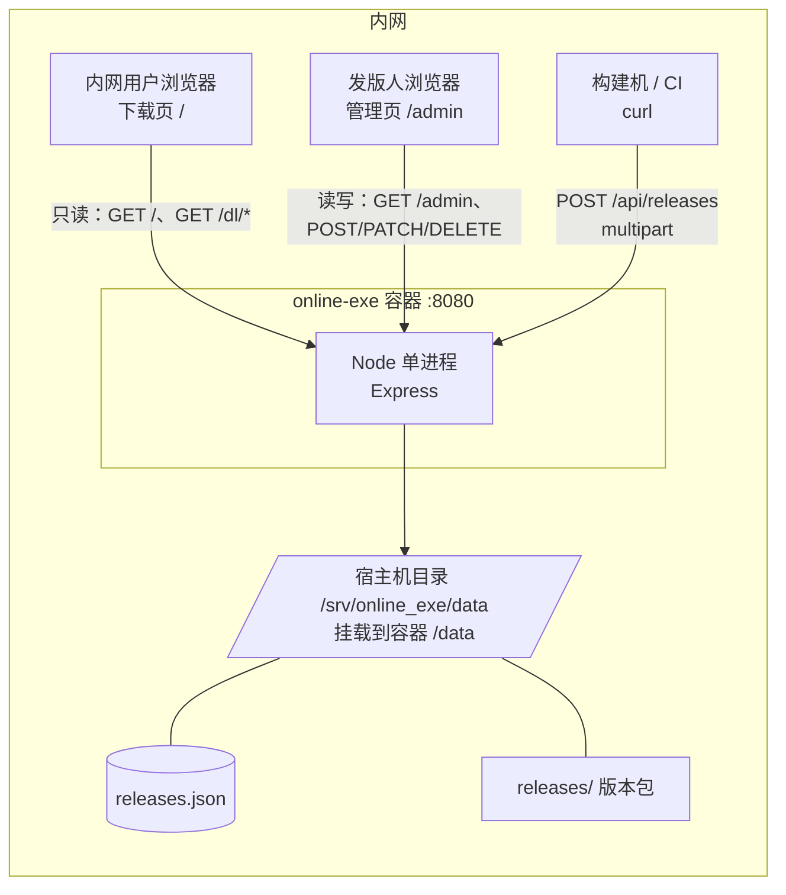

# 内网客户端发版平台 · 方案设计

> 版本：v3.1（Node.js 全栈 · 审查修订）　日期：2026-11-05　模块名：`online_exe`

## 变更记录

| 版本 | 日期 | 变更 |
|---|---|---|
| v1.0 | 2026-11-05 | 初版，按公网服务假设设计（HTTPS / 上传密钥 / Nginx / 对象存储预留） |
| v2.0 | 2026-11-05 | 确认仅部署内网：砍掉 HTTPS、上传密钥、限流、Nginx、OSS；元数据改为 JSON 文件 |
| v2.1 | 2026-11-05 | 确认 Docker 单容器部署，部署章节改为 Dockerfile + compose + 离线 save/load |
| v2.2 | 2026-11-05 | 两人开发，新增分工章节与前端技术栈 |
| v2.3 | 2026-11-05 | 页面收敛为两页：下载页 `/` 只读，管理页 `/admin` 合并上传与版本管理 |
| v2.4 | 2026-11-05 | 新增容量上限与耗时参考 |
| v2.5 | 2026-11-05 | 技术审查修订：运行基线、砍掉 overwrite、并发占位、启动对账、下载计数单源 |
| v2.6 | 2026-11-05 | Windows 拆分为 Win7 / Win10 两个独立平台，平台组合 6 → 8 组 |
| v3.0 | 2026-11-05 | **技术栈由 Go 改为 Node.js 全栈**：Express 5 + busboy + EJS；重写运行基线（`requestTimeout` 默认 300s 是大坑）、启动自检、部署与分工。设计决策与平台模型不变 |
| v3.1 | 2026-11-05 | **Node 版审查修订**：元数据改走 query string（解决 multipart 字段顺序不确定）；busboy 提交改为 `Promise.all(tasks)`（close 不等于写完）；修正 `headersTimeout`/`keepAliveTimeout` 方向；下载页 Tab 改锚点区块（JS 挂了也能用）；路由改 `:combo`；`aborted` 改 `close`；补 orphan 递归、坏记录 410、静态资源缓存、IE11 兜底 |

---

## 1. 需求与边界

### 1.1 已确认的需求

| # | 需求 | 落地方式 |
|---|---|---|
| 1 | 客户端发版，要版本管理，不要登录认证 | 按版本号归档产物，可查历史、可撤回；全程无账号体系 |
| 2 | 服务端可上传不同系统的包 | 按 `平台 + CPU 架构` 两维度收包，Windows 分 Win7 / Win10 |
| 3 | 内网浏览器可下载不同系统的包 | 下载页按平台分组，直链支持断点续传 |
| 4 | 只部署在内网服务器 | 不走公网，不做证书、不做鉴权、不做 CDN |
| 5 | Docker 单容器部署 | 一个镜像、一个进程、一个挂载目录 |

### 1.2 已确认的选型

| 项 | 结论 |
|---|---|
| 应用数量 | 单应用，多版本（无多产品托管需求） |
| 平台范围 | **Windows 分 Win7 / Win10 两套独立产物**；macOS（x64 / arm64）、Linux（x64 / arm64），共 8 组 |
| 语言 | **Node.js 全栈**（`Express 5` 后端 + `EJS` 模板 + 原生 ES5 前端） |
| 上传方式 | HTTP 上传（multipart 流式） |
| 存储 | 本地磁盘（容器内挂载宿主目录） |
| 部署方式 | **Docker 单容器**，离线 `save` / `load` 导入 |
| 自动更新接口 | 不做 |
| 代码签名 | 不做 |

### 1.3 「不同系统」的落地含义

系统不硬编码 `.exe`，而是「任意二进制产物 + 平台标签」。**Windows 必须按内核版本拆成两套产物**，因为同一个二进制无法同时覆盖 Win7 和 Win10。

| 平台标识 | 架构 | 常见产物 | 说明 |
|---|---|---|---|
| `windows7` | x64 / ia32 | `.exe` | Win7 SP1 及以下环境 |
| `windows10` | x64 / ia32 | `.exe` | Win10 / Win11 通用 |
| `macos` | arm64 / x64 | `.dmg` / `.zip` | Apple Silicon / Intel |
| `linux` | x64 / arm64 | `.AppImage` / `.tar.gz` | — |

**平台组合固定为 8 个**：`windows7-x64`、`windows7-ia32`、`windows10-x64`、`windows10-ia32`、`macos-arm64`、`macos-x64`、`linux-x64`、`linux-arm64`。上传时这 8 种之外的组合直接拒绝。

#### 为什么 Win7 和 Win10 必须是两个平台

不是「加个标签」的事，这两套包在技术上是两份不同的构建产物：

| 维度 | Win7 | Win10 / Win11 | 对方案的影响 |
|---|---|---|---|
| 官方支持 | 2020-01 已停止支持 | 主流支持中 | Win7 包通常冻结在某个版本，不再跟进 |
| TLS 1.2 | 默认不支持，需打 KB3140245 | 原生支持 | **内网走 HTTP，正好绕开**；若将来上 HTTPS，Win7 用户直接下载失败 |
| 浏览器 | 最高 IE11 | 有 Edge / Chrome | **下载页必须兼容 IE11**（见 4.7） |
| 运行库 | VC++ 2015-2019 部分可用、.NET 最高 4.8 | 新版齐全 | 客户端要么静态链接，要么随包带运行库 |
| 32 位存量 | 占比高（老教学机、一体机） | 占比低 | `ia32` 主要服务 Win7 |
| UA 标识 | `Windows NT 6.1` | `Windows NT 10.0`（Win11 相同） | 下载页可自动识别并推荐正确包 |

三条设计结论：

1. **版本号各自独立推进**。Win7 停更在 `1.2.0`、Win10 已到 `1.4.0` 是正常状态，`latest` 按平台分别计算。
2. **覆盖度提示以「上次发版实际包含的组合」为基准**，不固定 8 格。否则 `windows10-ia32` 这种从来不产的组合会永远显示「缺失」。
3. **上传时不做强制齐套校验**，只在页面软提示「本版本覆盖 5/8 组合」。强制校验会挡住「这次只修 macOS bug」的合法场景。

### 1.4 明确不做

- 不做账号 / 登录 / 权限角色
- 不做增量更新、差分包
- 不做自动更新检查接口（客户端不联网查询）
- 不做代码签名与公证
- 不做多应用托管
- 不做对象存储（只留抽象接口，不写实现）

---

## 2. 内网 + Docker + 单容器带来的简化

| 公网方案里的东西 | 处置 | 原因 |
|---|---|---|
| HTTPS / 证书 | **砍掉**，直接 `http://内网IP:8080` | 内网无中间人风险；且 Win7 不支持新 TLS |
| 上传密钥 | **砍掉** | 能访问内网即视为可信 |
| Nginx 反代 / 限流 | **砍掉** | 内网千兆，容器内直接对外 |
| `X-Accel-Redirect` | **砍掉** | 没有 Nginx，Express 的 `sendFile` 直接支持 Range |
| 对象存储 / CDN | **砍掉** | 没有公网出口 |
| `PUBLIC_BASE_URL` | **砍掉**，用相对路径 | 内网多网卡 / IP 会变，硬编码 host 必然出错 |
| 多容器编排 | **砍掉** | 无数据库、无缓存、无反向代理 |
| 镜像仓库 | **砍掉** | 内网无 registry，用 `docker save/load` 走文件传递 |

### 2.1 三个约束坑与对策

**坑一：内网服务器没有外网出口。**

`npm install` 在内网会失败。Docker 把这个问题从「服务器问题」变成「构建问题」：依赖在有网的构建机上 `npm ci` 装进镜像，内网只负责 `docker load`。

因此 `node_modules` **必须打进镜像**，不能挂载、不能运行时安装。`package-lock.json` 必须提交，保证构建机装出来的依赖版本可复现。

**坑二：磁盘会被版本堆满。**

8 平台 × 50 个版本 × 100MB ≈ 40GB。方案内置磁盘空间检查（见 4.5），并要求 `/data` 挂独立数据盘。

**坑三：Docker 抹平了「服务器是什么系统」。**

只要跑得动 Docker，里面是 Ubuntu 还是 CentOS 都一样。

---

## 3. 技术选型

| 层 | 选型 | 理由 |
|---|---|---|
| 运行时 | **Node.js 24 LTS** | 团队统一，前后端同栈，一个语言维护两处 |
| Web 框架 | **Express 5** | 生态最大、心智负担最低；`res.sendFile` 底层是 `send` 库，**原生支持 Range / If-Range / 条件请求** |
| multipart | **busboy**（不用 multer） | 唯一真正的流式解析；multer 是「先落盘或先读内存」的封装，2GB 包会吃掉内存 |
| 模板 | **EJS** | 语法接近 HTML，两人都能改，IE11 零压力 |
| 模块规范 | **ESM**（`"type": "module"`） | Node 24 原生，不需要构建步骤 |
| 类型 | **JSDoc 注释**，不上 TypeScript | 2200 行的项目配 tsc + 构建链，收益抵不过成本；编辑器照样有补全 |
| 存储 | **JSON 文件 + 内存索引** | 几百条记录，数据库属于过度设计 |
| 容器基础镜像 | `node:24-alpine` | 内置 `node` 用户（uid 1000），非 root 开箱可用 |

### 3.1 生产依赖只有三个

```json
{
  "type": "module",
  "engines": { "node": ">=24" },
  "dependencies": {
    "express": "^5.1.0",
    "busboy": "^1.6.0",
    "ejs": "^3.1.10"
  }
}
```

依赖越少，内网构建出问题的概率越低，镜像层越干净。`nodemon` 这类只进 `devDependencies`，`npm ci --omit=dev` 时不会进镜像。

### 3.2 为什么不用 TypeScript

- 没有构建步骤意味着改完直接 `node src/server.js` 就能跑，调试栈直指源码
- 两人协作时，少一层「你先跑一下 tsc」的沟通成本
- 关键接口用 JSDoc 标注，编辑器仍有类型提示和补全

如果以后规模变大要上 TS，`tsx` 或 Node 24 的原生类型剥离（`--experimental-strip-types`）都能平滑过渡。

### 3.3 从 Go 换过来的代价（客观记录）

| 项 | Go 版 | Node 版 |
|---|---|---|
| 镜像体积 | ~15MB | ~140MB |
| 运行时内存 | 20–40MB | 50–80MB |
| 大文件流式 | `io.Copy` 一行，背压自动 | `stream.pipeline` + 手动管背压，要小心 |
| Range / ETag | `http.ServeContent` 一行 | `res.sendFile` 一行，但自定义 ETag 要关掉默认值 |
| 部署产物 | 单二进制 | 镜像 + node_modules |
| 并发模型 | 多 goroutine + 锁 | 单线程事件循环，`inflight` 检查天然原子 |

结论：这些代价在「团队统一语言」面前可以接受，但**第 4 节的运行基线必须严格照做**——Node 有几个默认值会在生产上直接咬人。

---

## 4. 详细设计

### 4.0 运行时基线

这一节写「实现时必须遵守、写错就会在线上出事」的底层参数。

#### 4.0.1 三个超时（Node 版最大的坑）

Node 18+ 给 HTTP Server 加了几个默认超时，对普通 API 是保护，对**大文件上传就是绞索**：

| 参数 | Node 默认值 | 必须设为 | 不改的后果 |
|---|---|---|---|
| `server.requestTimeout` | **300000（5 分钟）** | **`0`（禁用）** | 2GB 包在百兆网络要 3 分钟，稍慢就被 408 掐断，**而且报错是 `request timeout`，根本看不出是上传超时** |
| `server.headersTimeout` | 60000 | `66000` | 只限制请求头，不影响上传；但必须**大于** `keepAliveTimeout` |
| `server.keepAliveTimeout` | 5000 | `65000` | 长连接复用；设得比 `headersTimeout` 大，Node 会告警并出现偶发连接重置 |
| `server.timeout` | 0 | `0`（保持） | socket 空闲超时，设了会断长传输 |

```js
import http from 'node:http'

const server = http.createServer(app)

// 关键：默认 300 秒会把大文件上传掐死，必须显式禁用
server.requestTimeout = 0
server.headersTimeout = 66_000     // 必须 > keepAliveTimeout
server.keepAliveTimeout = 65_000
server.timeout = 0

server.listen(cfg.port)
```

方向别记反：是 **`headersTimeout` > `keepAliveTimeout`**。反过来的话 Node 会在启动时打一条警告，然后长连接和请求头超时的判定互相打架，表现为偶发的 `ECONNRESET`。

`requestTimeout = 0` 不等于没有防护：上传侧靠 busboy 的 `limits.fileSize` 限制体积，下载侧靠客户端断开自然退出。

#### 4.0.2 启动自检（四步，顺序不能乱）

```
1. 确保 DATA_DIR 存在且可写（不存在则 mkdir -p）
2. 装载 releases.json —— 三态判断
3. 清理残留 *.tmp
4. 文件与记录对账
```

**第二步：三态判断**。最容易写错的一处——把「文件不存在」当成「文件损坏」，会让全新部署时服务直接起不来。

| 情况 | 判断方式 | 处理 |
|---|---|---|
| 文件不存在 | `err.code === 'ENOENT'` | 初始化空结构，正常启动 |
| 存在但 JSON 语法错误 | `JSON.parse` 抛异常 | **拒绝启动**，打印文件路径 + 出错位置 + 备份建议 |
| 存在且合法但缺字段 | 解析成功、字段为 undefined | 补默认值，记 WARN 日志 |

**第三条：清理残留 tmp**。上传中断或容器被 kill 会留下临时文件，而管理页的「占用总量」只统计 JSON 里的记录，看不见这些垃圾——磁盘就这么慢性泄漏。

启动时递归扫描 `data/releases/**/*.tmp` 全部删除，日志输出删除个数与总字节数。

**第四条：对账**。文件系统与 JSON 是两套状态，中间任何一步崩溃都会产生不一致：

| 不一致类型 | 现象 | 处理 |
|---|---|---|
| 孤儿文件 | 磁盘有 `1.3.0/windows10-x64/package.bin`，JSON 无记录 | 移到 `data/orphan/` 待人工确认，**不直接删** |
| 坏记录 | JSON 有记录，磁盘文件不见了 | 标 `status='broken'`，页面红标提示，**不自动删记录** |

对账只做「标记 + 移走」，不做「自动修复」。自动修复在版本记录这种不可再生数据上风险太高。

**扫描时必须跳过 `data/orphan/` 本身**，否则第二次启动会把上次挪过去的文件又认成孤儿，无限搬运，最后把 orphan 目录刷成一堆时间戳副本。

#### 4.0.3 健康检查

`GET /healthz` 不能只 `res.send('ok')` —— 磁盘满了、`/data` 不可写时，进程活着、所有上传全失败，而 Docker 依然认为容器健康。

```js
export async function healthz(req, res) {
  try {
    await storage.probe()        // 写一个 .health.tmp 再删
    res.status(200).send('ok')
  } catch {
    res.status(503).send('storage unavailable')
  }
}
```

探针要 `fs.writeFile` + 删除，失败即 503，Docker 的 `HEALTHCHECK` 会把容器标成 unhealthy。探针文件不要写进 `releases/` 目录，否则会被对账当成孤儿文件。

### 4.1 整体结构



一个容器、一个进程、一个端口、一个挂载目录。数据全部落在宿主机目录，容器本身无状态，删了重建不丢版本。

### 4.2 目录结构

```
online_exe/
├── package.json
├── package-lock.json
├── src/
│   ├── server.js              # 入口：http server + 三个超时 + 启动自检
│   ├── app.js                 # Express 实例、中间件、路由挂载
│   ├── config.js              # 环境变量装载与默认值
│   ├── catalog/
│   │   ├── types.js           # JSDoc 类型定义（不参与运行）
│   │   ├── catalog.js         # 内存索引、排序、latest、inflight 占位
│   │   ├── persist.js         # 原子写、三态加载、tmp 清理、对账
│   │   └── stats.js           # 下载计数（内存累加 + 定时落盘）
│   ├── routes/
│   │   ├── index.js           # 路由表
│   │   ├── dto.js             # HTTP 响应结构，与磁盘结构分离
│   │   ├── pages.js           # 页面渲染
│   │   ├── upload.js          # busboy 流式上传
│   │   ├── download.js        # sendFile + 自定义 ETag + 计数
│   │   └── releases.js        # 列表 / 撤回 / 恢复 / 删除
│   ├── middleware/
│   │   ├── cidr.js            # /admin 与写接口的来源网段限制
│   │   └── errors.js          # 统一错误响应
│   ├── storage/
│   │   ├── storage.js         # 接口：save / abs / remove / probe / freeBytes
│   │   └── local.js           # 本地磁盘实现
│   └── semver.js              # 解析、拆分、比较
├── views/                     # EJS 模板
│   ├── layout.ejs
│   ├── download.ejs           # 下载页（只读）
│   └── admin.ejs              # 管理页（上传 + 版本列表）
├── public/                    # 静态资源，随镜像走
│   ├── style.css
│   ├── download.js
│   └── admin.js
├── data/                      # 运行时挂载，.dockerignore 排除
│   ├── releases.json
│   ├── releases.json.bak
│   ├── stats.json
│   ├── releases/
│   └── orphan/
├── Dockerfile
├── docker-compose.yml
├── .dockerignore
└── docs/
```

**为什么磁盘结构和 HTTP DTO 分开**：`catalog/types.js` 是磁盘格式，`routes/dto.js` 是响应格式。混用的后果是——API 想加个 `download_url`，结果写进了 `releases.json`；想把 `uploaded_ip` 从响应里去掉，历史记录也跟着少字段。分开的代价只是一个二十行的映射函数。

**`.dockerignore` 必须包含**：`data/`、`node_modules/`、`.git/`、`docs/`、`*.md`。`node_modules` 尤其重要——本地装的依赖会覆盖镜像里 `npm ci` 装好的那份，而本地可能少装了生产依赖。

### 4.3 数据模型（JSON）

`data/releases.json`：

```json
{
  "schema": 1,
  "app": {
    "name": "核心力量",
    "description": "少儿跑酷客户端"
  },
  "releases": [
    {
      "id": "20261105T021000-1f3a9c7e",
      "version": "1.3.0",
      "major": 1, "minor": 3, "patch": 0,
      "prerelease": "",
      "is_prerelease": false,
      "platform": "windows10",
      "arch": "x64",
      "channel": "stable",
      "filename": "CoreRunner-1.3.0-win10-x64.exe",
      "object_key": "1.3.0/windows10-x64/package.bin",
      "size": 48234496,
      "sha256": "9f2c...",
      "changelog": "修复登录闪退；启动速度优化 30%",
      "force_update": false,
      "status": "active",
      "uploaded_at": "2026-11-05T02:10:00Z",
      "uploaded_ip": "10.20.3.51"
    }
  ]
}
```

关键字段：

| 字段 | 作用 |
|---|---|
| `id` | UTC 时间戳 + 8 位随机，避免同秒并发冲突 |
| `platform` | `windows7` / `windows10` / `macos` / `linux`。Win7 与 Win10 是两个独立平台，不是同一平台的两种标签 |
| `arch` | `x64` / `arm64` / `ia32`，与 platform 组合受 8 组白名单约束 |
| `major/minor/patch` | 拆成整数存，`1.10.0` 与 `1.9.0` 才能正确比大小 |
| `is_prerelease` | 正式版永远排在同版本预发布之前 |
| `object_key` | 磁盘相对路径，程序生成，绝不用用户文件名 |
| `uploaded_at` | **一律存 UTC**（`Z` 结尾），渲染时按 `TZ` 转本地 |
| `uploaded_ip` | 内网无账号，靠这条留痕 |
| `status` | `active` / `yanked` / `broken` |

**`downloads` 不在这里**。计数单独存 `data/stats.json`，渲染时按 id 合并：

```json
{ "1f3a9c7e": 42, "8b2d41af": 7 }
```

只有一个真相源，避免「releases.json 里的值和 stats.json 里的值对不上」这类必出 bug 的设计。

**schema 版本**：加载时如果读到大于当前程序支持的版本号，**拒绝启动并提示升级程序**，不要猜着解析。

#### 落盘策略（Node 版要注意 fsync）

- 元数据变更：写 `releases.json.tmp` → **`fsync`** → `rename` 覆盖 → fsync 目录
- 下载计数：内存累加，每 30 秒或累计 100 次批量写 `stats.json`
- 写盘前把旧文件复制一份 `releases.json.bak`，只保留一份

**`fs.writeFile()` 不保证数据落盘**。它是「写进内核页缓存」就返回，断电或宿主机崩溃时，文件可能变成 0 字节或半截。必须显式 fsync：

```js
import fs from 'node:fs/promises'

async function writeAtomic(target, data) {
  const tmp = `${target}.tmp`
  const fh = await fs.open(tmp, 'w')
  try {
    await fh.writeFile(data)
    await fh.sync()          // 关键：不调这行，rename 之后仍可能丢数据
  } finally {
    await fh.close()
  }
  await fs.rename(tmp, target)

  // 目录也要 fsync，否则 rename 本身可能没落盘（Linux 有效）
  const dir = await fs.open(path.dirname(target), 'r')
  try { await dir.sync() } finally { await dir.close() }
}
```

### 4.4 版本管理规则

| 规则 | 说明 |
|---|---|
| 版本格式 | 严格 semver：`MAJOR.MINOR.PATCH[-prerelease]`，允许前缀 `v` |
| 唯一键 | `(platform, arch, channel, version)` 组合唯一 |
| **严格不可变** | 同版本号重复上传 → 一律 `409`，**不提供覆盖**。传错了就发 `1.3.1` |
| 排序 | `major → minor → patch` 降序，正式版优先于预发布 |
| 预发布回落 | 某平台只有预发布版本时，`latest` 回落到最高的预发布并标 Beta |
| 撤回 | `status='yanked'`，文件保留，列表灰显，直链仍可下 |
| 物理删除 | `DELETE /api/releases/:id`，前端二次确认（输入版本号） |
| 渠道 | `stable` / `beta` 两个筛选维度 |

各平台独立取最新：**Win7 停 1.2.0、Win10 已到 1.4.0 是正常状态**，不要求 Win7 追上 Win10。

`windows7` 和 `windows10` 的唯一键互不影响：同一个 `1.3.0` 可以同时存在两份包，这是常态不是重复上传。

#### 为什么砍掉覆盖

允许覆盖同版本，跟下载侧的 `Cache-Control: immutable` 是**直接冲突**的：浏览器缓存了 `/dl/1.3.0/windows10-x64` 之后一年内不再发请求，包覆盖了也拿不到新的，用户只会说「我下了但程序没变」，极难排查。

两条路：给 URL 加内容指纹，或者禁止覆盖。选了后者，因为**版本号不可变是发版系统的底线**——同一个 `1.3.0` 在不同时间对应不同内容，会让「用户报的问题到底对应哪个二进制」永远说不清。

#### latest 的选取逻辑

```text
1. 过滤：platform / arch / channel 匹配，status === "active"
2. 正式版优先：在 !is_prerelease 的集合里取最高
3. 回落：若为空，取 is_prerelease 的最高版本，响应带 "prerelease": true
4. 排序键：major → minor → patch 降序，同版本按 uploaded_at 降序
```

第 3 步的回落是必须的：某平台刚开测、只传了 `1.3.0-beta.1`，如果严格过滤正式版，页面会显示「暂无版本」但磁盘上明明有包。

### 4.5 上传

`POST /api/releases?version=1.3.0&platform=windows10&arch=x64&channel=stable`

**决定唯一键和磁盘路径的字段走 query string，文件本身走 multipart body**：

| 位置 | 字段 | 必填 | 说明 |
|---|---|---|---|
| query | `version` | ✅ | semver；同版本重复上传一律 409 |
| query | `platform` | ✅ | `windows7` / `windows10` / `macos` / `linux` |
| query | `arch` | ✅ | `x64` / `arm64` / `ia32` |
| query | `channel` | | 默认 stable |
| query | `force_update` | | `0` / `1` |
| multipart | `file` | ✅ | 二进制产物 |
| multipart | `changelog` | | 更新说明，可多行 |

**为什么元数据必须走 query，不能放在 multipart 字段里**：multipart 的各个 part 是按客户端上传顺序依次到达的。浏览器 `FormData` 和 `curl -F` 的顺序不一定把普通字段排在文件前面——如果 `file` part 先到，服务端此时还拿不到 `version` 和 `platform`，就没法算唯一键、没法查重、没法定临时文件路径，只能要么把整个文件先丢进一个随机临时文件等着（2GB 白传），要么靠客户端自觉。

query string 在 HTTP 请求行里，**一定先于 body 到达**，解析它不需要等任何字节。这样「查重 → 占位 → 空间预检」全部能在开始接收文件之前完成，逻辑干净且不依赖客户端守规矩。

`changelog` 留在 multipart 里，是因为它可能很长（多行文本），塞进 URL 会被 8KB 长度限制卡住；它也不参与路径决策，晚到无所谓。

**没有 `overwrite` 字段**。覆盖已被取消，见 4.4。

#### 并发控制：Node 版反而更简单

Node 是单线程事件循环，**同步代码块不会被其他请求打断**。所以「查重 + 占位」写在一个同步块里天然原子，不需要 Go 版那种锁：

```js
// 以下代码位于 upload handler 内，key 与 inflight 都是本次请求可见的
const key = `${platform}|${arch}|${channel}|${version}`

// 这一整段同步执行，中间没有 await，不存在交错
if (catalog.has(key)) {
  return res.status(409).json({ error: '该版本已存在，请改用新版本号' })
}
if (inflight.has(key)) {
  return res.status(409).json({ error: '该版本正在上传' })
}
inflight.set(key, Date.now())

// 从这里开始 await 传输大文件，期间其它请求能看到 inflight 占位
```

**但 `await` 之间会切换**，所以占位必须在大文件传输之前完成，提交逻辑必须在传输之后重新进入同步块。这是 Node 版唯一需要小心的地方。

失败路径（超限、客户端断开、磁盘检查不通过）必须删除 `inflight` 标记并清理临时文件。再加一层兜底：`inflight` 记录带时间戳，`setInterval` 每 5 分钟清掉超过 30 分钟未提交的条目——客户端拔网线跑路时，超时释放比人肉重启可靠。

#### 处理流程

1. 解析 query，校验 `platform`/`arch` 是否在 8 组白名单内、semver 是否合法 —— **这一步不需要读 body**
2. 同步块内查重 + 占位
3. **磁盘空间预检**：`storage.freeBytes()`（内部 `fs.statfs`，可用字节 = `bavail * bsize`）取剩余空间，`剩余 < 2 × Content-Length` → 直接 507 并释放占位。无 `Content-Length`（chunked）时跳过，靠写错误兜底
4. 建目录 `data/releases/{version}/{platform}-{arch}/`
5. 用 busboy 流式接收，`pipeline(stream, tap, writeStream)` 写唯一临时文件，`tap` 在中间算 sha256
6. 超限（busboy `limits.fileSize`）、客户端断开、磁盘写失败 → 删临时文件、释放占位、返回错误
7. 原子提交：`rename(tmp, package.bin)`
8. 更新内存索引 + 落盘 JSON + 删除 inflight 标记
9. 返回 201 + 记录 JSON（含 sha256 与 size）

**空间检查必须在第 3 步、写盘之前做**。放到写完之后再检查，等于先花 20 分钟传完 2GB 再告诉用户「磁盘不够」。

#### busboy 流式写法（关键几行）

```js
import Busboy from 'busboy'
import { pipeline } from 'node:stream/promises'
import { Transform } from 'node:stream'
import { createHash } from 'node:crypto'
import fs from 'node:fs'

const bb = Busboy({
  headers: req.headers,
  limits: { fileSize: cfg.maxUploadMb * 1024 * 1024, files: 1 },
})

const tasks = []          // 收集每个文件的异步处理，close 时必须全部 await 完
let sha256, bytesWritten

bb.on('file', (name, stream) => {
  tasks.push((async () => {
    const hash = createHash('sha256')

    // 用 Transform 在流水线中间"顺手"算哈希。
    // 不能写成 stream.on('data', c => hash.update(c))——那会把流切到 flowing 模式，
    // 与 pipeline 抢同一份数据，结果是文件写不全、或哈希对不上，而且很难查。
    const tap = new Transform({
      transform(chunk, _enc, cb) { hash.update(chunk); cb(null, chunk) },
    })

    let tooLarge = false
    stream.on('limit', () => { tooLarge = true })   // limit 在 file stream 上，不在 bb 上

    await pipeline(stream, tap, fs.createWriteStream(tmpPath))
    if (tooLarge) throw new Error('FILE_TOO_LARGE')  // 超限时 pipeline 不一定 reject，靠标记判断
    sha256 = hash.digest('hex')
    bytesWritten = (await fs.stat(tmpPath)).size
  })())
})

bb.on('close', async () => {
  try {
    await Promise.all(tasks)      // ★ 关键：等文件真正写完，再提交
    // rename(tmp → package.bin) → 更新索引 → 写 JSON → 释放 inflight
  } catch (err) {
    // 任意一步失败：删 tmp、释放 inflight、返回 4xx/5xx
  }
})

req.pipe(bb)
```

**`bb.on('close')` 不等于「文件写完了」**。它只表示「请求体读完了」，而 `pipeline` 的落盘还在进行中。如果直接在 `close` 里提交，会出现「JSON 里有记录、`package.bin` 是半截」——而且上传小文件测试时几乎发现不了，因为小文件在 close 触发前就写完了。**必须把所有 file 任务收进数组，在 close 里 `await Promise.all(tasks)`**。

另外注意，`bb.on('file', async ...)` 这种写法是错的：busboy 不会等这个 async 函数返回的 promise，reject 也没人接。

**几个必须注意的点**：

- **不要用 multer**。它默认 `memoryStorage` 会把整个文件读进内存，2GB 直接 OOM；`diskStorage` 虽然落盘，但拿不到「边写边算哈希」的时机。
- **哈希必须走 Transform，不能挂 `data` 事件**。`stream.on('data')` 会让流进入 flowing 模式，与 `pipeline` 争夺数据源。
- `pipeline` 会自动处理背压，**不要自己写 `chunk => ws.write(chunk)`**——写盘跟不上时内存会暴涨。
- busboy 的文件大小限制事件在 **file stream** 上（`stream.on('limit')`），不在 Busboy 实例上。而且超限时 `pipeline` 通常是正常结束而不是抛错，必须靠标记位判断。
- **临时文件必须与目标文件同一文件系统**，放在 `data/releases/{version}/{platform}-{arch}/package.bin.{时间戳}-{随机}.tmp`。不能用 `/tmp`——跨文件系统 `rename` 会返回 `EXDEV`，原子提交的前提就没了。
- **临时文件名必须唯一**，固定名字在并发时互相覆盖，最后写出的包内容不完整但 sha256 记的是其中一次的，查都查不出来。
- 磁盘文件名一律程序生成 `package.bin`，**用户原始文件名只进 JSON 用于展示**。中文名、`../`、`CON`/`NUL` 这类 Windows 保留字，拿去拼路径就会出事。
- **客户端断开要清理**：监听 `req.on('close')` 并检查 `req.complete === false`。不要用已废弃的 `req.on('aborted')`——它在 Node 16 之后行为已变，`aborted` 事件不再可靠。

CI 用法：

```bash
# Win10 x64（Win7 版只需把 platform 改成 windows7，文件名跟着换）
curl -X POST "http://10.20.3.10:8080/api/releases?version=1.3.0&platform=windows10&arch=x64&channel=stable" \
  -F "changelog=修复登录闪退；启动速度优化 30%" \
  -F "file=@dist/CoreRunner-1.3.0-win10-x64.exe"
```

### 4.6 下载

`GET /dl/:version/:combo`

`combo` 形如 `windows10-x64`、`windows7-ia32`、`macos-arm64`，服务端按第一个 `-` 切成 platform 和 arch。

**不要写成 `/:platform-:arch`**。Express 5 用的是 path-to-regexp v8，相邻两个参数中间夹字面量 `-` 的解析行为在不同小版本间有过变化，有的版本能识别成两个参数，有的会把它当成一个奇怪的参数名。用单个 `:combo` 自己 `split` 一次，行为完全可控，也省得调试路由时怀疑人生。

| 要点 | 做法 |
|---|---|
| 断点续传 | `res.sendFile(absPath)`，底层 `send` 库原生支持 `Range` / `If-Range` |
| 自定义 ETag | **必须关掉默认 ETag**：`sendFile(p, { etag: false, lastModified: false })`，然后手动 `res.setHeader('ETag', '"' + sha256 + '"')` |
| 缓存 | `Cache-Control: public, max-age=31536000, immutable` |
| 文件名 | `Content-Disposition: attachment; filename*=UTF-8''<encodeURIComponent>` |
| 计数 | 内存累加，30s 落盘到 `stats.json`；304 也会 +1（浏览器确实发起了下载意图），只统计真实传输的话用 `req.fresh` 判断后跳过 |
| 撤回版本 | `yanked` 仍可下载，保证老用户回滚不断链 |

**为什么要显式关掉 `lastModified` 并接管 ETag**：`send` 库的规则是「响应头里已有 ETag 就用你的，没有才用 `mtime + size` 生成」。所以手动 `setHeader` 之后它不会覆盖。但它默认会设置 `Last-Modified`，条件请求就同时走时间判断——容器重建、数据盘恢复都会改 mtime，同一个包在客户端看来「变新了」，缓存失效；时间倒退时还会误判 304 让用户拿到旧包。

我们只认内容哈希：关掉 `lastModified`，ETag 用 sha256。缓存语义收敛成一个判据，不会互相打架。

**`immutable` 成立的前提是版本号不可变**。因为已经砍掉覆盖（见 4.4），同一个 URL 永远对应同一份内容，这个缓存头才敢设一年。

```js
export async function download(req, res, next) {
  const [platform, arch] = req.params.combo.split('-')
  const rel = catalog.find(req.params.version, platform, arch)
  if (!rel) return res.status(404).send('not found')

  const abs = storage.abs(rel.object_key)

  // 先判文件还在不在：对账可能把坏记录标成 broken，但记录本身不清
  if (!(await fs.stat(abs).catch(() => null))) {
    return res.status(410).send('包文件缺失，请联系发版人重新上传')
  }

  stats.inc(rel.id)                                   // 内存计数，不阻塞响应

  res.setHeader('Content-Type', 'application/octet-stream')
  res.setHeader('Content-Disposition',
    `attachment; filename*=UTF-8''${encodeURIComponent(rel.filename)}`)
  res.setHeader('ETag', `"${rel.sha256}"`)            // 内容哈希
  res.setHeader('Cache-Control', 'public, max-age=31536000, immutable')

  res.sendFile(abs, {
    etag: false,          // 别让 send 用 mtime 生成 ETag
    lastModified: false,  // 也别用 mtime 做条件判断
    acceptRanges: true,
  }, (err) => { if (err && !res.headersSent) next(err) })
}
```

**下载链接一律用相对路径**（`/dl/1.3.0/windows10-x64`），不在页面里拼 `http://IP:PORT`。内网服务器可能有多块网卡、IP 可能调整、也可能被人用主机名访问，硬编码 host 一定会出奇怪的 404。

### 4.7 页面

#### 页面划分

| 页面 | 地址 | 面向 | 职责 |
|---|---|---|---|
| **下载页** | `/` | 内网所有用户（客户端） | **只负责下载**，页面上不出现任何上传、删除、撤回入口 |
| **管理页** | `/admin` | 发版人 | **上传 + 版本管理**，一个页面干完整件事 |

两条设计意图：

1. **下载页是给所有人用的，越单纯越好**。它不该出现「删除」这种按钮——非技术同事误点一次就是事故。
2. **上传和管理本来是一件事的两半**。传完要立刻核对大小和 sha256，传错了要立刻撤回。拆成两个页面，人就只能在两页之间来回跳。

两页同进程、同数据源，上传成功后下载页即时可见，没有「发布」「审核」这类中间态。

#### 前端技术栈

HTML + CSS + 原生 JavaScript **ES5**，无框架、无 TypeScript、无构建工具，`public/` 目录随镜像走。

| 层 | 用什么 | 说明 |
|---|---|---|
| 结构 | EJS 模板 | 服务端渲染，列表在模板里循环输出 |
| 样式 | 手写 CSS（约 200 行） | 不用 CSS 变量、不用 Grid |
| 交互 | 原生 JS ES5（约 120 行） | `XMLHttpRequest` + 回调，不用 `fetch` |
| 静态资源 | `express.static('public')` | 本地文件，不走 CDN；**不要设长缓存** |

**静态资源不要设 `immutable`**。`/dl/` 下的包有版本号做指纹，可以缓存一年；但 `style.css`、`admin.js` 没有指纹，设长了改版后用户会一直拿旧文件，表现是「改了样式但没生效」。让它们走默认的 `ETag + 协商缓存`（304）就够了。真要长缓存，得给文件名加内容哈希，那是另一个工程量。

**版本历史表格默认只渲染最近 20 条**，其余折叠展开。IE11 渲染几百行 `<tr>` 会明显卡顿，而这个页面是给人「找某个旧版本」用的，全量渲染没有意义。

**硬约束一：不引 CDN**。内网无外网出口，任何 `<script src="https://cdn...">` 都会白屏。

**硬约束二：下载页必须兼容 IE11**。Win7 内网机器最高只装到 IE11，而 IE11 不支持：

| 不能用 | 用什么替代 |
|---|---|
| `const` / `let` / 箭头函数 / 模板字符串 | `var` + `function` |
| `fetch()` / `Promise` | `XMLHttpRequest` + 回调 |
| CSS 变量 `var(--x)` | 直接写色值 |
| CSS Grid | `float` 或 `table` 布局 |
| flexbox（部分属性有 bug） | 只用于简单排列，别依赖 `flex-basis` 计算 |

**管理页不要求兼容 IE11**——发版人自己用 Chrome/Edge，可以放开写。这个区分要写进文件注释，省得后面有人「顺手统一」把下载页也升级成 ES6。

判断标准：下载页主体由服务端 EJS 渲染，JS 只做「UA 高亮 + 自动滚动」这类可降级的增强。**JS 挂了页面也得能用。**

这条直接决定了下载页不能用 Tab：**Tab 切换必须靠 JS，而 IE11 上 JS 一挂页面就废了**。改用锚点区块，见下。

#### 下载页 `/`

只读，没有任何写操作。

- 顶部：应用名 + **各平台当前版本摘要**（如「Win7 1.2.0 / Win10 1.4.0 / macOS 1.4.0 / Linux 1.3.0」）。8 个平台各自独立发版，显示单个全局版本号会误导用户
- **四个平台区块垂直排列，不用 Tab**：`Windows 7` / `Windows 10` / `macOS` / `Linux` 各占一块，顶部一行锚点导航 `<a href="#win10">Windows 10</a>` 点击直接跳转。锚点是纯 HTML 行为，IE11 原生支持，JS 禁用也能跳
- **按 UA 自动定位**：JS 读 UA，`Windows NT 6.1` → 自动滚动到 Win7 区块；`Windows NT 10.0` → 滚动到 Win10 区块（Win11 也报 10.0，无需区分）；`Mac OS X` / `Linux` 同理。滚动失败（旧浏览器不支持 `scrollIntoView` 参数）就退化成停在顶部导航，不影响使用
- Win7 和 Win10 必须是**两个独立区块**，不能合并成一个「Windows」再让用户猜
- 每个区块内按架构排列下载卡片：版本、大小、更新时间、下载按钮
- Win7 区块顶部常驻提示：「需 SP1 + KB3140245（TLS 1.2 补丁）；安装失败请先装 VC++ 运行库」
- 版本历史表格：版本、平台、大小、时间、更新说明、下载
- `Beta` 渠道和 `yanked` 版本默认折叠，灰标
- 只有预发布版本的平台，卡片标 `Beta` 并提示「暂无正式版」
- macOS 卡片下附 Gatekeeper 放行步骤（见第 5 节）

**为什么放弃 Tab**：Tab 是「一次只看一个平台」的交互，但它把「看到全部内容」的能力绑在了 JS 上。Win7 内网机的 IE11 本身就是最不稳定的环节，一旦脚本报错，Tab 就切不动，用户只能下到一个平台的包。改成平铺区块后，最坏情况是页面很长，但**所有平台的下载链接永远都在**。

#### 管理页 `/admin`

不要求兼容 IE11，但要做**兜底提示**：`<head>` 里放一段极简检测，发现是 IE 或缺少 `Promise` 时直接显示「请用 Chrome / Edge 打开本页」，然后中止渲染。否则发版人误用 IE 打开会看到一片空白，第一反应是「服务挂了」。

一块页面三段，自上而下：

**① 状态条**

磁盘剩余 / 总量、版本总数、占用合计。常驻顶部，不用滚到底才发现盘满了。

**② 上传区**

- 拖拽 + 点击选文件，`XMLHttpRequest.upload.onprogress` 显示进度条与速率
- 上传地址拼 query：`POST /api/releases?version=1.3.0&platform=windows10&arch=x64`，`FormData` 里只放 `file` 和 `changelog`
- 表单字段：版本号、平台、架构、渠道、更新说明、强制更新
- 平台 / 架构用下拉，只允许 8 组合法组合；**`windows7` 和 `windows10` 是两个独立选项**，旁边标一句「同一份代码需分别构建」
- **覆盖度提示**：填完版本号后实时显示「1.3.0 已覆盖 5/8 组合」，点开可看还差哪几个（只提示，不阻止提交）
- **表单记忆**：版本号和渠道存 `sessionStorage`。一次发版要连传 8 个包，不记忆就得重复填 8 遍
- **版本冲突提示**：409 时明确写出「1.3.0 / windows10 / x64 已存在，请改用 1.3.1」，并自动把版本号 +1 到 patch 位
- 上传成功后：列表自动刷新，新增行高亮 3 秒，展示 sha256 前 8 位供核对
- 上传失败（超限 / 磁盘不足 / 连接中断）时，临时文件必须已清理，页面提示可重试

**③ 版本列表区**

- 按上传时间倒序，每行：版本、平台、架构、大小、时间、状态、操作
- 操作列：`撤回` / `恢复` / `删除`
- `删除` 需输入版本号二次确认，`撤回` 单击即可（可逆）
- 筛选项：平台、渠道、状态（全部 / 正式 / 预发布 / 已撤回）
- 底部「清理建议」：列出每个平台除最近 10 个版本之外的旧包及占用，**只列出，不自动删**

为什么上传和列表必须同页：传完一个新包，最需要的动作是「确认它真的进去了、大小对不对、sha256 对不对」。列表在另一个页面，人就只能靠记忆或刷新两次来确认。

### 4.8 环境变量

```bash
PORT=8080                      # 监听端口
DATA_DIR=/data                 # 数据目录（容器内固定 /data）
MAX_UPLOAD_MB=2048             # 单包上限，busboy limits.fileSize 用
KEEP_PER_PLATFORM=10           # 清理建议保留数（只提示，不自动删）
APP_NAME=核心力量              # 仅在首次初始化 releases.json 时写入
TZ=Asia/Shanghai               # 时区；日志与页面渲染都按此转换
ADMIN_ALLOW_CIDR=              # 空=不限制；填 10.20.0.0/16 则只允许该网段访问 /admin 与写接口
STATS_FLUSH_SEC=30             # 下载计数落盘间隔
```

`ADMIN_ALLOW_CIDR` 是「不加登录体系」前提下的最低成本防护：内网不等于可信网络，办公网和访客 WiFi 常常同网段，任何人打开 `http://IP:8080/admin` 都能删版本。填一个网段即可，下载页不受影响。

### 4.9 容量上限与耗时

| 环节 | 上限 | 由什么决定 | 可否调整 |
|---|---|---|---|
| 单包上传 | **2048MB**（默认） | `MAX_UPLOAD_MB` + busboy `limits.fileSize` | 改环境变量 |
| Node 进程内存 | **恒定 50–80MB**，与包大小无关 | `pipeline` 流式 + 32KB 高水位 | 不需要调 |
| 单包下载 | **无实际限制** | 文件系统 + `int64` | — |
| 容器本身 | 无限制 | Docker 不限制请求体 | — |
| 前置 Nginx（若将来加） | 默认 **1MB** | `client_max_body_size` | 必须改 |

核心结论：**上传是流式的**。`pipeline(part, writeStream)` 边读边写边算哈希，内存占用只有一个流缓冲区。传 10MB 和传 10GB，进程内存都是几十 MB。

两个容易忽略的细节：

- `Content-Length` 算的是整个请求体，含 multipart 边界与表单字段，**实际可用文件大小略小于 `MAX_UPLOAD_MB`**。别把上限卡在正好等于业务最大包。
- 磁盘检查按「剩余空间 < 2 × 包大小」拒绝，因为写入是临时文件 + rename，同一时刻有两份数据在盘上。

不同目标单包大小的建议：

| 目标单包 | 需要改什么 | 风险 |
|---|---|---|
| ≤ 500MB | 不用改 | 无 |
| 500MB – 2GB | 默认配置即可 | 上传耗时几十秒，正常 |
| 2 – 5GB | 调高 `MAX_UPLOAD_MB` | 网页上传在部分浏览器不稳定，改用 curl |
| > 5GB | 改配置 + 上分片上传（tus） | 整包上传不可靠，属于另一个工程量 |

内网传输耗时：

| 单包 | 千兆（≈110MB/s） | 百兆（≈11MB/s） | 无线（≈35MB/s） |
|---|---|---|---|
| 50MB | 0.5 秒 | 5 秒 | 1.5 秒 |
| 200MB | 2 秒 | 18 秒 | 6 秒 |
| 500MB | 5 秒 | 45 秒 | 14 秒 |
| 2GB | 20 秒 | 3 分钟 | 1 分钟 |

**真正先撞墙的是总容量**：

| 单包大小 | 单版本（8 平台） | 保留 30 版本 |
|---|---|---|
| 100MB | 0.8GB | 24GB |
| 500MB | 4GB | 120GB |
| 2GB | 16GB | **480GB** |

所以 `MAX_UPLOAD_MB` 该设多少，取决于磁盘预算，不是技术偏好。

---

## 5. 安全与运维

内网不等于零风险，问题集中在「误操作」和「磁盘」上。

| 风险 | 处置 |
|---|---|
| 误删版本 | 删除必须输入版本号；默认只提供「撤回」，物理删除是二级操作 |
| 误覆盖版本 | 已从机制上消除：版本号严格不可变，同版本一律 409 |
| 磁盘写满 | 上传前检查剩余空间；管理页顶部常驻显示；`/healthz` 写盘探针失败即标 unhealthy |
| 路径穿越 | `platform`/`arch` 白名单 + 版本号正则 + 磁盘名程序生成，三重挡 |
| JSON 损坏 | 启动三态判断；语法错误拒绝启动，绝不拿空数据覆盖 |
| 文件与记录不一致 | 启动对账：孤儿文件移入 `data/orphan/`，坏记录标 `broken`，只标记不自动修复 |
| 崩溃残留临时文件 | 启动清理 `**/*.tmp`，日志输出个数与字节数 |
| 断电丢数据 | 写盘必须 `fsync`：`fs.writeFile` 只管进页缓存，不保证落盘 |
| 并发上传同一版本 | `inflight` 占位，第二个请求直接 409「正在上传」 |
| `/admin` 被任意人访问 | `ADMIN_ALLOW_CIDR` 限定来源网段 |
| 服务挂了 | Docker `restart: unless-stopped` + `HEALTHCHECK` |
| 容器重建丢数据 | 数据全在宿主机挂载目录，容器无状态 |
| 谁传的说不清 | `uploaded_ip` + `uploaded_at` 记录在案 |
| 备份 | 整个 `/srv/online_exe/data` 目录拷走即可 |

### 5.1 三个平台特有的现实问题

**macOS：不签名公证，用户装不上。** Gatekeeper 会直接拦「无法验证开发者」，macOS 15 之后还要进「系统设置 → 隐私与安全性」手动放行。下载页 macOS 卡片下必须写清放行步骤，否则这个平台的包传了等于没传。

**Win7：不要随手加 HTTPS。** Win7 默认不支持 TLS 1.2（需 KB3140245）。现在走 HTTP 恰好规避；一旦有人为了「更安全」加证书，Win7 用户会全部连不上，而且报错完全不指向 TLS。

**Win7：IE11 是天花板。** 下载页必须 ES5 + 无 CSS 变量 + 无 Grid，JS 全部可降级。这条在 4.7 已写成硬约束，代码评审时要专门看一眼。

---

## 6. 部署（Docker 单容器）

### 6.1 交付形态

一个约 140MB 的镜像，`docker save` 成 tar，U 盘或内网共享拷进服务器，`docker load` 还原。

```
构建机（有外网）
  npm ci → docker build → docker save → online-exe-1.0.0.tar
                                            │  U 盘 / 内网共享
                                            ▼
内网服务器
  docker load → docker compose up -d
```

镜像主要体积来自 `node:24-alpine` 基础层（~120MB），业务代码只有几百 KB。这个代价换来的是「内网不用装 node、不用 npm install」。

### 6.2 构建与离线导入

**构建机**：

```bash
docker build -t online-exe:1.0.0 .
docker save online-exe:1.0.0 -o online-exe-1.0.0.tar
ls -lh online-exe-1.0.0.tar
```

**内网服务器**：

```bash
docker load -i online-exe-1.0.0.tar
mkdir -p /srv/online_exe/data
chown -R 1000:1000 /srv/online_exe/data     # 关键：与容器内 node 用户对齐
docker compose up -d
docker compose logs -f
```

> 镜像版本号和业务版本号分开：镜像 `1.0.0` 是服务端程序版本，和客户端 `1.3.0` 没关系。

### 6.3 Dockerfile

```dockerfile
FROM node:24-alpine

# tzdata 必装：alpine 默认没有时区文件
RUN apk add --no-cache tzdata

WORKDIR /app

# 先拷依赖清单，利用层缓存：只改业务代码时不会重装依赖
COPY package.json package-lock.json ./
RUN npm ci --omit=dev

COPY . .

ENV NODE_ENV=production \
    TZ=Asia/Shanghai \
    PORT=8080 \
    DATA_DIR=/data \
    MAX_UPLOAD_MB=2048

RUN mkdir -p /data && chown -R node:node /data
USER node

VOLUME ["/data"]
EXPOSE 8080

HEALTHCHECK --interval=30s --timeout=3s --start-period=5s --retries=3 \
  CMD node -e "fetch('http://127.0.0.1:8080/healthz').then(r=>process.exit(r.ok?0:1)).catch(()=>process.exit(1))"

CMD ["node", "src/server.js"]
```

几个刻意的选择：

| 选择 | 原因 |
|---|---|
| `node:24-alpine` | 内置 `node` 用户（uid 1000），非 root 开箱可用 |
| `npm ci` 而不是 `npm install` | 严格按 lock 文件装，构建可复现；`install` 可能偷偷升级次版本 |
| `--omit=dev` | 不带 nodemon 等开发依赖，镜像更干净 |
| 先 COPY package\*.json 再 COPY 源码 | 只改代码时复用依赖层，构建从 2 分钟降到 5 秒 |
| `USER node` | 与宿主机挂载目录属主对齐，避免上传时 `EACCES` |
| HEALTHCHECK 用 `node -e fetch` | alpine 里的 busybox wget 可用，但 node 自带 fetch 更稳 |

**不要用多阶段构建**。纯 JS 没有编译产物，多阶段只会多一层 `node_modules` 复制，收益为零。

### 6.4 docker-compose.yml

```yaml
services:
  online-exe:
    image: online-exe:${IMAGE_TAG:-1.0.0}
    container_name: online-exe
    restart: unless-stopped
    ports:
      - "8080:8080"
    environment:
      TZ: Asia/Shanghai
      MAX_UPLOAD_MB: "2048"
      KEEP_PER_PLATFORM: "10"
      ADMIN_ALLOW_CIDR: "10.20.0.0/16"
      NODE_ENV: production
    volumes:
      - /srv/online_exe/data:/data
    logging:
      driver: json-file
      options:
        max-size: "20m"
        max-file: "3"
    healthcheck:
      test: ["CMD", "node", "-e", "fetch('http://127.0.0.1:8080/healthz').then(r=>process.exit(r.ok?0:1)).catch(()=>process.exit(1))"]
      interval: 30s
      timeout: 3s
      retries: 3
```

`IMAGE_TAG` 走变量而不是写死：升级时改 `.env` 里的 `IMAGE_TAG=1.0.1`，`docker compose up -d` 完成替换。

`ADMIN_ALLOW_CIDR` 记得改成实际网段，填错管理页直接 403。

`logging` 那两行别省。容器日志默认无限增长，能在几个月内把磁盘写满——这是「莫名其妙磁盘满了」的常见来源。

### 6.5 六个容器坑

| # | 坑 | 现象 | 处置 |
|---|---|---|---|
| 1 | **数据没挂卷** | `docker rm` 后版本记录归零 | 必须 `-v /srv/online_exe/data:/data` |
| 2 | **文件权限** | 上传报 `EACCES`，宿主机改不动文件 | 容器内 `node`（uid 1000），宿主机目录 `chown -R 1000:1000` |
| 3 | **大文件被掐断** | 传 2GB 上传到一半连接重置 | `server.requestTimeout = 0`（Node 默认 300 秒） |
| 4 | **大文件被 413** | 若前置 Nginx，直接 413 | 宿主机 Nginx 的 `client_max_body_size` 默认 1MB |
| 5 | **时区差 8 小时** | 页面时间和日志全是 UTC | `TZ=Asia/Shanghai` + 镜像内装 tzdata |
| 6 | **重启不自动** | 宿主机重启后服务静默消失 | `restart: unless-stopped` |

第 3 条是 Node 版独有的，也是最隐蔽的一个——它只在传输超过 5 分钟时出现，本地小文件测试永远发现不了。

### 6.6 访问地址与容量

浏览器打开 `http://<内网IP>:8080`。建议让运维把 IP 固定，否则大家收藏的书签会失效。

容量全部落在宿主机 `/srv/online_exe/data`：

| 项 | 估算 |
|---|---|
| 单包大小 | 50–200MB |
| 单版本 8 平台 | 约 0.8GB |
| 保留 30 个版本 | 约 24GB |
| 建议磁盘预留 | **60GB 以上，单独挂数据盘** |

### 6.7 裸机部署（备选）

内网若不允许跑 Docker：装 Node 24 → `npm ci --omit=dev` → `node src/server.js`，用 systemd 托管，`DATA_DIR` 换 `/opt/online_exe/data`。

但裸机部署要自己解决「内网装不了依赖」——得把 `node_modules` 打包拷进去。Docker 的 `save/load` 更省事，所以默认走容器。

---

## 7. 两人开发分工

### 7.1 分工原则

1. **按文件切，不按前后端层切**。前端一共 540 行模板样式，一人包前端会闲死，一人包后端会累死。
2. **公共契约第一天冻结**。路由表、数据结构、接口签名定死之后，谁都不许单方面改。
3. **每个人的文件集合不重叠**，git 冲突概率压到接近 0。

### 7.2 阶段 0：契约冻结（两人一起，半天）

| 冻结项 | 落在哪个文件 | 要求 |
|---|---|---|
| 磁盘结构 | `src/catalog/types.js` | JSDoc 定义 `Release` 全部字段 |
| 响应 DTO | `src/routes/dto.js` | `toReleaseDto()` 映射函数，**不许与磁盘结构共用对象** |
| 存储接口 | `src/catalog/catalog.js` | `has / find / latest / list / add / setStatus` 签名 |
| 文件存储接口 | `src/storage/storage.js` | `save / abs / remove / probe / freeBytes` |
| 路由表 | `src/routes/index.js` | 所有路径 + handler 名，先返回 501 |
| 错误格式 | `src/middleware/errors.js` | 统一 `{ error: "..." }` + 状态码 |
| 模板文件名 | `views/` | `download.ejs` / `admin.ejs` 先占位 |
| 模板变量 | `src/routes/pages.js` | 每个模板接收的 data 字段定死 |
| 配置项 | `src/config.js` | 环境变量结构定死（含 `ADMIN_ALLOW_CIDR`） |

冻结后的纪律：

- 改 `types.js` → 群里说，两人同步改，**不允许「我先改了你跟上」**
- 加路由 → 只由 A 改 `routes/index.js`
- 契约变更顺手更新 `docs/api-contract.md`

### 7.3 模块分工

| 模块 | 文件 | 负责人 | 预估 |
|---|---|---|---|
| semver 解析与比较 | `src/semver.js` | **A** | 100 行 |
| 磁盘结构与内存索引 | `src/catalog/types.js` `catalog.js` | **A** | 250 行 |
| 原子写 / 三态加载 / tmp 清理 / 对账 | `src/catalog/persist.js` | **A** | 200 行 |
| 下载计数 | `src/catalog/stats.js` | **A** | 70 行 |
| 本地存储 + `probe` + `freeBytes` | `src/storage/` | **A** | 120 行 |
| 上传接口（busboy 流式 + 哈希 + inflight） | `src/routes/upload.js` | **A** | 260 行 |
| 服务入口 / 超时 / 启动自检 | `src/server.js` `config.js` | **A** | 120 行 |
| 路由表 / 中间件 | `src/routes/index.js` `src/middleware/` | **A 维护**（阶段 0 共同产出） | 120 行 |
| 下载接口（sendFile / ETag / 计数） | `src/routes/download.js` | **B** | 130 行 |
| 响应 DTO + 错误格式 | `src/routes/dto.js` `src/middleware/errors.js` | **B** | 90 行 |
| 页面渲染 | `src/routes/pages.js` | **B** | 200 行 |
| EJS 模板 + CSS | `views/` `public/style.css` | **B** | 420 行 |
| 前端交互 JS（ES5） | `public/download.js` `public/admin.js` | **B** | 120 行 |
| Dockerfile + compose + 部署验证 | `Dockerfile` `docker-compose.yml` | **B** | 80 行 |

合计：A 约 1240 行，B 约 1040 行（其中 540 行是 HTML/CSS，写起来比服务端逻辑快）。

### 7.4 为什么这么切

- **A 管「数据怎么进来」，B 管「数据怎么出去」**，中间只靠冻结的 `catalog` 接口对接，两边可以并行。
- B 在 A 的存储层没写完之前，可以先用假数据渲染页面，**不阻塞**。
- 唯一的重叠点是 `routes/index.js`，用「只由 A 改」的规则消灭。
- Node 全栈的好处在分工上体现得很直接：**两人用同一套语言，A 写的工具函数 B 能直接看懂**，不像前后端分语言时要在接口之外再解释一遍。

### 7.5 并行时序

| 时间 | A | B |
|---|---|---|
| D1 上午 | 阶段 0：一起定契约、搭骨架 | 阶段 0：一起定契约、搭骨架 |
| D1 下午 | semver + catalog（原子写、排序） | 两个页面的模板 + CSS（喂假数据） |
| D2 上午 | storage + 上传（busboy 流式 + 哈希） | 下载接口（sendFile + ETag）+ 页面渲染 |
| D2 下午 | 磁盘检查 + 启动自检 + 接真实数据 | 前端 JS（进度条、撤回/删除） |
| D3 上午 | 联调 + 边界用例 | Dockerfile + 镜像构建 + 容器部署 |
| D3 下午 | **一起跑验收清单（7.7）** | **一起跑验收清单（7.7）** |

两人并行约 2.5–3 天。比单人没快多少，差额全在契约冻结和联调。

### 7.6 协作约定

| 项 | 约定 |
|---|---|
| 分支 | `main` 保护；A 用 `feat/storage-upload`，B 用 `feat/web-download`，小步合并 |
| 冲突高发文件 | `src/server.js`、`routes/index.js`、`package.json`、`catalog/types.js` —— **只由 A 改** |
| 提交粒度 | 一个功能一个提交，禁止攒一天一次性提交 |
| 每日同步 | 下班前各自合到 `dev`，第二天从 `dev` 起步 |
| 接口变更 | 只走「先说 → 同改 → 通知」三步 |
| 代码评审 | 互相看核心逻辑：A 看前端有没有引入 ES6 语法 / CDN，B 看上传有没有把文件读进内存 |
| 依赖 | 加任何 `dependencies` 必须两人同意，并同时更新 `package-lock.json` |

### 7.7 验收清单（两人共同跑一遍）

1. **首次启动**：`/data` 为空目录，服务正常起来并生成空的 `releases.json`（不是拒绝启动）
2. 8 个平台各传一个包，下载页按平台正确分块（Win7 / Win10 为独立区块），每块版本号正确
3. 管理页上传成功后列表立即出现新行，大小与 sha256 前 8 位正确
4. 下载页上找不到任何上传 / 删除入口（只读约束）
5. **同版本重复上传一律 409**，磁盘上不产生多余额外文件
6. **并发上传同一版本**：两个 curl 同时打同一个 `(platform,arch,version)`，只有一个 201，另一个 409「正在上传」
7. **并发上传不同平台**：8 个 curl 同时传 8 个平台全部成功，总耗时接近单个包（验证没被串行化）
8. **2GB 包上传不 OOM**（`docker stats` 观察内存是否恒定在百兆内）
9. **传输超过 5 分钟不中断**（限速到 1MB/s 传 400MB，验证 `requestTimeout = 0` 生效）
10. **上传中途 `kill -9` 容器**，重启后 `**/*.tmp` 已清理，`releases.json` 无残留记录
11. **手动往 `data/releases/9.9.9/` 塞野文件**，重启后移入 `data/orphan/`，原记录不受影响
12. **挂载目录改只读**，`/healthz` 返回 503，`docker ps` 显示 unhealthy
13. 下载中断后续传成功（浏览器暂停/恢复，或 `curl -C -`）
14. **同一 URL 二次下载**返回 304 或命中缓存，服务端不再传输正文
15. 撤回版本后下载页列表灰显，直链仍可下载
16. `docker rm -f` 后重新 `up -d`，版本记录与文件都在
17. 宿主机重启后容器自动拉起
18. 页面时间与宿主机时间一致（时区没歪）
19. 传一个中文文件名的包，下载时文件名不乱码
20. 传一个 `.exe` 后缀但内容为随机字节的文件，sha256 与页面显示一致
21. 只传预发布版本的平台，下载页显示该版本并标 Beta，不是「暂无版本」
22. **Win7 与 Win10 同版本共存**：`1.3.0` 同时上传两份包，都成功、互不覆盖，直链分别可下
23. **Win7 + IE11 真机**打开下载页：不白屏、锚点导航能跳转、能下到 Win7 版包（**JS 全禁后照样能下所有平台**）
24. **Win10 浏览器**打开下载页：JS 自动滚动到「Windows 10」区块；Win11 同样落在 Win10 区块
25. Win7 包在干净的 Win7 SP1 机器上安装成功（运行库依赖已随包带上）
26. **断网模拟**：停掉外网后 `node src/server.js` 能正常启动（验证零外部依赖，没有偷偷请求 npm 或 CDN）
27. **字段顺序无关**：用 `curl -F "file=@big.exe" -F "changelog=xxx"`（文件放在第一个）上传，依然成功——验证元数据确实走 query、不依赖 multipart 顺序

### 7.8 备选分工（两人能力差异较大时）

如果一人对 Node 不熟：

- 熟的人做 A 全部 + 帮 B 把 `pages.js` 写完
- 不熟的人只做模板 + CSS + JS + Dockerfile，**不碰 catalog 内部**，只消费已经组装好的数据对象
- 前提是阶段 0 由熟的人先把模板变量结构定好，照着渲染即可

如果两人都偏后端、都不想做前端：

- 模板用最朴素的 `<table>`，CSS 只写 80 行基础排版
- 页面丑一点不影响内网使用，但下载错平台会影响——所以平台分组必须清楚

---

## 8. 里程碑

| 阶段 | 内容 | 验收 |
|---|---|---|
| M1 | 骨架 + 启动自检 + JSON 存储 + semver + 上传接口 | 空 `/data` 首次启动成功；curl 传 100MB 落盘正确；同版本重传 409 |
| M2 | 下载接口 + 下载页 | 能下、能断点续传、二次下载 304、sha256 与页面对得上 |
| M3 | 管理页（上传 + 版本列表） | 一页内完成上传、核对、撤回、删除，无需跳转 |
| M4 | 磁盘检查 + 对账 + Dockerfile + 离线导入 | `save/load` 后起容器；数据挂卷；`docker rm` 重建后记录还在；只读挂载时 healthz 返 503 |

代码量估计 2300–2600 行（服务端约 1400 + 模板样式 1000）。单人约 3 天，双人并行 2.5–3 天。

---

## 9. 遗留待定

1. **单包大概多大？** 决定 `MAX_UPLOAD_MB` 默认值和磁盘预留量。
2. **内网有多少人要下载？** 十几个人，Express 直出完全够；上百人同时拉，再考虑前置 Nginx 托管静态文件。
3. **服务端口 8080 是否被占？** 开工前确认。
4. **内网 Docker / Compose 版本？** compose 用的是 v2 语法，需要 Docker Compose v2。
5. **宿主机有没有独立数据盘挂 `/srv/online_exe/data`？** 没有的话至少确认根分区剩余 60GB。
6. **两人各自更擅长哪一侧？** 决定 7.3 按原样执行，还是切到 7.8。
7. **管理页的来源网段是什么？** 填 `ADMIN_ALLOW_CIDR`，填错管理页直接 403。
8. **构建机能不能联网跑 `npm ci`？** 如果构建机也断网，需要提前把 `node_modules` 打包成离线产物，或搭一个内网 npm 源。
