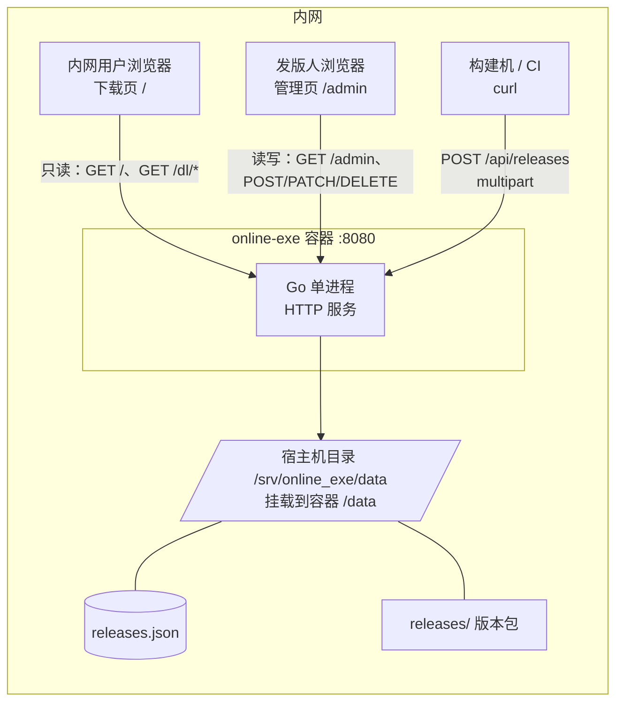

# 内网客户端发版平台 · 方案设计

> 版本：v2.3（内网部署 · Docker 单容器 · 双人协作 · 两页结构）　日期：2026-11-05　模块名：`online_exe`

## 变更记录

| 版本 | 日期 | 变更 |
|---|---|---|
| v1.0 | 2026-11-05 | 初版，按公网服务假设设计（HTTPS / UPLOAD_TOKEN / Nginx / OSS 预留） |
| v2.0 | 2026-11-05 | **确认仅部署内网**：砍掉 HTTPS、上传密钥、限流、Nginx、OSS；技术栈收敛为纯标准库；元数据从 SQLite 改为 JSON 文件 |
| v2.1 | 2026-11-05 | **确认 Docker 单容器部署**：语言定稿 Go（PHP 因单容器需双进程出局）；部署章节重写为 Dockerfile + compose + 离线 save/load；补充容器场景五个坑 |
| v2.2 | 2026-11-05 | **两人开发**：新增第 7 节分工（契约冻结 / 模块划分 / 并行时序 / 协作约定 / 验收清单 / 备选方案）；补充 4.7 前端技术栈 |
| v2.3 | 2026-11-05 | **页面收敛为两页**：下载页 `/` 只读、只负责下载；原上传页 `/upload` 与版本管理区 `/manage` 合并为管理页 `/admin`（上传 + 版本列表同页） |

---

## 1. 需求与边界

### 1.1 已确认的需求

| # | 需求 | 落地方式 |
|---|---|---|
| 1 | 客户端发版，要版本管理，不要登录认证 | 按版本号归档产物，可查历史、可撤回；全程无账号体系 |
| 2 | 服务端可上传不同系统的包 | 按 `操作系统 + CPU 架构` 两维度收包 |
| 3 | 内网浏览器可下载不同系统的包 | 网页按平台分组展示，直链支持断点续传 |
| 4 | 只部署在内网服务器 | 不走公网，不做证书、不做鉴权、不做 CDN |

### 1.2 已确认的选型

| 项 | 结论 |
|---|---|
| 应用数量 | 单应用，多版本（无多产品托管需求） |
| 平台范围 | windows（x64 / ia32）、macos（x64 / arm64）、linux（x64 / arm64），共 6 组 |
| 上传方式 | HTTP 上传 |
| 存储 | 本地磁盘（容器内挂载宿主目录） |
| 部署方式 | **Docker 单容器**，离线 `save` / `load` 导入 |
| 自动更新接口 | 不做 |
| 代码签名 | 不做 |

### 1.3 「不同系统」的落地含义

系统不硬编码 `.exe`，而是「任意二进制产物 + 平台标签」。平台 → 产物格式对照：

| 平台 | 架构 | 常见产物 |
|---|---|---|
| windows | x64 / ia32 | `.exe`（安装包或绿色版） |
| macos | arm64 / x64 | `.dmg` / `.zip` |
| linux | x64 / arm64 | `.AppImage` / `.tar.gz` |

**平台组合固定为 6 个**：`windows-x64`、`windows-ia32`、`macos-arm64`、`macos-x64`、`linux-x64`、`linux-arm64`。上传时这 6 种之外的组合直接拒绝，避免出现 `windows-arm64` 这种没人测过的孤儿包。

### 1.4 明确不做

- 不做账号 / 登录 / 权限角色
- 不做增量更新、差分包
- 不做自动更新检查接口（客户端不联网查询）
- 不做代码签名与公证
- 不做多应用托管
- 不做对象存储（只留抽象接口，不写实现）

---

## 2. 内网 + Docker 约束带来的简化

公网假设下的一堆东西全部可以砍掉：

| 公网方案里的东西 | 内网 + 单容器版处置 | 原因 |
|---|---|---|
| HTTPS / 证书 | **砍掉**，直接 `http://内网IP:8080` | 内网无中间人风险，证书反而增加运维成本 |
| `UPLOAD_TOKEN` 静态密钥 | **砍掉** | 能访问内网即视为可信；密钥会在内网口头传递中变成摆设 |
| Nginx 反代 / 限流 / 限速 | **砍掉** | 内网千兆起步，不考虑带宽竞争；容器内直接对外 |
| `X-Accel-Redirect` | **砍掉**，Go 直接 `ServeContent` | 没有 Nginx，少一跳反而更简单 |
| OSS / CDN 兜底 | **砍掉** | 没有公网出口，本地磁盘是唯一合理选择 |
| `PUBLIC_BASE_URL` 配置 | **砍掉**，用相对路径 | 内网多网卡 / IP 会变，硬编码 host 必然出错 |
| 恶意上传防毒包 | 降级为「记录来源 IP」 | 内网人员可控，留痕足够 |
| 多容器编排（db / redis / nginx） | **砍掉** | 无数据库、无缓存、无反向代理，一个容器就是全部 |
| 镜像仓库（Harbor / registry） | **砍掉** | 内网无 registry，用 `docker save/load` 走文件传递即可 |

### 2.1 三个约束坑与对策

**坑一：内网服务器没有外网出口。**

`go mod download`、`npm install`、`pip install` 在内网全都会失败。**Docker 把这个问题从「服务器问题」变成了「构建问题」**：依赖在有网的构建机上烧进镜像，内网只负责 `docker load`。

但方案仍然坚持**零第三方依赖**，原因有三：构建更快、镜像层更干净、万一构建机也没网也不至于卡死。

**坑二：磁盘会被版本堆满。**

6 平台 × 50 个版本 × 100MB ≈ 30GB。内网服务器的磁盘往往共用且没人监控。方案内置磁盘空间检查（见 4.5），并要求 `/data` 挂在独立数据盘上，而不是容器可写层。

**坑三：Docker 顺带抹平了「服务器是什么系统」。**

裸机部署时必须确认服务器是 Linux 还是 Windows Server，二进制产物不同、服务注册方式也不同。上了 Docker 之后这个变量消失——**只要它跑得动 Docker，里面跑什么系统都一样**。原来方案里那条「待确认服务器系统」的待定项也随之作废。

---

## 3. 技术选型（定稿）

| 层 | 选型 | 理由 |
|---|---|---|
| 语言 | **Go 1.22+**（当前 go.mod 为 1.26） | 单容器镜像 8–15MB、静态链接无运行时、`embed` 打包前端 |
| 路由 | **标准库 `net/http.ServeMux`** | Go 1.22 起原生支持 `GET /dl/{version}/{os}-{arch}` 路径参数，chi / gin 全部不必要 |
| 元数据 | **JSON 文件 + 内存索引** | 数据量几百条，SQLite 属于过度设计；JSON 让整个程序零第三方依赖 |
| 文件存储 | 本地磁盘，`Storage` 接口（仅 local 实现） | 留接口是为了以后真要换存储时不动上层，不写多余实现 |
| 前端 | `html/template` 服务端渲染 + 少量原生 JS | 只有 3 个页面，列表直接渲染，不用为页面另写一套 JSON API |
| 容器基础镜像 | `alpine:3.20`（非 `scratch`） | 需要 tzdata，否则容器默认 UTC，时间差 8 小时 |
| 依赖总数 | **0 个第三方包** | 内网构建的关键前提 |

### 3.1 语言为什么定 Go

「Docker 单容器」把选型的比较维度压缩成了两条：**镜像多大**、**一个容器放不放得下**。

| 语言 | 单容器镜像 | 单容器可行性 | 结论 |
|---|---|---|---|
| **Go** | **8–15MB** | ✅ 单进程，静态链接 | **选定** |
| Rust | 20–30MB | ✅ | 体积同级，开发周期 2–3 倍，不值 |
| PHP | 50MB+ | ❌ 需要 Nginx / php-fpm 两个进程 | **单容器直接出局** |
| Node / TS | 130–180MB | ✅ | 可行，但为发版工具背 150MB 运行时没必要 |
| Python | 120–160MB | ✅ | 同上，且 PyInstaller 易被杀软误报 |
| .NET | 200MB+ | ✅ | 过重 |
| Java | 300MB+ | ✅ | 过重，常驻内存还是 JVM 那套 |

三条结论：

1. **Docker 抵消了「内网装不了运行时」这个变量**，服务器系统、已装环境都不再重要，只要跑得动 Docker。
2. 比较维度收敛为「镜像体积 + 单进程」，Go 在这两项上形成压制性优势。
3. **PHP 是唯一被单容器直接判死的**——它必须靠 Nginx/Apache 挡在前面，单容器里塞两个进程是反模式。

### 3.2 为什么放弃 SQLite

上一版选 SQLite，是因为它在公网场景下「正规、好扩展」。翻盘的两个理由：

1. **零依赖是硬收益**。`modernc.org/sqlite` 是个几十万行的巨型依赖，镜像构建更慢，出问题更难查。而 JSON 方案 `go build` 在任何装了 Go 的机器上都能出包。
2. **数据量根本不构成理由**。6 平台 × 几十个版本 = 几百条记录，全量读进内存做排序，耗时微秒级。为了这个上数据库，属于给自己找运维对象。

代价与边界（说清楚，不含糊）：

- 并发写靠进程内 `sync.RWMutex`，多实例部署不适用（单容器单实例，够）
- 没有事务，写盘用「临时文件 → fsync → rename」保证原子性
- 如果以后要做多应用 + 复杂统计 + 分页查询，再迁 SQLite 也就几十行 DAO 的事

---

## 4. 详细设计

### 4.1 整体结构



一个容器、一个进程、一个端口、一个挂载目录，没有外部依赖。数据全部落在宿主机目录，容器本身无状态，删了重建不丢版本。

### 4.2 目录结构

```
online_exe/
├── cmd/server/main.go
├── internal/
│   ├── config/config.go       # 环境变量 / flag
│   ├── catalog/               # JSON 元数据 + 内存索引 + 排序
│   │   ├── catalog.go
│   │   └── persist.go
│   ├── httpapi/
│   │   ├── router.go
│   │   ├── pages.go           # html/template 渲染
│   │   ├── upload.go
│   │   ├── download.go
│   │   └── releases.go
│   ├── storage/local.go
│   └── semver/semver.go
├── web/                       # embed.FS 打包
│   ├── templates/
│   │   ├── download.html      # 下载页（只读）
│   │   └── admin.html         # 管理页（上传 + 版本列表）
│   └── static/
│       ├── style.css
│       ├── download.js
│       └── admin.js
├── data/                      # 运行时，.gitignore（容器内为 /data）
│   ├── releases.json
│   ├── stats.json
│   └── releases/
├── Dockerfile
├── docker-compose.yml
├── .dockerignore
└── docs/
```

`.dockerignore` 必须包含 `data/`、`.git/`、`docs/`、`*.md`，否则本地跑过的数据会被打进构建上下文，镜像体积白涨。`data/` 尤其不能进镜像——那会让「镜像内数据」和「挂载卷数据」两套并存，排查问题时极其混乱。

### 4.3 数据模型（JSON）

`data/releases.json`：

```json
{
  "schema": 1,
  "app": {
    "name": "核心力量",
    "description": "少儿跑酷客户端"
  },
  "releases": [
    {
      "id": "20261105T021000-7f3a",
      "version": "1.3.0",
      "major": 1, "minor": 3, "patch": 0,
      "prerelease": "",
      "is_prerelease": false,
      "os": "windows",
      "arch": "x64",
      "channel": "stable",
      "filename": "CoreRunner-1.3.0-win-x64.exe",
      "object_key": "1.3.0/windows-x64/package.bin",
      "size": 48234496,
      "sha256": "9f2c...",
      "changelog": "修复登录闪退；启动速度优化 30%",
      "force_update": false,
      "status": "active",
      "uploaded_at": "2026-11-05T02:10:00Z",
      "uploaded_ip": "10.20.3.51",
      "downloads": 0
    }
  ]
}
```

关键字段说明：

| 字段 | 作用 |
|---|---|
| `id` | 时间戳 + 随机后缀，排序稳定，不用自增 |
| `major/minor/patch` | 拆成整数存，`1.10.0` 与 `1.9.0` 才能正确比大小 |
| `is_prerelease` | 正式版永远排在同版本预发布之前 |
| `object_key` | 磁盘相对路径，程序生成，绝不用用户文件名 |
| `uploaded_ip` | 内网无账号，靠这条留痕「谁传的」 |
| `status` | `active` / `yanked`，撤回不删文件 |
| `downloads` | 单独存 `stats.json`，避免每次下载都重写整个元数据文件 |

**落盘策略**：

- 元数据变更：`releases.json.tmp` → `fsync` → `rename` → fsync 目录
- 下载计数：内存计数，每 30 秒或累计 100 次批量写 `stats.json`
- 启动时解析失败：**直接拒绝启动并打印错误**，绝不拿空数据覆盖原文件（这是最容易被写错的一处，一个 bug 就能清空所有版本记录）

### 4.4 版本管理规则

| 规则 | 说明 |
|---|---|
| 版本格式 | 严格 semver：`MAJOR.MINOR.PATCH[-prerelease]`，允许前缀 `v` |
| 唯一键 | `(os, arch, channel, version)` 组合唯一 |
| 不可变 | 同版本号重复上传 → `409`，必须显式 `overwrite=1` |
| 排序 | `major → minor → patch` 降序，正式版优先于预发布 |
| 撤回 | `status='yanked'`，文件保留，列表灰显，直链仍可下 |
| 物理删除 | 只提供 `DELETE /api/releases/{id}`，前端二次确认（输入版本号） |
| 渠道 | `stable` / `beta` 两个筛选维度，避免内测版被当成正式版 |

各平台独立取最新：Windows 停 1.2.0、macOS 已到 1.4.0 是正常状态，不做跨平台版本对齐。

### 4.5 上传

`POST /api/releases`（multipart）：

| 字段 | 必填 | 说明 |
|---|---|---|
| `file` | ✅ | 二进制产物 |
| `version` | ✅ | semver |
| `os` | ✅ | windows / macos / linux |
| `arch` | ✅ | x64 / arm64 / ia32 |
| `channel` | | 默认 stable |
| `changelog` | | 更新说明，多行文本 |
| `force_update` | | `0` / `1` |
| `overwrite` | | `1` 时允许覆盖同版本 |

处理流程：

1. 校验 `os`/`arch` 是否在 6 组白名单内
2. 解析 semver 并拆数字
3. 查重：同 `(os,arch,channel,version)` 存在且未带 `overwrite` → 409
4. 流式落盘：`io.TeeReader(file, sha256Hasher)` 写临时文件，边写边算哈希
5. 超限检查：默认单包 2GB，超出立刻中断并删除临时文件
6. 磁盘空间检查：剩余空间 < 2 倍包大小 → 拒绝，提示「磁盘空间不足」
7. 原子提交：临时文件 → rename 到 `data/releases/{version}/{os}-{arch}/package.bin`
8. 更新内存索引 + 落盘 JSON
9. 返回 201 + 记录 JSON

**必须遵守的几条（都是坑）**：

- 磁盘文件名一律程序生成 `package.bin`，**用户原始文件名只进 JSON 用于展示**。中文名、`../`、`CON`/`NUL` 这类 Windows 保留字，只要拿去拼路径就会出事。
- 先写 `.tmp` 再 rename，否则上传中断会留下半截文件被当成有效包。
- `multipart.Reader` 流式读，内存占用恒定；`http.MaxBytesReader` 兜底防止无上限读取。
- `overwrite` 时必须先写新文件成功，再删旧文件，不能反过来。

CI 用法：

```bash
curl -X POST "http://10.20.3.10:8080/api/releases" \
  -F "version=1.3.0" \
  -F "os=windows" \
  -F "arch=x64" \
  -F "channel=stable" \
  -F "changelog=修复登录闪退；启动速度优化 30%" \
  -F "file=@dist/CoreRunner-1.3.0-win-x64.exe"
```

### 4.6 下载

`GET /dl/{version}/{os}-{arch}`

| 要点 | 做法 |
|---|---|
| 断点续传 | `http.ServeContent`，原生支持 `Range` / `If-Range` |
| 缓存 | `ETag` = sha256，`Cache-Control: public, max-age=31536000, immutable` |
| 文件名 | `Content-Disposition: attachment; filename*=UTF-8''<urlencoded>`，中文名不乱码 |
| 计数 | 内存原子自增，30s 批量 flush 到 `stats.json` |
| 撤回版本 | `yanked` 仍可下载，保证老用户回滚不断链 |

**下载链接一律用相对路径**（`/dl/1.3.0/windows-x64`），不在页面里拼 `http://IP:PORT`。内网服务器可能有多块网卡、IP 可能调整、也可能被人用主机名访问，硬编码 host 一定会出奇怪的 404。

### 4.7 页面

#### 页面划分

| 页面 | 地址 | 面向 | 职责 |
|---|---|---|---|
| **下载页** | `/` | 内网所有用户（客户端） | **只负责下载**，页面上不出现任何上传、删除、撤回入口 |
| **管理页** | `/admin` | 发版人 | **上传 + 版本管理**，一个页面干完整件事 |

两条设计意图：

1. **下载页是给所有人用的，越单纯越好**。它不该出现「删除」这种按钮——非技术同事误点一次就是事故。管理入口完全不放在这一页上。
2. **上传和管理本来是一件事的两半**。传完要立刻核对大小和 sha256，传错了要立刻撤回。拆成两个页面，人就只能在两页之间来回跳，反而更容易出错，所以合并。

两页同进程、同数据源，上传成功后下载页即时可见，没有「发布」「审核」这类中间态。

JS 用量：下载页约 10 行（按 UA 高亮平台 Tab），管理页约 90 行（上传进度 + 列表刷新 + 撤回/删除确认）。

#### 前端技术栈

HTML + CSS + 原生 JavaScript（ES6），**无框架、无 TypeScript、无构建工具**，全部 `//go:embed` 进二进制。

| 层 | 用什么 | 说明 |
|---|---|---|
| 结构 | HTML + `html/template` | 服务端渲染，列表在模板里循环输出，不需要前端拉接口再拼 DOM |
| 样式 | 手写 CSS（约 200 行） | 可选引入 Pico.css（classless，几 KB）省排版力气 |
| 交互 | 原生 JS（约 120 行） | 不引 Vue / React / jQuery / Alpine |
| 打包 | `//go:embed web` | 前端不独立部署，随二进制一起走 |

**硬约束：不引 CDN**。内网无外网出口，任何 `<script src="https://cdn...">` 都会白屏，JS/CSS 必须落在 `web/static/` 内一起 embed。这条比选什么框架更要紧——很多教程模板默认引 CDN，直接拷进来就是线上事故。

#### 下载页 `/`

只读，没有任何写操作。

- 顶部：应用名 + 最新版本号 + 更新时间
- 平台 Tab：`Windows` / `macOS` / `Linux`，默认按访问者 UA 高亮
- 每个 Tab 内按架构排列下载卡片：版本、文件大小、更新时间、下载按钮
- 下方版本历史表格：版本、平台、大小、时间、更新说明、下载
- `Beta` 渠道和 `yanked` 版本默认折叠，灰标
- macOS 卡片下附 Gatekeeper 放行步骤（见第 5 节）

#### 管理页 `/admin`

一块页面三段，自上而下：

**① 状态条**

磁盘剩余 / 总量、版本总数、占用合计。常驻顶部，不用滚到底才发现盘满了。

**② 上传区**

- 拖拽 + 点击选文件，`XMLHttpRequest.upload.onprogress` 显示进度条与速率
- 表单字段：版本号、平台、架构、渠道、更新说明、强制更新
- 平台 / 架构用下拉，只允许 6 组合法组合
- **表单记忆**：版本号和渠道存 `sessionStorage`。一次发版要连传 6 个平台的包，不记忆就得重复填 6 遍，这是最容易让人放弃用网页、改去写 curl 的地方
- 上传成功后：列表自动刷新，新增那一行高亮 3 秒，并展示 sha256 前 8 位供人工核对

**③ 版本列表区**

- 按上传时间倒序，每行：版本、平台、架构、大小、时间、状态、操作
- 操作列：`撤回` / `恢复` / `删除`
- `删除` 需输入版本号二次确认，`撤回` 单击即可（可逆）
- 筛选项：平台、渠道、状态（全部 / 正式 / 预发布 / 已撤回）
- 底部「清理建议」：列出每个平台除最近 10 个版本之外的旧版本及占用空间，**只列出，不自动删**

为什么上传和列表必须同页：传完一个新包，最需要的动作是「确认它真的进去了、大小对不对、sha256 对不对」。如果列表在另一个页面，人就只能靠记忆或刷新两次来确认，出错概率直接上升。

### 4.8 环境变量 / 启动参数

```bash
LISTEN_ADDR=:8080            # 监听地址
DATA_DIR=/data               # 数据目录（容器内固定 /data，由宿主机挂载）
MAX_UPLOAD_MB=2048           # 单包上限
KEEP_PER_PLATFORM=10         # 清理建议保留数（只用于提示，不自动删）
APP_NAME=核心力量            # 首次启动写入 releases.json
TZ=Asia/Shanghai             # 容器内时区，不设则日志与页面时间都是 UTC
```

---

## 5. 安全与运维

内网不等于零风险，剩下的问题集中在「误操作」和「磁盘」上。

| 风险 | 处置 |
|---|---|
| 误删版本 | 删除必须输入版本号；默认只提供「撤回」，物理删除是二级操作 |
| 误覆盖版本 | 同版本默认 409，`overwrite=1` 显式覆盖 |
| 磁盘写满 | 上传前检查剩余空间；页面顶部常驻显示；启动日志打印占用 |
| 路径穿越 | `os`/`arch` 白名单 + 版本号正则 + 磁盘名程序生成，三重挡 |
| JSON 损坏 | 启动解析失败即拒绝启动，不覆盖原文件；每次写盘前把旧文件留一份 `.bak` |
| 服务挂了 | Docker `restart: unless-stopped` + `HEALTHCHECK` 自动拉起 |
| 容器重建丢数据 | 数据全在宿主机挂载目录，容器无状态；`docker rm` 不影响版本记录 |
| 内网谁传的说不清 | `uploaded_ip` + `uploaded_at` 记录在案，页面上可见 |
| 备份 | 整个 `/srv/online_exe/data` 目录拷走即可，无数据库导出步骤 |

**macOS 包的现实问题**：不做签名和公证，macOS 用户打开会被 Gatekeeper 直接拦，提示「无法验证开发者」，macOS 15 之后还要进「系统设置 → 隐私与安全性」手动放行。Windows 的 SmartScreen 至少能点「更多信息 → 仍要运行」绕过，macOS 是真的会卡住一批人。建议在下载页的 macOS 卡片下直接写放行步骤，否则这个平台的包传了等于没传。

---

## 6. 部署（Docker 单容器）

### 6.1 交付形态

一个约 15MB 的镜像，`docker save` 成 tar，用 U 盘或内网共享拷进服务器，`docker load` 还原。运行时零安装、零依赖、零外网。

```
构建机（有外网）
  docker build → docker save → online-exe-1.0.0.tar
                                    │  U 盘 / 内网共享
                                    ▼
内网服务器
  docker load → docker compose up -d
```

### 6.2 构建与离线导入

**构建机**：

```bash
docker build -t online-exe:1.0.0 .
docker save online-exe:1.0.0 -o online-exe-1.0.0.tar
ls -lh online-exe-1.0.0.tar          # 应该在 15MB 上下
```

**内网服务器**：

```bash
docker load -i online-exe-1.0.0.tar
mkdir -p /srv/online_exe/data
chown -R 1000:1000 /srv/online_exe/data     # 关键：与容器内 uid 对齐
docker compose up -d
docker compose logs -f
```

> 镜像版本号建议和业务版本号分开：镜像 `1.0.0` 是服务端程序的版本，和客户端 `1.3.0` 没关系，别混在一个序列里。

### 6.3 Dockerfile

```dockerfile
# ---------- 构建阶段 ----------
FROM golang:1.22-alpine AS build
WORKDIR /src
COPY go.mod ./
RUN go mod download
COPY . .
RUN CGO_ENABLED=0 GOOS=linux go build \
      -trimpath -ldflags="-s -w" \
      -o /out/server ./cmd/server

# ---------- 运行阶段 ----------
FROM alpine:3.20

# tzdata 必装：scratch/alpine 默认没有时区文件，不做这步所有时间差 8 小时
RUN apk add --no-cache tzdata ca-certificates \
 && addgroup -g 1000 app \
 && adduser  -u 1000 -G app -D -H app

WORKDIR /app
COPY --from=build /out/server /app/server

ENV TZ=Asia/Shanghai \
    LISTEN_ADDR=:8080 \
    DATA_DIR=/data \
    MAX_UPLOAD_MB=2048

RUN mkdir -p /data && chown -R 1000:1000 /data
USER 1000:1000

VOLUME ["/data"]
EXPOSE 8080

HEALTHCHECK --interval=30s --timeout=3s --start-period=5s --retries=3 \
  CMD wget -qO- http://127.0.0.1:8080/healthz || exit 1

ENTRYPOINT ["/app/server"]
```

几个刻意的选择：

| 选择 | 原因 |
|---|---|
| 用 `alpine` 而不是 `scratch` | 需要 tzdata 和 ca-certificates；`scratch` 里没有，时间会差 8 小时 |
| 非 root（uid 1000）运行 | 与宿主机挂载目录属主对齐，避免上传时 `permission denied` |
| `CGO_ENABLED=0` | 静态链接，镜像里不需要 glibc / musl 兼容层，跨机器跑不出事 |
| `-trimpath -ldflags="-s -w"` | 去掉调试符号和本地路径，体积从 ~12MB 降到 ~8MB |
| `HEALTHCHECK` 走 `/healthz` | 程序必须实现这个接口，否则健康检查形同虚设 |

### 6.4 docker-compose.yml

```yaml
services:
  online-exe:
    image: online-exe:1.0.0
    container_name: online-exe
    restart: unless-stopped
    ports:
      - "8080:8080"
    environment:
      TZ: Asia/Shanghai
      MAX_UPLOAD_MB: "2048"
      KEEP_PER_PLATFORM: "10"
    volumes:
      - /srv/online_exe/data:/data
    logging:
      driver: json-file
      options:
        max-size: "20m"
        max-file: "3"
    healthcheck:
      test: ["CMD", "wget", "-qO-", "http://127.0.0.1:8080/healthz"]
      interval: 30s
      timeout: 3s
      retries: 3
```

`logging` 那两行别省。容器日志默认无限增长，一个被反复扫描的下载接口能在几个月内把磁盘写满——这是容器部署最常见的「莫名其妙磁盘满了」的来源。

### 6.5 五个必须提前处理的容器坑

| # | 坑 | 现象 | 处置 |
|---|---|---|---|
| 1 | **数据没挂卷** | `docker rm` 后所有版本记录归零 | 必须 `-v /srv/online_exe/data:/data`；镜像内是只读可写层，删容器即删数据 |
| 2 | **文件权限** | 上传报 `permission denied`，宿主机改不动文件 | 容器非 root（uid 1000），宿主机目录 `chown -R 1000:1000`；或 compose 里加 `user: "${UID}:${GID}"` |
| 3 | **大文件被 413** | 传 2GB 包直接断，日志无异常 | 纯 `ports` 映射没有此问题；若前置了宿主机 Nginx，`client_max_body_size` 默认 1MB，必须调到 2G |
| 4 | **时区差 8 小时** | 页面时间和日志全是 UTC | `TZ=Asia/Shanghai` + 镜像内装 tzdata，两个都要做 |
| 5 | **重启不自动** | 宿主机重启后服务静默消失 | `restart: unless-stopped` |

### 6.6 为什么容器里不放 Nginx

单容器要求一个前台进程。Nginx 放进来只有两种结局：和 Go 抢端口走内部转发（多一跳，纯属浪费），或者直接托管静态文件（但那会绕过下载计数和 `yanked` 逻辑，版本撤回就失效了）。

Go 的 `http.ServeContent` 已经自带 Range / ETag / 条件请求，容器里不需要第二个进程。

### 6.7 访问地址与容量

浏览器打开 `http://<内网IP>:8080`。建议让运维把 IP 固定（DHCP 保留或静态绑定），否则大家收藏的书签会失效。

容量全部落在宿主机 `/srv/online_exe/data`：

| 项 | 估算 |
|---|---|
| 单包大小 | 50–200MB |
| 单版本 6 平台 | 约 0.6GB |
| 保留 30 个版本 | 约 18GB |
| 建议磁盘预留 | **50GB 以上，单独挂一块数据盘** |

### 6.8 裸机部署（备选）

内网若不允许跑 Docker，同一份代码 `CGO_ENABLED=0 go build` 出来的二进制直接 systemd 跑，数据目录换 `/opt/online_exe/data`，其余逻辑完全一致。

Docker 只是交付方式，不是架构依赖——这一点在设计时就要守住，别把业务逻辑写进 compose 或 Dockerfile。

---

## 7. 两人开发分工

### 7.1 分工原则

1. **按文件切，不按前后端层切**。前端一共 650 行模板样式，一人包前端会闲死，一人包后端会累死。
2. **公共契约第一天冻结**。路由表、数据结构、接口签名定死之后，谁都不许单方面改。
3. **每个人的文件集合不重叠**，git 冲突概率压到接近 0。

### 7.2 阶段 0：契约冻结（两人一起，半天）

这是整个分工能不能成立的前提，必须在写业务代码之前完成。

| 冻结项 | 落在哪个文件 | 要求 |
|---|---|---|
| 数据结构 | `internal/catalog/types.go` | `Release` 结构体全部字段 + JSON tag + 空值约定 |
| 存储接口 | `internal/catalog/catalog.go` | `Catalog` / `Storage` 的方法签名先定，实现留空 |
| 路由表 | `internal/httpapi/router.go` | 所有路径 + handler 名，handler 先返回 `501` |
| 错误格式 | `internal/httpapi/errors.go` | 统一 `{"error":"..."}` + 状态码约定 |
| 模板文件名 | `web/templates/` | 两个页面文件名先占位（`download.html` / `admin.html`） |
| 配置项 | `internal/config/config.go` | 环境变量结构体定死 |

冻结后的纪律：

- 改 `types.go` → 在群里说，两人同步改，**不允许「我先改了你跟上」**
- 加路由 → 只由 A 改 `router.go`
- 任何契约变更都要顺手更新 `docs/api-contract.md`

### 7.3 模块分工

| 模块 | 文件 | 负责人 | 预估 |
|---|---|---|---|
| semver 解析与比较 | `internal/semver/` | **A** | 120 行 |
| JSON 元数据 + 内存索引 + 排序 | `internal/catalog/` | **A** | 300 行 |
| 本地存储 | `internal/storage/` | **A** | 100 行 |
| 上传接口 + 流式落盘 + sha256 | `internal/httpapi/upload.go` | **A** | 250 行 |
| 磁盘空间检查 | `internal/httpapi/disk.go` | **A** | 60 行 |
| 路由 / 配置 / main | `router.go` `config.go` `main.go` | **A 维护**（阶段 0 共同产出） | 150 行 |
| 下载接口（Range / ETag / 计数） | `internal/httpapi/download.go` | **B** | 150 行 |
| 下载页 + 管理页渲染 | `internal/httpapi/pages.go` | **B** | 220 行 |
| 两个页面的模板 + CSS | `web/templates/` `web/static/` | **B** | 420 行 |
| 前端交互 JS | `web/static/download.js` `web/static/admin.js` | **B** | 120 行 |
| Dockerfile + compose + 部署验证 | `Dockerfile` `docker-compose.yml` | **B** | 80 行 |

合计：A 约 980 行（含 150 行公共骨架），B 约 1080 行（其中 650 行是 HTML/CSS，写起来比 Go 快）。

### 7.4 为什么这么切

- **A 管「数据怎么进来」，B 管「数据怎么出去」**，中间只靠冻结的 `Catalog` 接口对接，两边可以并行。
- Go 代码的心智负担高于模板，A 的 980 行 Go 和 B 的 1080 行（含 650 行静态页面）体感基本持平。
- B 在 A 的存储层没写完之前，可以先用假数据渲染页面，**不阻塞**。
- 唯一的重叠点是 `router.go`，用「只由 A 改」的规则消灭。

### 7.5 并行时序

| 时间 | A | B |
|---|---|---|
| D1 上午 | 阶段 0：一起定契约、搭骨架 | 阶段 0：一起定契约、搭骨架 |
| D1 下午 | semver + catalog（原子写、排序） | 两个页面的模板 + CSS（喂假数据） |
| D2 上午 | storage + 上传接口（流式 + sha256） | 下载接口（Range / ETag）+ pages 渲染 |
| D2 下午 | 磁盘检查 + 接真实数据 | 前端 JS（进度条、撤回/删除） |
| D3 上午 | 联调 + 边界用例 | Dockerfile + 镜像构建 + 容器部署 |
| D3 下午 | **一起跑验收清单（7.7）** | **一起跑验收清单（7.7）** |

两人并行约 2.5–3 天。比单人 2 天没快多少，差额全在契约冻结和联调——这是两人协作的正常代价，别指望线性提速。

### 7.6 协作约定

| 项 | 约定 |
|---|---|
| 分支 | `main` 保护；A 用 `feat/storage-upload`，B 用 `feat/web-download`，小步合并 |
| 冲突高发文件 | `main.go`、`router.go`、`go.mod`、`types.go` —— **只由 A 改**，B 有需求口头提 |
| 提交粒度 | 一个功能一个提交，禁止攒一天一次性提交（联调定位全靠它） |
| 每日同步 | 下班前各自合到 `dev`，第二天从 `dev` 起步；10 分钟对一次进度 |
| 接口变更 | 只走「先说 → 同改 → 通知」三步，不走单向通知 |
| 代码评审 | 互相看对方的核心逻辑（A 看 JS 有没有写内联 CDN，B 看上传有没有把文件读进内存） |

### 7.7 验收清单（两人共同跑一遍）

1. 6 个平台各传一个包，下载页按平台正确分组
2. 管理页上传成功后列表立即出现新行，大小与 sha256 前 8 位正确
3. 下载页上找不到任何上传/删除入口（只读约束）
4. 同版本重复上传 → `409`；带 `overwrite=1` → 覆盖成功且旧文件已删
5. 2GB 包上传不 OOM（`docker stats` 观察内存是否恒定）
6. 下载中断后续传成功（浏览器暂停/恢复，或 `curl -C -`）
7. 撤回版本后下载页列表灰显，直链仍可下载
8. `docker rm -f` 后重新 `up -d`，版本记录与文件都在
9. 宿主机重启后容器自动拉起
10. 页面时间与宿主机时间一致（时区没歪）
11. 传一个中文文件名的包，下载时文件名不乱码
12. 传一个 `.exe` 后缀但内容为随机字节的文件，sha256 与页面显示一致

### 7.8 备选分工（两人能力差异较大时）

如果一人完全没写过 Go：

- 强的人做全部 A 模块 + 帮 B 把 `pages.go` 写完
- 弱的人只做模板 + CSS + JS + Dockerfile，**不碰 catalog 内部**，只消费 `[]Release` 切片
- 前提是阶段 0 由强的人先把 `template data` 结构定好，弱的人照着渲染

如果两人都偏后端、都不想做前端：

- 模板用最朴素的 `<table>`，CSS 只写 80 行基础排版，把精力放在接口正确性上
- 页面丑一点不影响内网使用，但下载错平台会影响——所以平台分组必须清楚

---

## 8. 里程碑

| 阶段 | 内容 | 验收 |
|---|---|---|
| M1 | 骨架 + JSON 存储 + semver + 上传接口 | curl 传 100MB 包成功，文件落盘，`releases.json` 正确 |
| M2 | 下载接口 + 下载页 | 浏览器加载页面，能下、能断点续传、sha256 与页面对得上 |
| M3 | 管理页（上传 + 版本列表） | 一页内完成上传、核对、撤回、删除，无需跳转其他页面 |
| M4 | 磁盘检查 + Dockerfile + 离线导入 | `docker save/load` 后起容器，数据挂卷，`docker rm` 重建后版本记录还在 |

代码量估计 1400–1800 行 Go + 650 行模板样式。单人 2 天，双人并行 2.5–3 天（含契约冻结与联调）。

---

## 9. 遗留待定

1. **单包大概多大？** 决定 `MAX_UPLOAD_MB` 默认值和磁盘预留量。
2. **内网有多少人要下载？** 十几个人，Go 直出完全够；上百人同时拉，再考虑前置 Nginx 托管静态文件。
3. **服务端口 8080 是否被占？** 开工前确认，避免部署时才发现冲突。
4. **内网 Docker / Compose 版本？** compose 文件用的是 v2 语法（`services:` 顶层、无 `version:`），需要 Docker Compose v2。老版本（`docker-compose` 1.x）要改写法，提前确认省一轮返工。
5. **宿主机有没有独立数据盘可挂 `/srv/online_exe/data`？** 没有的话至少要确认根分区剩余 50GB 以上。
6. **两人各自更擅长哪一侧？** 决定 7.3 的分工是按原样执行，还是切到 7.8 的备选方案。
