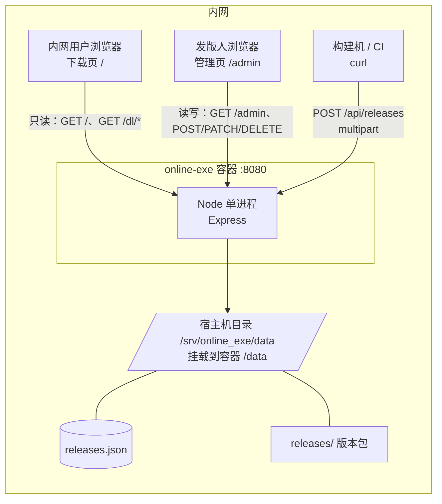

# 内网客户端发版平台 · 方案设计

> 版本：v3.3（Node.js 全栈 · 三轮审查修订）　日期：2026-11-05　模块名：`online_exe`
>
> 状态：已审核修订（v3.3）。本轮修订逐条对照 Node.js / busboy / send 官方源码验证，改动处正文用 **v3.3 修正** 就地标注，完整清单见文末「附录：审核修订记录」。

## 变更记录

| 版本 | 日期 | 变更 |
|---|---|---|
| v1.0 | 2026-11-05 | 初版，按公网服务假设设计（HTTPS / 上传密钥 / Nginx / 对象存储预留） |
| v2.0 | 2026-11-05 | 确认仅部署内网：砍掉 HTTPS、上传密钥、限流、Nginx、OSS；元数据改为 JSON 文件 |
| v2.1 | 2026-11-05 | 确认 Docker 单容器部署，部署章节改为 Dockerfile + compose + 离线 save/load |
| v2.2 | 2026-11-05 | 两人开发，新增分工章节与前端技术栈 |
| v2.3 | 2026-11-05 | 页面收敛为两页：下载页 `/` 只读，管理页 `/admin` 合并上传与版本管理 |
| v2.4 | 2026-11-05 | 新增容量上限与耗时参考 |
| v2.5 | 2026-11-05 | 技术审查修订：运行基线、砍掉 overwrite、并发占位、启动对账、下载计数单源 |
| v2.6 | 2026-11-05 | Windows 拆分为 Win7 / Win10 两个独立平台，平台组合 6 → 8 组 |
| v3.0 | 2026-11-05 | **技术栈由 Go 改为 Node.js 全栈**：Express 5 + busboy + EJS；重写运行基线（`requestTimeout` 默认 300s 是大坑）、启动自检、部署与分工。设计决策与平台模型不变 |
| v3.1 | 2026-11-05 | **Node 版审查修订**：元数据改走 query string（解决 multipart 字段顺序不确定）；busboy 提交改为 `Promise.all(tasks)`（close 不等于写完）；修正 `headersTimeout`/`keepAliveTimeout` 方向；下载页 Tab 改锚点区块（JS 挂了也能用）；路由改 `:combo`；`aborted` 改 `close`；补 orphan 递归、坏记录 410、静态资源缓存、IE11 兜底 |
| v3.2 | 2026-11-05 | **二轮审查**：删掉 `channel` 与 `force_update`，唯一键收敛为 `(platform,arch,version)`；空间预检系数 2 → 1.1；JSON 写串行队列 + 提交顺序修正；busboy 补 `defParamCharset`、`filesLimit`/`error` 事件、状态机防重入；`Content-Disposition` 补 ASCII 回退（IE11）；包文件补 fsync；新增优雅退出；修 IPv6-mapped 地址、EJS 布局、broken 重传、orphan 管理入口 |
| v3.3 | 2026-11-05 | **三轮审查**：修 `tasks` 悬空 promise 导致进程退出（最严重）；删除改为墓碑，堵死「删后重传」击穿不可变；`status` 与文件缺失解耦（新增 `file_missing`）；v 前缀归一化；空间预检加并发额度；超时方向纠错（真实约束是 `headersTimeout <= requestTimeout`）；`commit()` 作用域 bug；broken 重传沿用原 id；部署改 `network_mode: host` 取真实源 IP；清理 4.7 残留的「渠道/强制更新」；补续传计数去重、combo 校验、CI 网段说明 |

---

## 1. 需求与边界

### 1.1 已确认的需求

| # | 需求 | 落地方式 |
|---|---|---|
| 1 | 客户端发版，要版本管理，不要登录认证 | 按版本号归档产物，可查历史、可撤回；全程无账号体系 |
| 2 | 服务端可上传不同系统的包 | 按 `平台 + CPU 架构` 两维度收包，Windows 分 Win7 / Win10 |
| 3 | 内网浏览器可下载不同系统的包 | 下载页按平台分组，直链支持断点续传 |
| 4 | 只部署在内网服务器 | 不走公网，不做证书、不做鉴权、不做 CDN |
| 5 | Docker 单容器部署 | 一个镜像、一个进程、一个挂载目录 |

### 1.2 已确认的选型

| 项 | 结论 |
|---|---|
| 应用数量 | 单应用，多版本（无多产品托管需求） |
| 平台范围 | **Windows 分 Win7 / Win10 两套独立产物**；macOS（x64 / arm64）、Linux（x64 / arm64），共 8 组 |
| 语言 | **Node.js 全栈**（`Express 5` 后端 + `EJS` 模板 + 原生 ES5 前端） |
| 上传方式 | HTTP 上传（multipart 流式） |
| 存储 | 本地磁盘（容器内挂载宿主目录） |
| 部署方式 | **Docker 单容器**，离线 `save` / `load` 导入 |
| 自动更新接口 | 不做 |
| 代码签名 | 不做 |

### 1.3 「不同系统」的落地含义

系统不硬编码 `.exe`，而是「任意二进制产物 + 平台标签」。**Windows 必须按内核版本拆成两套产物**，因为同一个二进制无法同时覆盖 Win7 和 Win10。

| 平台标识 | 架构 | 常见产物 | 说明 |
|---|---|---|---|
| `windows7` | x64 / ia32 | `.exe` | Win7 SP1 及以下环境 |
| `windows10` | x64 / ia32 | `.exe` | Win10 / Win11 通用 |
| `macos` | arm64 / x64 | `.dmg` / `.zip` | Apple Silicon / Intel |
| `linux` | x64 / arm64 | `.AppImage` / `.tar.gz` | — |

**平台组合固定为 8 个**：`windows7-x64`、`windows7-ia32`、`windows10-x64`、`windows10-ia32`、`macos-arm64`、`macos-x64`、`linux-x64`、`linux-arm64`。上传时这 8 种之外的组合直接拒绝。

#### 为什么 Win7 和 Win10 必须是两个平台

不是「加个标签」的事，这两套包在技术上是两份不同的构建产物：

| 维度 | Win7 | Win10 / Win11 | 对方案的影响 |
|---|---|---|---|
| 官方支持 | 2020-01 已停止支持 | 主流支持中 | Win7 包通常冻结在某个版本，不再跟进 |
| TLS 1.2 | 默认不支持，需打 KB3140245 | 原生支持 | **内网走 HTTP，正好绕开**；若将来上 HTTPS，Win7 用户直接下载失败 |
| 浏览器 | 最高 IE11 | 有 Edge / Chrome | **下载页必须兼容 IE11**（见 4.7） |
| 运行库 | VC++ 2015-2019 部分可用、.NET 最高 4.8 | 新版齐全 | 客户端要么静态链接，要么随包带运行库 |
| 32 位存量 | 占比高（老教学机、一体机） | 占比低 | `ia32` 主要服务 Win7 |
| UA 标识 | `Windows NT 6.1` | `Windows NT 10.0`（Win11 相同） | 下载页可自动识别并推荐正确包 |

三条设计结论：

1. **版本号各自独立推进**。Win7 停更在 `1.2.0`、Win10 已到 `1.4.0` 是正常状态，`latest` 按平台分别计算。
2. **覆盖度提示以「上次发版实际包含的组合」为基准**，不固定 8 格。否则 `windows10-ia32` 这种从来不产的组合会永远显示「缺失」。
3. **上传时不做强制齐套校验**，只在页面软提示「本版本覆盖 5/8 组合」。强制校验会挡住「这次只修 macOS bug」的合法场景。

### 1.4 明确不做

- 不做账号 / 登录 / 权限角色
- 不做增量更新、差分包
- 不做自动更新检查接口（客户端不联网查询）
- 不做代码签名与公证
- 不做多应用托管
- 不做对象存储（只留抽象接口，不写实现）

---

## 2. 内网 + Docker + 单容器带来的简化

| 公网方案里的东西 | 处置 | 原因 |
|---|---|---|
| HTTPS / 证书 | **砍掉**，直接 `http://内网IP:8080` | 内网无中间人风险；且 Win7 不支持新 TLS |
| 上传密钥 | **砍掉** | 能访问内网即视为可信 |
| Nginx 反代 / 限流 | **砍掉** | 内网千兆，容器内直接对外 |
| `X-Accel-Redirect` | **砍掉** | 没有 Nginx，Express 的 `sendFile` 直接支持 Range |
| 对象存储 / CDN | **砍掉** | 没有公网出口 |
| `PUBLIC_BASE_URL` | **砍掉**，用相对路径 | 内网多网卡 / IP 会变，硬编码 host 必然出错 |
| 多容器编排 | **砍掉** | 无数据库、无缓存、无反向代理 |
| 镜像仓库 | **砍掉** | 内网无 registry，用 `docker save/load` 走文件传递 |

### 2.1 三个约束坑与对策

**坑一：内网服务器没有外网出口。**

`npm install` 在内网会失败。Docker 把这个问题从「服务器问题」变成「构建问题」：依赖在有网的构建机上 `npm ci` 装进镜像，内网只负责 `docker load`。

因此 `node_modules` **必须打进镜像**，不能挂载、不能运行时安装。`package-lock.json` 必须提交，保证构建机装出来的依赖版本可复现。

**坑二：磁盘会被版本堆满。**

8 平台 × 50 个版本 × 100MB ≈ 40GB。方案内置磁盘空间检查（见 4.5），并要求 `/data` 挂独立数据盘。

**坑三：Docker 抹平了「服务器是什么系统」。**

只要跑得动 Docker，里面是 Ubuntu 还是 CentOS 都一样。

---

## 3. 技术选型

| 层 | 选型 | 理由 |
|---|---|---|
| 运行时 | **Node.js 24 LTS** | 团队统一，前后端同栈，一个语言维护两处 |
| Web 框架 | **Express 5** | 生态最大、心智负担最低；`res.sendFile` 底层是 `send` 库，**原生支持 Range / If-Range / 条件请求** |
| multipart | **busboy**（不用 multer） | 唯一真正的流式解析；multer 是「先落盘或先读内存」的封装，2GB 包会吃掉内存 |
| 模板 | **EJS** | 语法接近 HTML，两人都能改，IE11 零压力 |
| 模块规范 | **ESM**（`"type": "module"`） | Node 24 原生，不需要构建步骤 |
| 类型 | **JSDoc 注释**，不上 TypeScript | 2200 行的项目配 tsc + 构建链，收益抵不过成本；编辑器照样有补全 |
| 存储 | **JSON 文件 + 内存索引** | 几百条记录，数据库属于过度设计 |
| 容器基础镜像 | `node:24-alpine` | 内置 `node` 用户（uid 1000），非 root 开箱可用 |

### 3.1 生产依赖只有三个

```json
{
  "type": "module",
  "engines": { "node": ">=24" },
  "scripts": {
    "start": "node src/server.js",
    "dev": "nodemon src/server.js"
  },
  "dependencies": {
    "express": "^5.1.0",
    "busboy": "^1.6.0",
    "ejs": "^3.1.10"
  },
  "devDependencies": {
    "nodemon": "^3.1.0"
  }
}
```

**v3.3 补充**：`start` 脚本不是装饰。`npm ci --omit=dev` 之后 `node_modules/.bin` 里只有生产依赖，容器里靠 `CMD ["node", "src/server.js"]` 直接起还无所谓；但一旦有人想用 `npm start` 排查（比如 `docker run --rm -it online-exe npm start`），没有这个脚本会报 `Missing script: start`，白耽误十分钟。`dev` 脚本里的 `nodemon` 在 `devDependencies`，`--omit=dev` 时不会进镜像，所以容器里跑 `npm run dev` 必然失败——这是预期行为。

依赖越少，内网构建出问题的概率越低，镜像层越干净。`nodemon` 这类只进 `devDependencies`，`npm ci --omit=dev` 时不会进镜像。

### 3.2 为什么不用 TypeScript

- 没有构建步骤意味着改完直接 `node src/server.js` 就能跑，调试栈直指源码
- 两人协作时，少一层「你先跑一下 tsc」的沟通成本
- 关键接口用 JSDoc 标注，编辑器仍有类型提示和补全

如果以后规模变大要上 TS，`tsx` 或 Node 24 的原生类型剥离（`--experimental-strip-types`）都能平滑过渡。

### 3.3 从 Go 换过来的代价（客观记录）

| 项 | Go 版 | Node 版 |
|---|---|---|
| 镜像体积 | ~15MB | ~140MB |
| 运行时内存 | 20–40MB | 50–80MB |
| 大文件流式 | `io.Copy` 一行，背压自动 | `stream.pipeline` + 手动管背压，要小心 |
| Range / ETag | `http.ServeContent` 一行 | `res.sendFile` 一行；`send` 会沿用已有 ETag，但**默认还会设 `Last-Modified`**，必须显式关掉 |
| 部署产物 | 单二进制 | 镜像 + node_modules |
| 并发模型 | 多 goroutine + 锁 | 单线程事件循环，`inflight` 检查天然原子 |

结论：这些代价在「团队统一语言」面前可以接受，但**第 4 节的运行基线必须严格照做**——Node 有几个默认值会在生产上直接咬人。

---

## 4. 详细设计

### 4.0 运行时基线

这一节写「实现时必须遵守、写错就会在线上出事」的底层参数。

#### 4.0.1 四个超时（Node 版最大的坑）

Node 18+ 给 HTTP Server 加了几个默认超时，对普通 API 是保护，对**大文件上传就是绞索**：

| 参数 | Node 默认值 | 必须设为 | 不改的后果 |
|---|---|---|---|
| `server.requestTimeout` | **300000（5 分钟）** | **`0`（禁用）** | 2GB 包在百兆网络要 3 分钟，稍慢就被 408 掐断，**而且报错是 `request timeout`，根本看不出是上传超时** |
| `server.headersTimeout` | 60000 | 60000（**保持默认**） | 只限制请求头接收时长，与上传无关。**v3.3 修正**：不需要改成 66000 |
| `server.keepAliveTimeout` | 5000 | 65000 | 默认 5 秒太短，客户端连接池会复用到服务端已经关掉的 socket，表现为偶发 `ECONNRESET` |
| `server.timeout` | 0 | `0`（保持） | socket 空闲超时，设了会断长传输 |

```js
import http from 'node:http'

const server = http.createServer(app)

// 关键：默认 300 秒会把大文件上传掐死，必须显式禁用
server.requestTimeout = 0
server.headersTimeout = 60_000
server.keepAliveTimeout = 65_000
server.timeout = 0

// 只监听 IPv4：见 4.8，双栈下 remoteAddress 会带 ::ffff: 前缀，CIDR 匹配必踩坑
server.listen(cfg.port, '0.0.0.0')
```

**v3.3 修正：超时的方向讲反了。** v3.1/v3.2 写的「`headersTimeout` 必须大于 `keepAliveTimeout`，否则 Node 会告警并出现 `ECONNRESET`」，在 Node 源码里**不存在**这个检查。

对照 `lib/_http_server.js` 的 `storeHTTPOptions()`，唯一的强约束是：

```js
if (this.requestTimeout > 0 && this.headersTimeout > 0 && this.headersTimeout > this.requestTimeout) {
  throw new ERR_OUT_OF_RANGE('headersTimeout', '<= requestTimeout', headersTimeout);
}
```

即 **`headersTimeout` 必须 ≤ `requestTimeout`**（两者都 > 0 时才校验），违反直接抛异常、进程起不来。`keepAliveTimeout` 与 `headersTimeout` 之间没有任何比较，也没有启动告警。

顺带一个容易忽略的事实：keep-alive 的**实际**空闲超时是 `keepAliveTimeout + keepAliveTimeoutBuffer`（buffer 默认 `1000`），所以设 65000 实际生效约 66 秒。

`requestTimeout = 0` 不等于没有防护：上传侧靠 busboy 的 `limits.fileSize` 限制体积，下载侧靠客户端断开自然退出。

#### 4.0.2 启动自检（四步，顺序不能乱）

```
1. 确保 DATA_DIR 存在且可写（不存在则 mkdir -p）
2. 装载 releases.json —— 三态判断
3. 清理残留 *.tmp
4. 文件与记录对账
```

**第二步：三态判断**。最容易写错的一处——把「文件不存在」当成「文件损坏」，会让全新部署时服务直接起不来。

| 情况 | 判断方式 | 处理 |
|---|---|---|
| 文件不存在 | `err.code === 'ENOENT'` | 初始化空结构，正常启动 |
| 存在但 JSON 语法错误 | `JSON.parse` 抛异常 | **拒绝启动**，打印文件路径 + 出错位置 + 备份建议 |
| 存在且合法但缺字段 | 解析成功、字段为 undefined | 补默认值，记 WARN 日志 |

**第三条：清理残留 tmp**。上传中断或容器被 kill 会留下临时文件，而管理页的「占用总量」只统计 JSON 里的记录，看不见这些垃圾——磁盘就这么慢性泄漏。

启动时递归扫描 `data/releases/**/*.tmp` 全部删除，日志输出删除个数与总字节数。

**第四条：对账**。文件系统与 JSON 是两套状态，中间任何一步崩溃都会产生不一致。**扫描根目录固定为 `data/releases/`**（`orphan/` 在 `data/` 下，天然不在扫描范围内，不需要额外跳过）：

| 不一致类型 | 现象 | 处理 |
|---|---|---|
| 孤儿文件 | 磁盘有 `1.3.0/windows10-x64/package.bin`，JSON 无记录 | 移到 `data/orphan/` 待人工确认，**不直接删** |
| 文件缺失 | JSON 有记录，磁盘文件不见了 | 置 `file_missing = true`，页面红标提示，**不自动删记录** |

**v3.3 修正：文件缺失不再写进 `status`。** v3.2 用 `status='broken'`，会**覆盖掉原来的 `yanked`**——一个已经撤回的版本，文件一旦丢失就变回"损坏"，撤回状态凭空消失，列表里重新冒出一条待处理的红标记录。

现在把两个维度拆开：

- `status` 表示**发版人的意图**：`active` / `yanked` / `deleted`
- `file_missing` 表示**磁盘的客观事实**：`true` / `false`

对账只动 `file_missing`，不碰 `status`。UI 上 `file_missing === true` 就显示「缺文件」红标，与它是不是已撤回无关。

**但 `status === 'deleted'` 的记录必须整个跳过对账。** 墓碑的文件是主动删掉的，对账看到「文件没了」就把 `file_missing` 置真，查重条件（`file_missing !== true`）随即放行，墓碑的不可变保护当场失效。这是拆字段之后必然出现的耦合点，实现时别漏：

```js
for (const rel of catalog.list()) {
  if (rel.status === 'deleted') continue      // 墓碑不参与文件对账
  const exists = await fs.stat(storage.abs(rel.object_key)).catch(() => null)
  if (!exists && !rel.file_missing) { rel.file_missing = true; changed = true }
  if (exists && rel.file_missing)   { rel.file_missing = false; changed = true }
}
```

对账只做「标记 + 移走」，不做「自动修复」。自动修复在版本记录这种不可再生数据上风险太高。

`orphan/` 里的文件不会自动清理——管理页状态条会显示「孤儿 N 个 / X MB」并提供清理入口，见 4.7。

#### 4.0.3 健康检查

`GET /healthz` 不能只 `res.send('ok')` —— 磁盘满了、`/data` 不可写时，进程活着、所有上传全失败，而 Docker 依然认为容器健康。

```js
export async function healthz(req, res) {
  try {
    await storage.probe()        // 写一个 .health.tmp 再删
    res.status(200).send('ok')
  } catch {
    res.status(503).send('storage unavailable')
  }
}
```

探针要 `fs.writeFile` + 删除，失败即 503，Docker 的 `HEALTHCHECK` 会把容器标成 unhealthy。探针文件不要写进 `releases/` 目录，否则会被对账当成孤儿文件。

#### 4.0.4 优雅退出

`docker stop` 先发 SIGTERM，等 10 秒后 SIGKILL。没有退出处理的话，正在传的 2GB 会被硬砍（用户白传）、`stats.json` 里最多 30 秒的计数会丢。

```js
let shuttingDown = false

async function shutdown(signal) {
  if (shuttingDown) return
  shuttingDown = true
  console.log(`[shutdown] 收到 ${signal}，停止接收新请求`)

  server.close()                       // 不再接受新连接，已有的继续

  // 等正在进行的上传结束，最多 30 秒
  const deadline = Date.now() + 30_000
  while (inflight.size > 0 && Date.now() < deadline) {
    await new Promise((r) => setTimeout(r, 200))
  }

  await stats.flush()                  // 计数落盘
  await persist.flush()                // = await writeQueue，排空待写的 JSON

  if (inflight.size > 0) {
    console.warn(`[shutdown] 仍有 ${inflight.size} 个上传未完成，强制退出`)
  }
  server.closeAllConnections()         // 收掉残留 keep-alive 连接
  process.exit(0)
}

process.on('SIGTERM', () => void shutdown('SIGTERM'))
process.on('SIGINT',  () => void shutdown('SIGINT'))
```

`stop_grace_period` 要大于这个 30 秒，否则 Docker 会在我们等上传的时候先 SIGKILL。见 6.4 的 compose 配置。

**别在 shutdown 里直接 `process.exit()`**，那样 `stats.flush()` 和队列里的 JSON 写都不会执行完。上面每一步都是 `await` 完再退。

**v3.3 修正**：`persist.flush()` 不是凭空来的，实现就是 `return writeQueue`——4.3 那个串行队列的队尾 promise。`await` 它等于等所有排队中的 JSON 写完成。写成别的形式（比如再发起一次写）会和队列打架，等于把串行化拆了。

### 4.1 整体结构



一个容器、一个进程、一个端口、一个挂载目录。数据全部落在宿主机目录，容器本身无状态，删了重建不丢版本。

### 4.2 目录结构

```
online_exe/
├── package.json
├── package-lock.json
├── src/
│   ├── server.js              # 入口：http server + 三个超时 + 启动自检
│   ├── app.js                 # Express 实例、中间件、路由挂载
│   ├── config.js              # 环境变量装载与默认值
│   ├── catalog/
│   │   ├── types.js           # JSDoc 类型定义（不参与运行）
│   │   ├── catalog.js         # 内存索引、排序、latest、inflight 占位
│   │   ├── persist.js         # 原子写、三态加载、tmp 清理、对账
│   │   └── stats.js           # 下载计数（内存累加 + 定时落盘）
│   ├── routes/
│   │   ├── index.js           # 路由表
│   │   ├── dto.js             # HTTP 响应结构，与磁盘结构分离
│   │   ├── pages.js           # 页面渲染
│   │   ├── upload.js          # busboy 流式上传
│   │   ├── download.js        # sendFile + 自定义 ETag + 计数
│   │   └── releases.js        # 列表 / 撤回 / 恢复 / 删除
│   ├── middleware/
│   │   ├── cidr.js            # /admin 与写接口的来源网段限制
│   │   └── errors.js          # 统一错误响应
│   ├── storage/
│   │   ├── storage.js         # 接口：save / abs / remove / probe / freeBytes
│   │   └── local.js           # 本地磁盘实现
│   └── semver.js              # 解析、拆分、比较
├── views/                     # EJS 模板
│   ├── partials/
│   │   ├── head.ejs           # <head> + 顶部导航
│   │   └── foot.ejs           # 页脚 + </body>
│   ├── download.ejs           # 下载页（只读）
│   └── admin.ejs              # 管理页（上传 + 版本列表）
├── public/                    # 静态资源，随镜像走
│   ├── style.css
│   ├── download.js
│   └── admin.js
├── data/                      # 运行时挂载，.dockerignore 排除
│   ├── releases.json
│   ├── releases.json.bak
│   ├── stats.json
│   ├── releases/
│   └── orphan/
├── Dockerfile
├── docker-compose.yml
├── .dockerignore
└── docs/
```

**为什么磁盘结构和 HTTP DTO 分开**：`catalog/types.js` 是磁盘格式，`routes/dto.js` 是响应格式。混用的后果是——API 想加个 `download_url`，结果写进了 `releases.json`；想把 `uploaded_ip` 从响应里去掉，历史记录也跟着少字段。分开的代价只是一个二十行的映射函数。

**`.dockerignore` 必须包含**：`data/`、`node_modules/`、`.git/`、`docs/`、`*.md`。`node_modules` 尤其重要——本地装的依赖会覆盖镜像里 `npm ci` 装好的那份，而本地可能少装了生产依赖。

### 4.3 数据模型（JSON）

`data/releases.json`：

```json
{
  "schema": 3,
  "app": {
    "name": "核心力量",
    "description": "少儿跑酷客户端"
  },
  "releases": [
    {
      "id": "20261105T021000-1f3a9c7e",
      "version": "1.3.0",
      "major": 1, "minor": 3, "patch": 0,
      "prerelease": "",
      "is_prerelease": false,
      "platform": "windows10",
      "arch": "x64",
      "filename": "CoreRunner-1.3.0-win10-x64.exe",
      "object_key": "1.3.0/windows10-x64/package.bin",
      "size": 48234496,
      "sha256": "9f2c...",
      "changelog": "修复登录闪退；启动速度优化 30%",
      "status": "active",
      "file_missing": false,
      "uploaded_at": "2026-11-05T02:10:00Z",
      "uploaded_ip": "10.20.3.51"
    }
  ]
}
```

关键字段：

| 字段 | 作用 |
|---|---|
| `id` | UTC 时间戳 + 8 位随机，避免同秒并发冲突；也是 `stats.json` 的 key |
| `platform` | `windows7` / `windows10` / `macos` / `linux`。Win7 与 Win10 是两个独立平台，不是同一平台的两种标签 |
| `arch` | `x64` / `arm64` / `ia32`，与 platform 组合受 8 组白名单约束 |
| `major/minor/patch` | 拆成整数存，`1.10.0` 与 `1.9.0` 才能正确比大小 |
| `is_prerelease` | **同时承担「渠道」语义**：`false` = 正式版，`true` = 预发布。不再单设 `channel` 字段 |
| `object_key` | 磁盘相对路径，程序生成，绝不用用户文件名。墓碑记录保留该字段（指向已删除的文件），不要置空——置空后无法判断"这条记录当初存在哪个路径" |
| `uploaded_at` | **一律存 UTC**（`Z` 结尾），渲染时按 `TZ` 转本地 |
| `uploaded_ip` | 内网无账号，靠这条留痕。**填之前先确认 Docker 网络模式能拿到真实源 IP**，见 6.4 |
| `status` | **发版人的意图**：`active`（在架）/ `yanked`（已撤回）/ `deleted`（墓碑）。**v3.3 修正**：去掉 `broken`，文件是否缺失改由独立字段表达 |
| `file_missing` | **磁盘的客观事实**：对账发现文件不在时置 `true`。与 `status` 正交——一个 `yanked` 的记录也可能 `file_missing` |

#### 为什么删掉了 `channel` 和 `force_update`

上一版有 `channel: stable|beta` 和 `force_update: bool` 两个字段，两个都站不住：

- **`channel` 与 `is_prerelease` 完全冗余**。`1.3.0-beta.1` 本来就从 semver 的 prerelease 段能看出是预发布，再挂一个 `channel=beta` 就是两个维度表达同一件事，而且没有约束——会造出「`1.3.0` 正式版挂在 beta 渠道」这种奇怪数据。删掉 `channel`，`is_prerelease` 就是渠道。
- **`force_update` 没有任何消费方**。方案明确不做自动更新接口，客户端不会来查这个字段；下载页也没有展示它的位置。传了没人读的字段只会让人以为这个功能存在。真需要「强制更新」提示，等做客户端更新接口时再加。

#### `channel` 从唯一键移除的连带影响

唯一键从 `(platform, arch, channel, version)` 收敛为 **`(platform, arch, version)`**。

原因是一个必须回答的问题：允许 `1.3.0` 同时以 stable 和 beta 存在吗？如果允许，`/dl/1.3.0/windows10-x64` 到底返回哪一份？下载 URL 里没有 channel，这个歧义无解。

收敛之后语义很干净：**同一个 platform+arch 下，一个版本号对应唯一一份内容**——这正是「版本号不可变」的延伸。

**`downloads` 不在这里**。计数单独存 `data/stats.json`，key 用**完整 id**，渲染时按 id 合并：

```json
{ "20261105T021000-1f3a9c7e": 42, "20261105T033500-8b2d41af": 7 }
```

不用短 id——截取后 8 位虽然碰撞概率低，但没有任何收益，只会让人对着两份数据怀疑「这是不是同一条」。

**schema 版本**：现在是 `3`。

| 旧版本 | 升级动作 |
|---|---|
| `1`（v3.0） | 忽略 `channel` / `force_update` |
| `2`（v3.2 → v3.3） | **v3.3 修正**：`status === 'broken'` 的记录改写为 `status = 'active'`（若是被对账覆盖过的撤回记录，需要人工确认）+ `file_missing = true`；其余记录补 `file_missing = false` |

看到**大于**当前版本的，拒绝启动并提示升级程序。迁移前先复制一份 `releases.json.bak`——这是唯一一处会批量改写历史记录的操作。

#### 落盘策略（Node 版要注意 fsync 和串行化）

- 元数据变更：写 `releases.json.tmp` → **`fsync`** → `rename` 覆盖 → fsync 目录
- 下载计数：内存累加，每 30 秒或累计 100 次批量写 `stats.json`
- 写盘前把旧文件复制一份 `releases.json.bak`，只保留一份

**`fs.writeFile()` 不保证数据落盘**。它是「写进内核页缓存」就返回，断电或宿主机崩溃时，文件可能变成 0 字节或半截。必须显式 fsync：

```js
import fs from 'node:fs/promises'

async function writeAtomic(target, data) {
  const tmp = `${target}.tmp`
  const fh = await fs.open(tmp, 'w')
  try {
    await fh.writeFile(data)
    await fh.sync()          // 关键：不调这行，rename 之后仍可能丢数据
  } finally {
    await fh.close()
  }
  await fs.rename(tmp, target)

  // 目录也要 fsync，否则 rename 本身可能没落盘（Linux 有效）
  // v3.3 修正：Windows / 部分文件系统上对目录 fsync 会抛 EACCES / EINVAL，
  // 这一步失败不影响数据正确性（只是崩溃时的持久性弱一点），不能让它把整个写操作判失败
  try {
    const dir = await fs.open(path.dirname(target), 'r')
    try { await dir.sync() } finally { await dir.close() }
  } catch (e) {
    if (!['EACCES', 'EPERM', 'EINVAL', 'EISDIR'].includes(e.code)) throw e
  }
}
```

**所有 JSON 写入必须串行化**。固定 `.tmp` 后缀 + 并发调用 = 两个写互相覆盖同一个临时文件，写出半个 JSON 再 rename 上去，文件直接损坏。Node 单线程不等于没有并发——`await` 之间就会切换：

```js
let writeQueue = Promise.resolve()

// 每次写挂到队尾。前一个失败也要继续排，所以第二个参数也传 fn
function enqueueWrite(fn) {
  const run = writeQueue.then(fn, fn)
  writeQueue = run.catch(() => {})   // 队列本身不因某次失败中断
  return run                         // 调用方拿到真实结果，能感知失败
}
```

上传提交、撤回、删除、计数落盘，全部走这一个队列。

### 4.4 版本管理规则

| 规则 | 说明 |
|---|---|
| 版本格式 | 严格 semver：`MAJOR.MINOR.PATCH[-prerelease]`，允许前缀 `v`，**但入库前必须去掉**（见下） |
| 唯一键 | **`(platform, arch, version)`** 组合唯一，`channel` 已从唯一键移除 |
| **严格不可变** | 同版本号重复上传 → 一律 `409`（仅 `file_missing === true` 的记录除外，见下），**不提供覆盖**。传错了就发 `1.3.1` |
| 排序 | `major → minor → patch` 降序，正式版优先于预发布 |
| 预发布回落 | 某平台只有预发布版本时，`latest` 回落到最高的预发布并标 Beta |
| 撤回 | `status='yanked'`，文件保留，列表灰显，直链仍可下 |
| 删除 | `DELETE /api/releases/:id`，前端二次确认（输入版本号）；**只删文件、记录改墓碑**，见下 |
| 渠道 | **由 `is_prerelease` 表达**：`false` = stable，`true` = beta。不再有独立字段 |

各平台独立取最新：**Win7 停 1.2.0、Win10 已到 1.4.0 是正常状态**，不要求 Win7 追上 Win10。

`windows7` 和 `windows10` 的唯一键互不影响：同一个 `1.3.0` 可以同时存在两份包，这是常态不是重复上传。

#### v3.3 修正：`v` 前缀必须在入口归一化

允许输入 `v1.3.0` 是个体验问题，但 **`version` 同时是唯一键和磁盘路径**（`data/releases/{version}/`）：

- 不归一化 → `v1.3.0` 和 `1.3.0` 是两条独立记录、两个目录、下载页两行一样的版本号
- `major/minor/patch` 拆分时也要先剥前缀，否则 `v1` 解析失败
- 下载 URL `/dl/v1.3.0/...` 与 `/dl/1.3.0/...` 指向两份不同内容，`immutable` 缓存各自生效

所以：**入口处 `const version = raw.replace(/^v/i, '')`，之后所有环节（唯一键、路径、JSON、URL）一律用归一化后的值**。原始输入只写进日志。

#### v3.3 修正：删除是「墓碑」，不是物理消失

v3.2 的 `DELETE` 是真删记录 + 真删文件。这留下一个漏洞：**删掉再以同一版本号传新包，内容就变了，而下载 URL 没变**——这正好击穿 4.6 的 `Cache-Control: immutable` 和本节「版本号不可变」的底线。用户缓存了旧 `1.3.0`，永远看不到新包，报障时谁也说不清。

改成墓碑：

```js
// DELETE /api/releases/:id
await fs.unlink(storage.abs(rel.object_key)).catch(() => {})
rel.status = 'deleted'
rel.file_missing = false      // 墓碑不是「文件意外丢失」，是「文件被主动删除」，别混淆
// 保留 id / version / platform / arch / object_key，只清掉可回收字段
```

- 记录**不删**，`status` 置 `deleted`，`object_key` 保留（指向已不存在的文件）
- 管理页默认不显示墓碑行，筛选项「已删除」可查
- 查重逻辑天然拦住：`existing && existing.file_missing !== true` → 409，墓碑也会命中
- `latest()` 只认 `status === 'active'`，墓碑自动排除
- **v3.3 修正：对账必须跳过墓碑**。否则重启时对账发现「记录在、文件没了」，会把墓碑标成 `file_missing = true`，查重条件随即放行——不可变保护被自己绕开了。见 4.0.2
- 墓碑占的空间可以忽略（几百字节），换来不可变性不会被绕过

#### `file_missing` 记录的重传例外

`file_missing === true` 表示「记录在、文件没了」（对账发现）。如果严格按不可变规则挡住同版本上传，用户就永远修不好这条记录——他必须先找到记录、删掉、再重传。

所以查重逻辑要放行这一种情况：

```js
const existing = catalog.get(key)
if (existing && existing.file_missing !== true) {
  return res.status(409).json({ error: '该版本已存在，请改用新版本号' })
}
// 文件缺失的记录：允许重传补齐
```

**v3.3 修正：重传必须沿用原 `id`。** v3.2 写的是「id 重新生成，stats 计数保留」——这两句自相矛盾：`stats.json` 的 key 就是 `id`，`id` 换了计数必然对不上，除非再写一段迁移逻辑。

改为 `buildRecord({ id: existing?.id ?? newId(), ... })`。同一条版本记录从头到尾只有一个 `id`，下载计数、`uploaded_at` 之外的元数据都自然延续。

注意墓碑（`status === 'deleted'`）**不适用**这个例外——它的 `file_missing` 是 `false`，会正常命中 409。删掉就是删掉了，想再发就换版本号。

#### 为什么砍掉覆盖

允许覆盖同版本，跟下载侧的 `Cache-Control: immutable` 是**直接冲突**的：浏览器缓存了 `/dl/1.3.0/windows10-x64` 之后一年内不再发请求，包覆盖了也拿不到新的，用户只会说「我下了但程序没变」，极难排查。

两条路：给 URL 加内容指纹，或者禁止覆盖。选了后者，因为**版本号不可变是发版系统的底线**——同一个 `1.3.0` 在不同时间对应不同内容，会让「用户报的问题到底对应哪个二进制」永远说不清。

#### latest 的选取逻辑

签名固定为 **`latest(platform, arch)`**，**没有 channel 参数**——渠道已经由 `is_prerelease` 表达，不需要再传。

```text
1. 过滤：platform + arch 匹配，status === "active" 且 file_missing === false
   （缺文件的版本不能出现在「当前最新」里，否则用户点了就 410）
2. 正式版优先：在 is_prerelease === false 的集合里取最高
3. 回落：若为空，取 is_prerelease === true 的最高版本，响应带 isPrerelease: true
4. 排序键：major → minor → patch 降序，同版本按 uploaded_at 降序
```

**下载页的「各平台当前版本摘要」用的就是这个函数的结果**。某平台只有预发布版本时，摘要显示该预发布版本并在后面标 `Beta`，而不是显示「暂无版本」。**v3.3 修正**：是 8 个 `platform-arch` 组合各自调用一次 `latest()`、互不影响（原文写「三个平台」，与 4 个 OS / 8 个组合都不符）；摘要把 8 个结果聚合成 4 行的规则见 4.7。

管理页的渠道筛选则直接读 `is_prerelease` 字段，不经过 `latest()`。

### 4.5 上传

`POST /api/releases?version=1.3.0&platform=windows10&arch=x64`

**决定唯一键和磁盘路径的字段走 query string，文件本身走 multipart body**：

| 位置 | 字段 | 必填 | 说明 |
|---|---|---|---|
| query | `version` | ✅ | semver；同 `(platform,arch,version)` 重复上传一律 409 |
| query | `platform` | ✅ | `windows7` / `windows10` / `macos` / `linux` |
| query | `arch` | ✅ | `x64` / `arm64` / `ia32` |
| multipart | `file` | ✅ | 二进制产物 |
| multipart | `changelog` | | 更新说明，可多行 |

**为什么元数据必须走 query，不能放在 multipart 字段里**：multipart 的各个 part 是按客户端上传顺序依次到达的。浏览器 `FormData` 和 `curl -F` 的顺序不一定把普通字段排在文件前面——如果 `file` part 先到，服务端此时还拿不到 `version` 和 `platform`，就没法算唯一键、没法查重、没法定临时文件路径，只能要么把整个文件先丢进一个随机临时文件等着（2GB 白传），要么靠客户端自觉。

query string 在 HTTP 请求行里，**一定先于 body 到达**，解析它不需要等任何字节。这样「查重 → 占位 → 空间预检」全部能在开始接收文件之前完成。

`changelog` 留在 multipart 里，是因为它可能很长（多行文本），塞进 URL 会被 8KB 长度限制卡住；它也不参与路径决策，晚到无所谓。

**没有 `overwrite`、`channel`、`force_update`**：覆盖已取消（4.4），渠道由 `is_prerelease` 表达（4.3），`force_update` 没有消费方。

#### 并发控制：Node 版反而更简单

Node 是单线程事件循环，**同步代码块不会被其他请求打断**。所以「查重 + 占位」写在一个同步块里天然原子：

```js
const key = `${platform}|${arch}|${version}`

// 这一整段同步执行，中间没有 await，不存在交错
const existing = catalog.get(key)
if (existing && existing.file_missing !== true) {   // 缺文件的记录允许重传修复，见 4.4
  return res.status(409).json({ error: '该版本已存在，请改用新版本号' })
}
if (inflight.has(key)) {
  return res.status(409).json({ error: '该版本正在上传' })
}
inflight.set(key, Date.now())
```

**但 `await` 之间会切换**，所以占位必须在大文件传输之前完成，提交逻辑必须在传输之后重新进入一个不被其他提交打断的段落。

失败路径（超限、客户端断开、磁盘检查不通过）必须删除 `inflight` 标记并清理临时文件。再加兜底：`inflight` 记录带时间戳，`setInterval` 每 5 分钟清掉超过 30 分钟未提交的条目——客户端拔网线跑路时，超时释放比人肉重启可靠。

#### 处理流程

1. 解析 query，**归一化版本号（剥 `v` 前缀）**，校验 `platform`/`arch` 是否在 8 组白名单内、semver 是否合法 —— **这一步不需要读 body**
2. 同步块内查重 + 占位
3. **磁盘空间预检**：`storage.freeBytes()`（内部 `fs.statfs`，可用字节 = `bavail * bsize`），`(可用 - 已预留) < 1.1 × Content-Length` → 直接 507 并释放占位。无 `Content-Length`（chunked）时跳过，靠写错误兜底
4. **登记预留额度** `reservedBytes += 1.1 × Content-Length`，释放时扣回（见下）
5. 建目录 `data/releases/{version}/{platform}-{arch}/`
6. busboy 流式接收，`pipeline(stream, tap, writeStream)` 写唯一临时文件，`tap` 在中间算 sha256
7. **对临时文件 `fsync`**，再读实际字节数
8. 失败（超限 / 断开 / 写盘错误）→ 删临时文件、释放占位与预留额度、返回错误
9. 提交（串行队列内）：再次查重 → `rename(tmp → package.bin)` → 写 JSON → **更新内存索引** → 删 inflight、扣回预留额度
10. 返回 201 + 记录 JSON（含 sha256 与 size）

**空间系数是 1.1，不是 2**。上一版写的「临时文件 + rename，同一时刻两份数据」是错的：`rename` 只改目录项，不复制数据，同一个 inode 换个名字而已，峰值就是一份。留 10% 余量给目录项和日志足够，按 2 倍算会白白浪费一半磁盘预算。

**v3.3 修正：单次预检挡不住并发。** 第 3 步是典型的 TOCTOU——8 个请求各自读一次 `freeBytes()` 都看到「剩余够」，然后同时开始写，最后一起撞 ENOSPC。验收清单第 8 条恰恰要求 8 个并发全部成功。

补一个内存累加器，让预检看的是「扣掉别人已占额度之后的可用空间」：

```js
let reservedBytes = 0   // 所有在途上传的预计占用之和

// 返回「实际预留的额度」，0 表示预留失败；这个返回值要在请求作用域里留着，释放时传回来
function tryReserve(bytes) {
  const need = Math.ceil(bytes * 1.1)
  if (freeBytesCache - reservedBytes < need) return 0
  reservedBytes += need
  return need
}
function releaseReserve(need) {
  if (need > 0) reservedBytes = Math.max(0, reservedBytes - need)
}
```

handler 里：

```js
const reserved = tryReserve(Number(req.headers['content-length'] || 0))
if (!reserved && req.headers['content-length']) {
  return res.status(507).json({ error: '磁盘空间不足' })
}
```

`tryReserve` / `releaseReserve` 本身不含 `await`，在单线程里天然原子，和 `inflight` 放在同一段同步块内一起做。释放点：`abort()`、`commit()` 的 `finally`、写盘失败回滚处——**三处都要还，漏一处额度就会单调递减，最终所有上传都 507**。

`freeBytes()` 不必每次实时 `statfs`——磁盘状态变化不会那么快，5 秒缓存（`freeBytesCache`）足够，还省掉并发时几百次系统调用。

**提交顺序不能反**：必须「rename 成功 → 写 JSON 成功 → 才更新内存」。如果先更新内存再写盘，写盘失败时内存里有记录、磁盘没有，重启后记录消失、文件变成孤儿。写 JSON 失败时还要 `unlink` 掉刚 rename 的文件做回滚，否则留下孤儿。

**提交必须串行化**。`fs.rename` 是异步的，两个请求（`inflight` 被超时误清后）可能同时进入提交，都通过再次查重，然后第二个 `rename` 覆盖第一个的文件。把「再次查重 + rename + 写 JSON + 更新内存」整段挂到 4.3 那个 `writeQueue` 上，同一时刻只有一个提交在执行。

#### busboy 流式写法

```js
import Busboy from 'busboy'
import { pipeline } from 'node:stream/promises'
import { Transform } from 'node:stream'
import { createHash } from 'node:crypto'
import fs from 'node:fs/promises'

const bb = Busboy({
  headers: req.headers,
  defParamCharset: 'utf8',   // 默认 latin1，中文 filename 会直接乱码
  // v3.3 修正：limits.fields 默认是 Infinity，不设它 fieldsLimit 永远不会触发，
  // 下面那个监听就是死代码。显式给个上限，异常请求才有边界
  limits: { fileSize: cfg.maxUploadMb * 1024 * 1024, files: 1, fields: 10, fieldSize: 64 * 1024 },
})

let state = 'receiving'      // receiving | committing | done | aborted
let sha256, bytesWritten, tmpPath
const tasks = []             // 收集文件任务，close 时必须全部 await 完
const taskErrors = []        // 任务内部的失败，交给 commit 统一判定

bb.on('file', (name, stream) => {
  tmpPath = storage.tmpPath(version, platform, arch)   // 唯一名，与目标同目录

  // ★ v3.3 修正：必须在这里立刻 catch，不能只 push 一个裸 promise。
  //   abort 路径下 commit() 永远不会执行，tasks 里的 promise 就没人 await；
  //   而 pipeline 在客户端断开时会 reject，Node 默认
  //   --unhandled-rejections=throw —— 未处理的 rejection 直接作为
  //   未捕获异常抛出，进程退出。一个拔网线的用户能打挂整个服务。
  tasks.push((async () => {
    const hash = createHash('sha256')

    // 用 Transform 在流水线中间算哈希。
    // 不能写成 stream.on('data', c => hash.update(c))——那会把流切到 flowing 模式，
    // 与 pipeline 抢同一份数据，结果是文件写不全、或哈希对不上。
    const tap = new Transform({
      transform(chunk, _enc, cb) { hash.update(chunk); cb(null, chunk) },
    })

    let tooLarge = false
    stream.on('limit', () => { tooLarge = true })   // limit 在 file stream 上，不在 bb 上

    await pipeline(stream, tap, fs.createWriteStream(tmpPath))
    if (tooLarge) throw new Error('FILE_TOO_LARGE')

    // 包也要 fsync：只 rename 不 fsync，断电后文件可能存在但内容截断
    const fh = await fs.open(tmpPath, 'r+')
    try { await fh.sync() } finally { await fh.close() }

    sha256 = hash.digest('hex')
    bytesWritten = (await fs.stat(tmpPath)).size
  })().catch((err) => {
    taskErrors.push(err)       // 收下错误，绝不让它变成 unhandledRejection
    return null
  }))
})

// 这几个事件不监听，会出现「静默成功」或未捕获异常
bb.on('filesLimit', () => abort(400, '一次只能上传一个文件'))
bb.on('fieldsLimit', () => abort(400, '字段数超出限制'))
bb.on('error',    () => abort(400, 'multipart 解析失败'))
req.on('error',   () => abort(400, '连接中断'))

// 客户端中途断开：req 先 close，bb 可能永远不 close
req.on('close', () => {
  if (!req.complete && state === 'receiving') abort(499, '客户端已断开')
})

bb.on('close', () => {
  if (state !== 'receiving') return    // 已 abort，别重复提交
  state = 'committing'
  void commit()
})

function abort(code, msg) {
  if (state !== 'receiving') return    // 防重入：只清理一次
  state = 'aborted'

  // v3.3 修正：先等 pipeline 收尾，再删文件。
  // 直接 cleanup() 会和还在写的 writeStream 抢同一个路径 ——
  // unlink 在 open 之前执行会 ENOENT，之后 createWriteStream 又把文件建出来，
  // 结果留下一个没人认领的 .tmp（只能靠下次启动清理兜底）。
  void (async () => {
    await Promise.allSettled(tasks)    // allSettled：等全部结束，不因某个失败提前返回
    await cleanup()                    // 删 tmp、删 inflight
    releaseReserve(reserved)           // 额度统一在这里还，不要塞进 cleanup()，否则会和 commit 的 finally 双释放
  })()

  if (!res.headersSent) res.status(code).json({ error: msg })
}

req.pipe(bb)
```

`commit()` 内部：

```js
async function commit() {
  try {
    if (tasks.length === 0) throw new Error('NO_FILE')   // 请求里没有 file part，别让 rename(undefined) 报 500
    await Promise.all(tasks)                    // 等全部文件任务收尾（内部已 catch，这里不会抛）
    if (taskErrors.length > 0) throw taskErrors[0]   // 但要把任务内部的失败捞出来

    // v3.3 修正：必须接住 enqueueWrite 的返回值。
    // v3.2 写的是「enqueueWrite(...); ... res.json(toReleaseDto(rec))」，
    // 而 rec 定义在箭头函数内部 —— 那个作用域外面根本拿不到，运行时必然 ReferenceError
    const rec = await enqueueWrite(async () => {   // 串行：再次查重 + rename + 写 JSON + 更新内存
      const cur = catalog.get(key)
      if (cur && cur.file_missing !== true) throw new Error('DUPLICATE')

      const finalPath = storage.path(version, platform, arch)
      await fs.rename(tmpPath, finalPath)

      // 沿用原 id：同一版本记录从头到尾只有一个 id，stats 计数天然连续
      const record = buildRecord({ id: cur?.id ?? newId(), file_missing: false /* ... */ })
      try {
        await writeAtomic(jsonPath, serialize(catalog.withAdded(record)))
      } catch (e) {
        await fs.unlink(finalPath).catch(() => {})   // 回滚，避免留下孤儿
        throw e
      }
      catalog.apply(record)               // 磁盘成功之后才动内存
      return record
    })

    state = 'done'
    res.status(201).json(toReleaseDto(rec))
  } catch (err) {
    state = 'aborted'
    await cleanup()
    if (!res.headersSent) {
      // v3.3 修正：错误码映射集中一处，别在状态码上写三元套三元
      const code = { DUPLICATE: 409, NO_FILE: 400, FILE_TOO_LARGE: 413 }[err.message] ?? 500
      res.status(code).json({ error: err.message })
    }
  } finally {
    inflight.delete(key)
    releaseReserve(reserved)         // 预留额度一定要还，否则并发额度会单调耗尽
  }
}
```

**`bb.on('close')` 不等于「文件写完了」**。它只表示「请求体读完了」，而 `pipeline` 的落盘还在进行中。如果直接在 `close` 里提交，会出现「JSON 里有记录、`package.bin` 是半截」——而且上传小文件测试时几乎发现不了，因为小文件在 close 触发前就写完了。

另外，`bb.on('file', async ...)` 这种写法是错的：busboy 不会等这个 async 函数返回的 promise，reject 也没人接。必须自己把 promise 收进数组。

**几个必须注意的点**：

- **不要用 multer**。它默认 `memoryStorage` 会把整个文件读进内存，2GB 直接 OOM；`diskStorage` 虽然落盘，但拿不到「边写边算哈希」的时机。
- **哈希必须走 Transform，不能挂 `data` 事件**。`stream.on('data')` 会让流进入 flowing 模式，与 `pipeline` 争夺数据源。
- `pipeline` 会自动处理背压，**不要自己写 `chunk => ws.write(chunk)`**——写盘跟不上时内存会暴涨。
- busboy 的文件大小限制事件在 **file stream** 上（`stream.on('limit')`），不在 Busboy 实例上。而且超限时 `pipeline` 通常是正常结束而不是抛错，必须靠标记位判断。
- **临时文件必须与目标文件同一文件系统**，放在 `data/releases/{version}/{platform}-{arch}/package.bin.{时间戳}-{随机}.tmp`。不能用 `/tmp`——跨文件系统 `rename` 会返回 `EXDEV`，原子提交的前提就没了。
- **临时文件名必须唯一**，固定名字在并发时互相覆盖，最后写出的包内容不完整但 sha256 记的是其中一次的，查都查不出来。
- 磁盘文件名一律程序生成 `package.bin`，**用户原始文件名只进 JSON 用于展示**。中文名、`../`、`CON`/`NUL` 这类 Windows 保留字，拿去拼路径就会出事。
- **客户端断开要清理**：监听 `req.on('close')` 并检查 `req.complete === false`。不要用已废弃的 `req.on('aborted')`——它在 Node 16 之后行为已变，`aborted` 事件不再可靠。
- **v3.3 修正：失败路径上的 promise 必须有 `.catch`**。这是本节最容易漏、后果最重的一条。`tasks` 数组只在 `commit()` 里被消费，可 `abort()` 路径根本走不到 `commit()`。任何推进 `tasks` 的异步任务都必须当场挂 `.catch`，否则 Node 15+ 的默认 `--unhandled-rejections=throw` 会把它当作未捕获异常，**整个进程退出**——不是这一个上传失败，是全部在传的上传一起废掉。同理，`req.pipe(bb)` 之外任何「发出去就不管」的 promise 都要审一遍。

CI 用法：

```bash
# Win10 x64（Win7 版只需把 platform 改成 windows7，文件名跟着换）
curl -X POST "http://10.20.3.10:8080/api/releases?version=1.3.0&platform=windows10&arch=x64" \
  -F "changelog=修复登录闪退；启动速度优化 30%" \
  -F "file=@dist/CoreRunner-1.3.0-win10-x64.exe"
```

### 4.6 下载

`GET /dl/:version/:combo`

`combo` 形如 `windows10-x64`、`windows7-ia32`、`macos-arm64`，服务端按 `-` 切成 platform 和 arch。

**建议写成 `:combo` 自己 split，而不是 `/:platform-:arch`。** v3.2 给的理由是「path-to-regexp 在不同小版本间对相邻参数夹字面量的解析有变化」，**这个理由不成立**——v8 文档明确参数名是合法 JavaScript 标识符、遇到非法字符即终止，`/:platform-:arch` 是被正常支持的。

真正值得写成 `:combo` 的原因只有一条：**校验和报错集中在一处**。路由层只拿到一个不透明字符串，`split` 后统一判 `parts.length === 2` 并做白名单校验，错误处理不需要散落在路由解析和 handler 两处。

```js
const parts = String(req.params.combo || '').split('-')
if (parts.length !== 2) return res.status(404).send('not found')
const [platform, arch] = parts
if (!PLATFORM_ARCH_SET.has(`${platform}-${arch}`)) return res.status(404).send('not found')
```

**v3.3 修正**：v3.2 直接 `const [platform, arch] = combo.split('-')`，对 `windows10-x64-extra` 这种输入会静默取前两段并命中记录——本来该 404 的请求返回了一个真实文件。多余段必须显式拒绝。

| 要点 | 做法 |
|---|---|
| 断点续传 | `res.sendFile(absPath)`，底层 `send` 库原生支持 `Range` / `If-Range` |
| 自定义 ETag | `sendFile(p, { etag: false, lastModified: false })` + 手动 `res.setHeader('ETag', '"' + sha256 + '"')` |
| 缓存 | `Cache-Control: public, max-age=31536000, immutable` |
| 文件名 | `Content-Disposition: attachment; filename="<ASCII 回退>"; filename*=UTF-8''<encodeURIComponent>` |
| 计数 | 内存累加，30s 落盘到 `stats.json`；**只在非 Range 请求或 Range 起点为 0 时 +1**，避免断点续传重复计数 |
| 撤回版本 | `yanked` 仍可下载，保证老用户回滚不断链 |

**`Content-Disposition` 必须同时给 ASCII 回退**。IE11 不支持 RFC 5987 的 `filename*`，只认 `filename="..."`；只写 `filename*` 的话，Win7 + IE11 下载出来的文件名会变成 URL 最后一段（`windows10-x64`）或者一段乱码。而下载页明确要求兼容 IE11，这是硬冲突。

```js
// 非 ASCII 和引号全部替换成下划线，保证能在 HTTP 头部安全输出
const asciiFallback = rel.filename.replace(/[^\x20-\x7E]/g, '_').replace(/["\\]/g, '_')

res.setHeader('Content-Disposition',
  `attachment; filename="${asciiFallback}"; filename*=UTF-8''${encodeURIComponent(rel.filename)}`)
```

现代浏览器优先用 `filename*`（中文正常），IE11 退到 `filename`（下划线，但至少扩展名对）。

**不要再用 `req.fresh` 做计数判断**。`req.fresh` 依赖 `res` 上已经设置了 `ETag` 才能比较，而计数发生在 `sendFile` 之前、响应头还没设，此时它恒为 `false`；等 `sendFile` 之后再判断，响应已经发出去了。所以固定为「到达服务端的请求都计数」，语义是「用户点了一次下载」，这个数字对发版场景够用，不要写那种实际不生效的优化。

**v3.3 修正：计数的口径要写准，别自欺欺人。** v3.2 说「304 也 +1」来弥补缓存命中——但在 `immutable` 生效的场景下浏览器**根本不会发请求**，连 304 都没有。所以这个数字的真实含义是：

- 包含：首次下载、强制刷新、直接用 `curl` 拉
- 不包含：`immutable` 有效期内的重复下载（浏览器本地消化，服务端零感知）

想让数字接近真实分发量，只有给 URL 加内容指纹或去掉 `immutable`。当前场景（内网、人数少、只想看「这个包有没有人下」）不值得为此付出代价，**接受这个口径并在页面上标注「统计口径：服务端收到的下载请求」**即可。

另一个必然踩到的点：**断点续传会发多个 Range 请求**，一次下载可能变成好几次计数。所以计数要加条件——`Range` 头缺失，或 `Range` 起点是 0（`bytes=0-`），才算一次新下载：

```js
const range = req.headers.range
const isNewDownload = !range || /^bytes=0-/.test(range)
if (isNewDownload) stats.inc(rel.id)
```

**为什么要显式关掉 `lastModified` 并接管 ETag**：`send` 库的规则是「响应头里已有 ETag 就用你的，没有才用 `mtime + size` 生成」。所以手动 `setHeader` 之后它不会覆盖。但它默认会设置 `Last-Modified`，条件请求就同时走时间判断——容器重建、数据盘恢复都会改 mtime，同一个包在客户端看来「变新了」，缓存失效；时间倒退时还会误判 304 让用户拿到旧包。

我们只认内容哈希：关掉 `lastModified`，ETag 用 sha256。缓存语义收敛成一个判据，不会互相打架。

**`immutable` 成立的前提是版本号不可变**。因为已经砍掉覆盖（见 4.4），同一个 URL 永远对应同一份内容，这个缓存头才敢设一年。

```js
export async function download(req, res, next) {
  // v3.3 修正：段数不对直接 404，不给「取前两段」的机会
  const parts = String(req.params.combo || '').split('-')
  if (parts.length !== 2) return res.status(404).send('not found')
  const [platform, arch] = parts
  if (!PLATFORM_ARCH_SET.has(`${platform}-${arch}`)) return res.status(404).send('not found')

  const rel = catalog.find(req.params.version, platform, arch)
  if (!rel) return res.status(404).send('not found')

  // v3.3 修正：墓碑不是「文件缺失」，直接 404，别让用户以为包坏了还能修
  if (rel.status === 'deleted') return res.status(404).send('not found')

  const abs = storage.abs(rel.object_key)

  // 先判文件还在不在：对账可能把记录标成 file_missing，但记录本身不清
  if (!(await fs.stat(abs).catch(() => null))) {
    return res.status(410).send('包文件缺失，请联系发版人重新上传')
  }

  // v3.3 修正：断点续传会发多个 Range 请求，只让「新下载」计数
  const range = req.headers.range
  if (!range || /^bytes=0-/.test(range)) stats.inc(rel.id)

  const asciiFallback = rel.filename.replace(/[^\x20-\x7E]/g, '_').replace(/["\\]/g, '_')

  res.setHeader('Content-Type', 'application/octet-stream')
  res.setHeader('Content-Disposition',
    `attachment; filename="${asciiFallback}"; filename*=UTF-8''${encodeURIComponent(rel.filename)}`)
  res.setHeader('ETag', `"${rel.sha256}"`)            // 内容哈希
  res.setHeader('Cache-Control', 'public, max-age=31536000, immutable')

  res.sendFile(abs, {
    etag: false,          // 别让 send 用 mtime 生成 ETag
    lastModified: false,  // 也别用 mtime 做条件判断
    acceptRanges: true,
  }, (err) => {
    if (!err) return
    // 客户端主动断开是常态，不当作错误
    if (err.code === 'ECONNABORTED' || err.code === 'ECONNRESET') return
    if (res.headersSent) return res.destroy()   // 已经开始发正文，只能断连接
    next(err)
  })
}
```

最后那个 `headersSent` 分支不能只写 `if (err && !res.headersSent) next(err)`——传输中途出错时 `headersSent` 已经是 `true`，那样等于什么都不做，连接就挂在那里等超时。必须显式 `destroy()`。

**下载链接一律用相对路径**（`/dl/1.3.0/windows10-x64`），不在页面里拼 `http://IP:PORT`。内网服务器可能有多块网卡、IP 可能调整、也可能被人用主机名访问，硬编码 host 一定会出奇怪的 404。

### 4.7 页面

#### 页面划分

| 页面 | 地址 | 面向 | 职责 |
|---|---|---|---|
| **下载页** | `/` | 内网所有用户（客户端） | **只负责下载**，页面上不出现任何上传、删除、撤回入口 |
| **管理页** | `/admin` | 发版人 | **上传 + 版本管理**，一个页面干完整件事 |

两条设计意图：

1. **下载页是给所有人用的，越单纯越好**。它不该出现「删除」这种按钮——非技术同事误点一次就是事故。
2. **上传和管理本来是一件事的两半**。传完要立刻核对大小和 sha256，传错了要立刻撤回。拆成两个页面，人就只能在两页之间来回跳。

两页同进程、同数据源，上传成功后下载页即时可见，没有「发布」「审核」这类中间态。

#### 前端技术栈

HTML + CSS + 原生 JavaScript **ES5**，无框架、无 TypeScript、无构建工具，`public/` 目录随镜像走。

| 层 | 用什么 | 说明 |
|---|---|---|
| 结构 | EJS 模板 | 服务端渲染，列表在模板里循环输出 |
| 样式 | 手写 CSS（约 200 行） | 不用 CSS 变量、不用 Grid |
| **下载页 JS** | **原生 ES5 + `XMLHttpRequest`**（约 60 行） | 必须兼容 IE11：不能有 `const`/箭头函数/`fetch`/`Promise` |
| **管理页 JS** | **现代 JS（ES2020+），`fetch` 可用**（约 60 行） | 只在 Chrome/Edge 跑，IE 打开会显示兜底提示 |
| 静态资源 | `express.static(...)` | 本地文件，不走 CDN；**不要设长缓存** |

**v3.3 修正：ESM 下没有 `__dirname`，且不要用相对 cwd 的路径。** `express.static('public')` 和 `app.set('views', 'views')` 都依赖进程工作目录——容器里 `WORKDIR /app` 恰好对得上，但 `docker exec` 进容器、systemd 启动、或将来换工作目录，就会静默 404。统一用 `import.meta.dirname`（Node 20.11+，24 原生支持）：

```js
import path from 'node:path'

const root = path.join(import.meta.dirname, '..')
app.set('views', path.join(root, 'views'))
app.use(express.static(path.join(root, 'public')))
```

**两个页面的 JS 标准不一样，这一点必须写进文件顶部注释**。下载页面向所有内网用户，其中包含 Win7 + IE11；管理页只有发版人自己用，用现代语法没关系。上一版技术栈表写「全部 ES5」，同时又写「管理页可以放开写」，两句话自相矛盾——现在拆成两行，各管各的。

**EJS 没有内置 layout**。依赖里只有 `express`/`busboy`/`ejs`，没有 `express-ejs-layouts`，所以别指望放一个 `layout.ejs` 就能自动套壳——它必须靠 include 显式用。改用：

```
views/
├── partials/head.ejs     # <head> + 顶部导航
├── partials/foot.ejs     # 页脚 + </body>
├── download.ejs          # <%- include('partials/head', {title:'下载'}) %> ...
└── admin.ejs
```

两页各 include 一次，十行代码的事，不值得为它引一个依赖。

**静态资源不要设 `immutable`**。`/dl/` 下的包有版本号做指纹，可以缓存一年；但 `style.css`、`admin.js` 没有指纹，设长了改版后用户会一直拿旧文件，表现是「改了样式但没生效」。让它们走默认的 `ETag + 协商缓存`（304）就够了。真要长缓存，得给文件名加内容哈希，那是另一个工程量。

**版本历史表格默认只渲染最近 20 条**，其余折叠展开。IE11 渲染几百行 `<tr>` 会明显卡顿，而这个页面是给人「找某个旧版本」用的，全量渲染没有意义。

**硬约束一：不引 CDN**。内网无外网出口，任何 `<script src="https://cdn...">` 都会白屏。

**硬约束二：下载页必须兼容 IE11**。Win7 内网机器最高只装到 IE11，而 IE11 不支持：

| 不能用 | 用什么替代 |
|---|---|
| `const` / `let` / 箭头函数 / 模板字符串 | `var` + `function` |
| `fetch()` / `Promise` | `XMLHttpRequest` + 回调 |
| CSS 变量 `var(--x)` | 直接写色值 |
| CSS Grid | `float` 或 `table` 布局 |
| flexbox（部分属性有 bug） | 只用于简单排列，别依赖 `flex-basis` 计算 |

**管理页不要求兼容 IE11**——发版人自己用 Chrome/Edge，可以放开写。这个区分要写进文件注释，省得后面有人「顺手统一」把下载页也升级成 ES6。

判断标准：下载页主体由服务端 EJS 渲染，JS 只做「UA 高亮 + 自动滚动」这类可降级的增强。**JS 挂了页面也得能用。**

这条直接决定了下载页不能用 Tab：**Tab 切换必须靠 JS，而 IE11 上 JS 一挂页面就废了**。改用锚点区块，见下。

#### 下载页 `/`

只读，没有任何写操作。

- 顶部：应用名 + **各平台当前版本摘要**（如「Win7 1.2.0 / Win10 1.4.0 / macOS 1.4.0 / Linux 1.3.0」）。8 个组合各自独立发版，显示单个全局版本号会误导用户
- **v3.3 修正：摘要是 4 个 OS，但数据是 8 个组合，聚合规则必须写死**。`latest()` 的签名是 `(platform, arch)`，而摘要把一个 OS 压成一行，遇到「macOS arm64 是 1.4.0、x64 还是 1.3.0」就没有答案了。规则定为：
  1. 取该 OS 下各 arch 的 `latest()`，再取其中**版本最高**的那个作为摘要版本
  2. 各 arch 版本不一致时，摘要后面加一个 `*`，下方一行小字列出「arm64 1.4.0 / x64 1.3.0」
  3. 区块内的卡片**永远按 arch 逐张展示**，摘要只是概览，不能替代卡片
  实现上就是 `Math.max` 一组 `latest()` 的结果，不需要额外数据结构
- **四个平台区块垂直排列，不用 Tab**：`Windows 7` / `Windows 10` / `macOS` / `Linux` 各占一块，顶部一行锚点导航 `<a href="#win10">Windows 10</a>` 点击直接跳转。锚点是纯 HTML 行为，IE11 原生支持，JS 禁用也能跳
- **按 UA 自动定位**：JS 读 UA，`Windows NT 6.1` → 自动滚动到 Win7 区块；`Windows NT 10.0` → 滚动到 Win10 区块（Win11 也报 10.0，无需区分）；`Mac OS X` / `Linux` 同理。滚动失败（旧浏览器不支持 `scrollIntoView` 参数）就退化成停在顶部导航，不影响使用
- Win7 和 Win10 必须是**两个独立区块**，不能合并成一个「Windows」再让用户猜
- 每个区块内按架构排列下载卡片：版本、大小、更新时间、下载按钮
- Win7 区块顶部常驻提示：「需 Windows 7 SP1；安装失败请先装 VC++ 2015-2019 运行库」。**不要在这里提 KB3140245**——那是 TLS 1.2 补丁，当前走 HTTP 用不上，写在下载页只会让人去装一个无关的补丁
- 版本历史表格：版本、平台、大小、时间、更新说明、下载
- 预发布版本（`is_prerelease`）和 `yanked` 版本默认折叠，灰标；`deleted`（墓碑）**完全不显示**；`file_missing` 的行红标「缺文件」且下载按钮置灰（v3.3 修正）
- 只有预发布版本的平台，卡片标 `Beta` 并提示「暂无正式版」
- macOS 卡片下附 Gatekeeper 放行步骤（见第 5 节）

**为什么放弃 Tab**：Tab 是「一次只看一个平台」的交互，但它把「看到全部内容」的能力绑在了 JS 上。Win7 内网机的 IE11 本身就是最不稳定的环节，一旦脚本报错，Tab 就切不动，用户只能下到一个平台的包。改成平铺区块后，最坏情况是页面很长，但**所有平台的下载链接永远都在**。

#### 管理页 `/admin`

不要求兼容 IE11，但要做**兜底提示**：否则发版人误用 IE 打开会看到一片空白，第一反应是「服务挂了」。

**v3.3 修正**：v3.2 写「`<head>` 里检测到 IE 后中止渲染」——做不到。页面是服务端 EJS 渲染好的，`<head>` 里的脚本执行时 HTML 已经完整下发，没有「中止」这个动作（`document.write` 强插会打乱文档结构）。

可行做法是**打标记 + CSS 隐藏**：`<html>` 上先带一个默认类，脚本命中 IE 就换成 `ie-blocked`，主体隐藏、提示块显示：

```html
<html class="js-ok">
<head>
  <script>
    /* 必须内联、同步、放在所有资源之前 */
    if (!window.Promise || !window.fetch) {
      document.documentElement.className = 'ie-blocked'
    }
  </script>
</head>
<body>
  <div class="ie-tip">请用 Chrome / Edge 打开本页</div>
  <div class="app"> ... 正常内容 ... </div>
</body>
```

```css
.ie-tip { display: none; }
.ie-blocked .app { display: none; }
.ie-blocked .ie-tip { display: block; }
```

IE11 里 CSS 完全可用，这个方案不依赖任何脚本能力，也不需要 `<head>` 阶段的渲染控制。注意 `window.fetch` 检测就够了，别去 feature-detect 一堆 ES2020 语法——那些检测不出来。

一块页面三段，自上而下：

**① 状态条**

磁盘剩余 / 总量、版本总数、占用合计、**孤儿文件 N 个 / 共 X MB**。常驻顶部，不用滚到底才发现盘满了。

**v3.3 修正**：「版本总数」和「占用合计」都要排除 `deleted`（墓碑）。否则删掉一个版本后数字纹丝不动，用户会以为删除失败，接着反复点。墓碑不计入总数、不占空间（文件已删），只在「已删除」筛选里可见。

孤儿文件那一项可点开，列出具体路径和大小，支持单个删除和「全部清理」。对账把它们挪进 `data/orphan/` 只是保护措施，如果没有入口，这个目录会悄悄涨满磁盘——跟「启动清理 tmp」要解决的是同一类问题，不能只清不展示。

**② 上传区**

- 拖拽 + 点击选文件，`XMLHttpRequest.upload.onprogress` 显示进度条与速率
- 上传地址拼 query：`POST /api/releases?version=1.3.0&platform=windows10&arch=x64`，`FormData` 里只放 `file` 和 `changelog`
- 表单字段：**版本号、平台、架构、更新说明**。**v3.3 修正**：没有「渠道」和「强制更新」——两者已在 v3.2 从数据模型删除（见 4.3），渠道由 semver 的 prerelease 段自动派生，页面上只在填完版本号后回显一个只读的「预发布 / 正式」标签
- 平台 / 架构用下拉，只允许 8 组合法组合；**`windows7` 和 `windows10` 是两个独立选项**，旁边标一句「同一份代码需分别构建」
- **覆盖度提示**：填完版本号后实时显示「1.3.0 已覆盖 5/8 组合」，点开可看还差哪几个（只提示，不阻止提交）
- **表单记忆**：版本号、平台、架构存 `sessionStorage`。一次发版要连传 8 个包，不记忆就得重复填 8 遍（**v3.3 修正**：原来写「版本号和渠道」，渠道已不存在）
- **版本冲突提示**：409 时明确写出「1.3.0 / windows10 / x64 已存在，请改用 1.3.1」，并自动把版本号 +1 到 patch 位
- 上传成功后：列表自动刷新，新增行高亮 3 秒，展示 sha256 前 8 位供核对
- 上传失败（超限 / 磁盘不足 / 连接中断）时，临时文件必须已清理，页面提示可重试

**③ 版本列表区**

- 按上传时间倒序，每行：版本、平台、架构、大小、时间、状态、操作
- 操作列**按状态区分**，不要给所有行同一套按钮（**v3.3 修正**：状态与「文件是否缺失」是两个维度，按钮要按组合给）：
  - `active` + 文件在：`撤回` / `删除`
  - `active` + `file_missing`：`重新上传`（跳到上传区并预填版本和平台）/ `删除`
  - `yanked` + 文件在：`恢复` / `删除`
  - `yanked` + `file_missing`：`重新上传` / `恢复` / `删除`
  - `deleted`（墓碑）：无操作，只在「已删除」筛选下可见
- `file_missing` 是「记录在、文件没了」的事实，与是否已撤回无关。用户想修复只有两条路：重新上传同版本（4.4 的查重对 `file_missing` 放行），或者删掉记录重来。如果只给「删除」，用户得先删再传，多一步且容易忘；给「重新上传」按钮是更自然的引导
- `删除` 需输入版本号二次确认，`撤回` 单击即可（可逆）。删除是墓碑，**不可恢复**，文案要写「删除后该版本号作废，不可再上传同版本」
- 筛选项：平台、状态（全部 / 正式 / 预发布 / 已撤回 / 缺文件 / 已删除）
- 底部「清理建议」：列出每个 `platform-arch` 组合除最近 `KEEP_PER_PLATFORM` 个版本之外的旧包及占用，**只列出，不自动删**（**v3.3 修正**：原来写「每个平台」，实际口径是 8 个组合，不是 4 个 OS）

为什么上传和列表必须同页：传完一个新包，最需要的动作是「确认它真的进去了、大小对不对、sha256 对不对」。列表在另一个页面，人就只能靠记忆或刷新两次来确认。

### 4.8 环境变量

```bash
PORT=8080                      # 监听端口
DATA_DIR=/data                 # 数据目录（容器内固定 /data）
MAX_UPLOAD_MB=2048             # 单包上限，busboy limits.fileSize 用
KEEP_PER_PLATFORM=10           # 清理建议保留数（只提示，不自动删）
APP_NAME=核心力量              # 仅在首次初始化 releases.json 时写入
TZ=Asia/Shanghai               # 时区；日志与页面渲染都按此转换
ADMIN_ALLOW_CIDR=              # 空=不限制；填 10.20.0.0/16 则只允许该网段访问 /admin 与写接口
STATS_FLUSH_SEC=30             # 下载计数落盘间隔
```

`ADMIN_ALLOW_CIDR` 是「不加登录体系」前提下的最低成本防护：内网不等于可信网络，办公网和访客 WiFi 常常同网段，任何人打开 `http://IP:8080/admin` 都能删版本。填一个网段即可，下载页不受影响。

**v3.3 修正：这个网段必须同时包含构建机。** 写接口（`POST /api/releases`）受同一个中间件保护，如果 CI 所在网段不在白名单里，4.1 图里那条「构建机 → `POST /api/releases`」会被 403 挡掉，而报错看起来像「服务没起来」。上线前先用 `curl -v` 从构建机打一次 `/admin`，确认返回 200 而不是 403。

**IPv4 地址在双栈监听下会变成 `::ffff:10.20.3.51`**。`server.listen(port)` 默认监听 `::`（双栈），此时 `req.socket.remoteAddress` 对 IPv4 客户端返回的是带前缀的形式。如果中间件直接拿这个字符串去匹配 `10.20.0.0/16`，永远匹配不上，管理页会全部 403，而且日志里看到的地址是对的，排查起来很费劲。

**v3.3 修正：统一走「只监听 IPv4」，不再两选一。** 内网全是 IPv4，只在 `0.0.0.0` 上监听，`::ffff:` 前缀根本不会出现，CIDR 匹配逻辑也不用特殊处理：

```js
server.listen(cfg.port, '0.0.0.0')   // 4.0.1 的示例已按此写
```

如果确实要开 IPv6，再回到「剥前缀 + 单独配 v6 网段」这条路：

```js
const addr = (req.socket.remoteAddress || '').replace(/^::ffff:/, '')
```

**v3.3 新增：Docker 端口映射可能让源 IP 失真。** 这是 `ADMIN_ALLOW_CIDR` 和 `uploaded_ip` 共同的前提，必须在上线前实测。

默认 bridge 网络 + `ports: "8080:8080"` 时，容器内看到的 `remoteAddress` 取决于流量走 iptables DNAT 还是 `docker-proxy`（`userland-proxy` 默认 `true`）。走代理时源地址会变成 bridge 网关（通常 `172.17.0.1`），后果是双杀：

- `ADMIN_ALLOW_CIDR=10.20.0.0/16` 会把**所有**管理页请求 403，日志里那个地址看着还挺"正常"
- `uploaded_ip` 全部记成同一个网关地址，5 节「谁传的说不清」这条防线直接失效

所以 6.4 的 compose **默认改为 `network_mode: host`**，容器直接使用宿主机网络栈，源 IP 百分之百真实。验证命令：

```bash
# 容器内起个临时端口，从另一台内网机器访问，看打印的地址是不是那台机器的 IP
docker exec -it online-exe node -e "require('http').createServer((q,s)=>{console.log(q.socket.remoteAddress);s.end()}).listen(9999)"
# 如果打印 172.17.0.1 之类的网关地址，说明源 IP 被 NAT 了
```

### 4.9 容量上限与耗时

| 环节 | 上限 | 由什么决定 | 可否调整 |
|---|---|---|---|
| 单包上传 | **2048MB**（默认） | `MAX_UPLOAD_MB` + busboy `limits.fileSize` | 改环境变量 |
| Node 进程内存 | **恒定 50–80MB**，与包大小无关 | `pipeline` 流式 + 32KB 高水位 | 不需要调 |
| 单包下载 | **无实际限制** | 文件系统 + `int64` | — |
| 容器本身 | 无限制 | Docker 不限制请求体 | — |
| 前置 Nginx（若将来加） | 默认 **1MB** | `client_max_body_size` | 必须改 |

核心结论：**上传是流式的**。`pipeline(part, writeStream)` 边读边写边算哈希，内存占用只有一个流缓冲区。传 10MB 和传 10GB，进程内存都是几十 MB。

两个容易忽略的细节：

- `Content-Length` 算的是整个请求体，含 multipart 边界与表单字段，**实际可用文件大小略小于 `MAX_UPLOAD_MB`**。别把上限卡在正好等于业务最大包。
- 空间检查按 `剩余 < 1.1 × 包大小` 拒绝。系数是 1.1 而不是 2：`rename` 只改目录项、不复制数据，峰值就是一份临时文件。多留的一点余量是给目录项和系统日志的。

不同目标单包大小的建议：

| 目标单包 | 需要改什么 | 风险 |
|---|---|---|
| ≤ 500MB | 不用改 | 无 |
| 500MB – 2GB | 默认配置即可 | 上传耗时几十秒，正常 |
| 2 – 5GB | 调高 `MAX_UPLOAD_MB` | 网页上传在部分浏览器不稳定，改用 curl |
| > 5GB | 改配置 + 上分片上传（tus） | 整包上传不可靠，属于另一个工程量 |

内网传输耗时：

| 单包 | 千兆（≈110MB/s） | 百兆（≈11MB/s） | 无线（≈35MB/s） |
|---|---|---|---|
| 50MB | 0.5 秒 | 5 秒 | 1.5 秒 |
| 200MB | 2 秒 | 18 秒 | 6 秒 |
| 500MB | 5 秒 | 45 秒 | 14 秒 |
| 2GB | 20 秒 | 3 分钟 | 1 分钟 |

**真正先撞墙的是总容量**：

| 单包大小 | 单版本（8 平台） | 保留 30 版本 |
|---|---|---|
| 100MB | 0.8GB | 24GB |
| 500MB | 4GB | 120GB |
| 2GB | 16GB | **480GB** |

所以 `MAX_UPLOAD_MB` 该设多少，取决于磁盘预算，不是技术偏好。

---

## 5. 安全与运维

内网不等于零风险，问题集中在「误操作」和「磁盘」上。

| 风险 | 处置 |
|---|---|
| 误删版本 | 删除必须输入版本号；默认只提供「撤回」，物理删除是二级操作 |
| 误覆盖版本 | 已从机制上消除：版本号严格不可变，同版本一律 409（`file_missing` 记录例外） |
| **删除后重传击穿不可变**（v3.3） | 删除改为墓碑：`status='deleted'` 保留记录，查重照样 409。否则"删了再传"等于给同一个 URL 换了内容，`immutable` 缓存和版本追溯同时失效 |
| **失败路径的 promise 泄漏**（v3.3） | 上传中断时 `tasks` 无人消费，pipeline 的 rejection 会变成未捕获异常直接杀进程。所有异步任务当场挂 `.catch`，`abort()` 里用 `Promise.allSettled` 收尾 |
| 磁盘写满 | 上传前检查剩余空间（1.1 倍）；管理页顶部常驻显示；`/healthz` 写盘探针失败即标 unhealthy |
| 路径穿越 | `platform`/`arch` 白名单 + 版本号正则 + 磁盘名程序生成，三重挡 |
| JSON 损坏 | 启动三态判断；语法错误拒绝启动，绝不拿空数据覆盖 |
| 并发写 JSON 互相覆盖 | 固定 `.tmp` + 并发写会写出半个 JSON。所有写挂到 `writeQueue` 串行执行 |
| 提交阶段被并发覆盖 | 「再次查重 + rename + 写 JSON + 更新内存」整段在队列内串行，不能只在开头查一次 |
| 文件与记录不一致 | 启动对账（只扫 `data/releases/`）：孤儿文件移入 `data/orphan/`，文件缺失置 `file_missing=true`（不动 `status`），只标记不自动修复 |
| `file_missing` 记录修不好 | 查重对 `file_missing` 放行；管理页给「重新上传」按钮，不用先删后传；重传沿用原 `id`，下载计数不丢 |
| 孤儿文件悄悄占满磁盘 | 管理页状态条展示「孤儿 N 个 / X MB」，可查看、可清理 |
| 崩溃残留临时文件 | 启动清理 `**/*.tmp`，日志输出个数与字节数 |
| 断电丢数据 | JSON 与包文件**都要 fsync**：`fs.writeFile` 只管进页缓存；包文件只 rename 不 fsync 会出现「文件在、内容截断」 |
| 并发上传同一版本 | `inflight` 占位，第二个请求直接 409「正在上传」；30 分钟超时兜底 |
| 客户端中途断开 | `req.on('close')` + `req.complete === false` 判定，状态机防重入，只清理一次 |
| `docker stop` 砍断上传 | SIGTERM 优雅退出：停新连接 → 等 inflight → flush → 退出；`stop_grace_period: 45s` |
| `/admin` 被任意人访问 | `ADMIN_ALLOW_CIDR` 限定来源网段，**构建机网段必须包含在内** |
| 双栈下 CIDR 永不匹配 | `remoteAddress` 可能是 `::ffff:10.20.3.51`，剥前缀或只监听 `0.0.0.0` |
| **Docker 端口映射改写源 IP**（v3.3） | bridge 模式下容器看到的可能是网关地址，CIDR 与 `uploaded_ip` 同时失真。用 `network_mode: host`，上线前按 4.8 实测 |
| 服务挂了 | Docker `restart: unless-stopped` + `HEALTHCHECK` |
| 容器重建丢数据 | 数据全在宿主机挂载目录，容器无状态 |
| 谁传的说不清 | `uploaded_ip` + `uploaded_at` 记录在案。**前提是源 IP 真实**，见上一条 |
| 下载计数虚高 | 断点续传会发多个 Range 请求，只对「无 Range 或 `bytes=0-`」计数 |
| 下载计数偏低 | `immutable` 生效期内浏览器不发请求，服务端零感知。这是口径问题，不是 bug，页面上标注清楚 |
| 备份 | 整个 `/srv/online_exe/data` 目录拷走即可 |

### 5.1 几个平台特有的现实问题

**macOS：不签名公证，用户装不上。** Gatekeeper 会直接拦「无法验证开发者」，macOS 15 之后还要进「系统设置 → 隐私与安全性」手动放行。下载页 macOS 卡片下必须写清放行步骤，否则这个平台的包传了等于没传。

**Win7：不要随手加 HTTPS。** Win7 默认不支持 TLS 1.2（需 KB3140245）。现在走 HTTP 恰好规避；一旦有人为了「更安全」加证书，Win7 用户会全部连不上，而且报错完全不指向 TLS。

**Win7：IE11 是天花板。** 下载页必须 ES5 + 无 CSS 变量 + 无 Grid，JS 全部可降级。这条在 4.7 已写成硬约束，代码评审时要专门看一眼。

---

## 6. 部署（Docker 单容器）

### 6.1 交付形态

一个约 140MB 的镜像，`docker save` 成 tar，U 盘或内网共享拷进服务器，`docker load` 还原。

```
构建机（有外网）
  npm ci → docker build → docker save → online-exe-1.0.0.tar
                                            │  U 盘 / 内网共享
                                            ▼
内网服务器
  docker load → docker compose up -d
```

镜像主要体积来自 `node:24-alpine` 基础层（~120MB），业务代码只有几百 KB。这个代价换来的是「内网不用装 node、不用 npm install」。

### 6.2 构建与离线导入

**构建机**：

```bash
docker build -t online-exe:1.0.0 .
docker save online-exe:1.0.0 -o online-exe-1.0.0.tar
ls -lh online-exe-1.0.0.tar
```

**内网服务器**：

```bash
docker load -i online-exe-1.0.0.tar
mkdir -p /srv/online_exe/data
chown -R 1000:1000 /srv/online_exe/data     # 关键：与容器内 node 用户对齐
docker compose up -d
docker compose logs -f
```

> 镜像版本号和业务版本号分开：镜像 `1.0.0` 是服务端程序版本，和客户端 `1.3.0` 没关系。

### 6.3 Dockerfile

```dockerfile
FROM node:24-alpine

# tzdata 必装：alpine 默认没有时区文件
RUN apk add --no-cache tzdata

WORKDIR /app

# 先拷依赖清单，利用层缓存：只改业务代码时不会重装依赖
COPY package.json package-lock.json ./
RUN npm ci --omit=dev

COPY . .

ENV NODE_ENV=production \
    TZ=Asia/Shanghai \
    PORT=8080 \
    DATA_DIR=/data \
    MAX_UPLOAD_MB=2048

RUN mkdir -p /data && chown -R node:node /data
USER node

VOLUME ["/data"]
EXPOSE 8080

HEALTHCHECK --interval=30s --timeout=3s --start-period=30s --retries=3 \
  CMD node -e "fetch('http://127.0.0.1:8080/healthz').then(r=>process.exit(r.ok?0:1)).catch(()=>process.exit(1))"

CMD ["node", "src/server.js"]
```

几个刻意的选择：

| 选择 | 原因 |
|---|---|
| `node:24-alpine` | 内置 `node` 用户（uid 1000），非 root 开箱可用 |
| `npm ci` 而不是 `npm install` | 严格按 lock 文件装，构建可复现；`install` 可能偷偷升级次版本 |
| `--omit=dev` | 不带 nodemon 等开发依赖，镜像更干净 |
| 先 COPY package\*.json 再 COPY 源码 | 只改代码时复用依赖层，构建从 2 分钟降到 5 秒 |
| `USER node` | 与宿主机挂载目录属主对齐，避免上传时 `EACCES` |
| HEALTHCHECK 用 `node -e fetch` | alpine 里的 busybox wget 可用，但 node 自带 fetch 更稳 |

**不要用多阶段构建**。纯 JS 没有编译产物，多阶段只会多一层 `node_modules` 复制，收益为零。

### 6.4 docker-compose.yml

```yaml
services:
  online-exe:
    image: online-exe:${IMAGE_TAG:-1.0.0}
    container_name: online-exe
    restart: unless-stopped
    stop_grace_period: 45s        # 必须大于 shutdown 里等 inflight 的 30s
    # v3.3 修正：改用宿主网络，容器内 remoteAddress 才是真实客户端 IP。
    # host 模式下 `ports` 映射无效（写了也不生效），端口由应用自己监听 PORT=8080
    network_mode: host
    environment:
      TZ: Asia/Shanghai
      MAX_UPLOAD_MB: "2048"
      KEEP_PER_PLATFORM: "10"
      ADMIN_ALLOW_CIDR: "10.20.0.0/16"
      NODE_ENV: production
    volumes:
      - /srv/online_exe/data:/data
    logging:
      driver: json-file
      options:
        max-size: "20m"
        max-file: "3"
    healthcheck:
      test: ["CMD", "node", "-e", "fetch('http://127.0.0.1:8080/healthz').then(r=>process.exit(r.ok?0:1)).catch(()=>process.exit(1))"]
      interval: 30s
      timeout: 3s
      retries: 3
```

`IMAGE_TAG` 走变量而不是写死：升级时改 `.env` 里的 `IMAGE_TAG=1.0.1`，`docker compose up -d` 完成替换。

**v3.3 修正：为什么改 `network_mode: host`。** 见 4.8 的说明——默认 bridge + `ports` 映射在部分环境下会把源 IP 换成 docker 网关，`ADMIN_ALLOW_CIDR` 和 `uploaded_ip` 双双失真，而这俩恰好是本方案仅有的两道"谁能操作/谁传的"防线。

host 模式的代价与对策：

| 代价 | 说明 | 对策 |
|---|---|---|
| `ports` 失效 | host 模式不经过 Docker 网络，端口映射配置无效 | 应用直接 `listen(8080, '0.0.0.0')`，Dockerfile 的 `EXPOSE` 仅作文档 |
| 端口冲突 | 宿主机 8080 被占就起不来 | 开工前确认端口（见 9.3）；或改 `PORT` 环境变量 |
| 隔离性下降 | 容器与宿主机共享网络栈 | 内网单容器场景不需要额外隔离 |
| 不支持 Docker Desktop | host 模式在 Mac/Windows 上是半残的 | 部署目标是 Linux 服务器，不受影响 |

**如果运维坚持用 bridge**（比如统一网络规划），那必须做两件事：① 按 4.8 的验证命令实测源 IP；② 实测发现源 IP 是网关地址时，`ADMIN_ALLOW_CIDR` 要么留空，要么填网关网段——但那样等于没保护，此时应改为「靠上游防火墙限制 8080 的来源」，而不是靠应用层。

`ADMIN_ALLOW_CIDR` 记得改成实际网段，填错管理页直接 403。**别忘了把构建机网段算进去**，否则 CI 上传会被自己的防护挡掉。

`logging` 那两行别省。容器日志默认无限增长，能在几个月内把磁盘写满——这是「莫名其妙磁盘满了」的常见来源。

### 6.5 九个容器坑

| # | 坑 | 现象 | 处置 |
|---|---|---|---|
| 1 | **数据没挂卷** | `docker rm` 后版本记录归零 | 必须 `-v /srv/online_exe/data:/data` |
| 2 | **文件权限** | 上传报 `EACCES`，宿主机改不动文件 | 容器内 `node`（uid 1000），宿主机目录 `chown -R 1000:1000` |
| 3 | **大文件被掐断** | 传 2GB 上传到一半连接重置 | `server.requestTimeout = 0`（Node 默认 300 秒） |
| 4 | **大文件被 413** | 若前置 Nginx，直接 413 | 宿主机 Nginx 的 `client_max_body_size` 默认 1MB |
| 5 | **时区差 8 小时** | 页面时间和日志全是 UTC | `TZ=Asia/Shanghai` + 镜像内装 tzdata |
| 6 | **重启不自动** | 宿主机重启后服务静默消失 | `restart: unless-stopped` |
| 7 | **`docker stop` 砍断上传** | 发版时重启服务，正在传的包全废、用户白传 | SIGTERM 优雅退出 + `stop_grace_period: 45s`（默认只等 10 秒） |
| 8 | **双栈监听导致 CIDR 全 403** | 管理页打不开，日志里的 IP 看着又是对的 | `remoteAddress` 是 `::ffff:10.20.3.51`，剥前缀或只监听 `0.0.0.0` |
| 9 | **端口映射改写源 IP**（v3.3 新增） | `ADMIN_ALLOW_CIDR` 全 403，或 `uploaded_ip` 全是同一个地址 | 走 `network_mode: host`；坚持 bridge 就先实测 `remoteAddress` |

第 3、8、9 条是 Node 版特有的，也是最隐蔽的三个：一个只在传大文件时出现，两个只在配了 `ADMIN_ALLOW_CIDR` 之后出现，本地小规模测试都碰不到。

第 9 条最坑的地方在于**它会伪装成第 8 条**：同样表现为"管理页全 403"，但改监听地址没用，因为问题在 Docker 网络层，不在 Node。先看 `uploaded_ip` 记录的是不是一堆 `172.17.0.x`，能一秒区分。

### 6.6 访问地址与容量

浏览器打开 `http://<内网IP>:8080`。建议让运维把 IP 固定，否则大家收藏的书签会失效。

容量全部落在宿主机 `/srv/online_exe/data`：

| 项 | 估算 |
|---|---|
| 单包大小 | 50–200MB |
| 单版本 8 平台 | 约 0.8GB |
| 保留 30 个版本 | 约 24GB |
| 建议磁盘预留 | **60GB 以上，单独挂数据盘** |

### 6.7 裸机部署（备选）

内网若不允许跑 Docker：装 Node 24 → `npm ci --omit=dev` → `node src/server.js`，用 systemd 托管，`DATA_DIR` 换 `/opt/online_exe/data`。

但裸机部署要自己解决「内网装不了依赖」——得把 `node_modules` 打包拷进去。Docker 的 `save/load` 更省事，所以默认走容器。

---

## 7. 两人开发分工

### 7.1 分工原则

1. **按文件切，不按前后端层切**。前端一共 540 行模板样式，一人包前端会闲死，一人包后端会累死。
2. **公共契约第一天冻结**。路由表、数据结构、接口签名定死之后，谁都不许单方面改。
3. **每个人的文件集合不重叠**，git 冲突概率压到接近 0。

### 7.2 阶段 0：契约冻结（两人一起，半天）

| 冻结项 | 落在哪个文件 | 要求 |
|---|---|---|
| 磁盘结构 | `src/catalog/types.js` | JSDoc 定义 `Release` 全部字段 |
| 响应 DTO | `src/routes/dto.js` | `toReleaseDto()` 映射函数，**不许与磁盘结构共用对象** |
| 存储接口 | `src/catalog/catalog.js` | `has / find / latest / list / add / setStatus` 签名 |
| 文件存储接口 | `src/storage/storage.js` | `save / abs / remove / probe / freeBytes` |
| 路由表 | `src/routes/index.js` | 所有路径 + handler 名，先返回 501 |
| 错误格式 | `src/middleware/errors.js` | 统一 `{ error: "..." }` + 状态码 |
| 模板文件名 | `views/` | `download.ejs` / `admin.ejs` 先占位 |
| 模板变量 | `src/routes/pages.js` | 每个模板接收的 data 字段定死 |
| 配置项 | `src/config.js` | 环境变量结构定死（含 `ADMIN_ALLOW_CIDR`） |

**v3.3 修正：路由表要连方法一起冻结，不能只写路径。** v3.2 只规定了「有撤回/恢复功能」，没有给路由，A 和 B 各写各的就会对不上。冻结为：

| 方法 | 路径 | 用途 | 阶段 0 |
|---|---|---|---|
| GET | `/` | 下载页 | 501 |
| GET | `/admin` | 管理页 | 501 |
| GET | `/dl/:version/:combo` | 包下载 | 501 |
| GET | `/healthz` | 健康检查 | 501 |
| GET | `/api/releases` | 版本列表（含筛选参数） | 501 |
| POST | `/api/releases` | 上传（query 带 `version`/`platform`/`arch`） | 501 |
| POST | `/api/releases/:id/yank` | 撤回 | 501 |
| POST | `/api/releases/:id/unyank` | 恢复 | 501 |
| DELETE | `/api/releases/:id` | 删除（墓碑） | 501 |
| DELETE | `/api/orphans` | 清空孤儿目录 | 501 |

冻结后的纪律：

- 改 `types.js` → 群里说，两人同步改，**不允许「我先改了你跟上」**
- 加路由 → 只由 A 改 `routes/index.js`
- 契约变更顺手更新 `docs/api-contract.md`

### 7.3 模块分工

| 模块 | 文件 | 负责人 | 预估 |
|---|---|---|---|
| semver 解析与比较 | `src/semver.js` | **A** | 100 行 |
| 磁盘结构与内存索引 | `src/catalog/types.js` `catalog.js` | **A** | 250 行 |
| 原子写 / 三态加载 / tmp 清理 / 对账 | `src/catalog/persist.js` | **A** | 200 行 |
| 下载计数 | `src/catalog/stats.js` | **A** | 70 行 |
| 本地存储 + `probe` + `freeBytes` | `src/storage/` | **A** | 120 行 |
| 上传接口（busboy 流式 + 哈希 + inflight） | `src/routes/upload.js` | **A** | 260 行 |
| 服务入口 / 超时 / 启动自检 | `src/server.js` `config.js` | **A** | 120 行 |
| 路由表 / 中间件 | `src/routes/index.js` `src/middleware/` | **A 维护**（阶段 0 共同产出） | 120 行 |
| 下载接口（sendFile / ETag / 计数） | `src/routes/download.js` | **B** | 130 行 |
| 响应 DTO + 错误格式 | `src/routes/dto.js` `src/middleware/errors.js` | **B** | 90 行 |
| 页面渲染 | `src/routes/pages.js` | **B** | 200 行 |
| EJS 模板 + CSS | `views/` `public/style.css` | **B** | 420 行 |
| 前端交互 JS（ES5） | `public/download.js` `public/admin.js` | **B** | 120 行 |
| Dockerfile + compose + 部署验证 | `Dockerfile` `docker-compose.yml` | **B** | 80 行 |

合计：A 约 1240 行，B 约 1040 行（其中 540 行是 HTML/CSS，写起来比服务端逻辑快）。

### 7.4 为什么这么切

- **A 管「数据怎么进来」，B 管「数据怎么出去」**，中间只靠冻结的 `catalog` 接口对接，两边可以并行。
- B 在 A 的存储层没写完之前，可以先用假数据渲染页面，**不阻塞**。
- 唯一的重叠点是 `routes/index.js`，用「只由 A 改」的规则消灭。
- Node 全栈的好处在分工上体现得很直接：**两人用同一套语言，A 写的工具函数 B 能直接看懂**，不像前后端分语言时要在接口之外再解释一遍。

### 7.5 并行时序

| 时间 | A | B |
|---|---|---|
| D1 上午 | 阶段 0：一起定契约、搭骨架 | 阶段 0：一起定契约、搭骨架 |
| D1 下午 | semver + catalog（原子写、排序） | 两个页面的模板 + CSS（喂假数据） |
| D2 上午 | storage + 上传（busboy 流式 + 哈希） | 下载接口（sendFile + ETag）+ 页面渲染 |
| D2 下午 | 磁盘检查 + 启动自检 + 接真实数据 | 前端 JS（进度条、撤回/删除） |
| D3 上午 | 联调 + 边界用例 | Dockerfile + 镜像构建 + 容器部署 |
| D3 下午 | **一起跑验收清单（7.7）** | **一起跑验收清单（7.7）** |

两人并行约 2.5–3 天。比单人没快多少，差额全在契约冻结和联调。

### 7.6 协作约定

| 项 | 约定 |
|---|---|
| 分支 | `main` 保护；A 用 `feat/storage-upload`，B 用 `feat/web-download`，小步合并 |
| 冲突高发文件 | `src/server.js`、`routes/index.js`、`package.json`、`catalog/types.js` —— **只由 A 改** |
| 提交粒度 | 一个功能一个提交，禁止攒一天一次性提交 |
| 每日同步 | 下班前各自合到 `dev`，第二天从 `dev` 起步 |
| 接口变更 | 只走「先说 → 同改 → 通知」三步 |
| 代码评审 | 互相看核心逻辑：A 看前端有没有引入 ES6 语法 / CDN，B 看上传有没有把文件读进内存 |
| 依赖 | 加任何 `dependencies` 必须两人同意，并同时更新 `package-lock.json` |

### 7.7 验收清单（两人共同跑一遍）

1. **首次启动**：`/data` 为空目录，服务正常起来并生成空的 `releases.json`（不是拒绝启动）
2. 8 个平台各传一个包，下载页按平台正确分块（Win7 / Win10 为独立区块），每块版本号正确
3. 管理页上传成功后列表立即出现新行，大小与 sha256 前 8 位正确
4. 下载页上找不到任何上传 / 删除入口（只读约束）
5. **同版本重复上传一律 409**，磁盘上不产生多余额外文件
6. **并发上传同一版本**：两个 curl 同时打同一个 `(platform,arch,version)`，只有一个 201，另一个 409「正在上传」
7. **并发提交不互相覆盖**：把 `inflight` 超时临时改成 0 秒，两个请求同时提交同一 key，结果只能有一个成功、文件内容与 JSON 记录一致
8. **并发上传不同平台**：8 个 curl 同时传 8 个平台全部成功，总耗时接近单个包（验证没被串行化）
9. **2GB 包上传不 OOM**（`docker stats` 观察内存是否恒定在百兆内）
10. **传输超过 5 分钟不中断**（限速到 1MB/s 传 400MB，验证 `requestTimeout = 0` 生效）
11. **上传中途 `kill -9` 容器**，重启后 `**/*.tmp` 已清理，`releases.json` 无残留记录
12. **上传中途 `docker stop`**（不是 `-f`），服务等上传完成或 30 秒超时后才退出，`stats.json` 计数没丢
13. **手动往 `data/releases/9.9.9/` 塞野文件**，重启后移入 `data/orphan/`，原记录不受影响
14. **孤儿文件在管理页可见**：状态条显示个数与总大小，点开能看路径、能单个删除
15. **`file_missing` 记录能重传**：手工删掉某个包文件 → 重启 → 记录被置 `file_missing=true` 且 `status` 保持不变 → 同版本重新上传成功（不返回 409）→ 重传后 `id` 与原来一致、下载计数没归零
16. **已撤回的版本文件丢失**：先撤回（`yanked`）再删掉包文件 → 重启 → 记录仍是 `yanked` 且 `file_missing=true`，**不能变回 `active`**（v3.3 新增，验状态与文件事实已解耦）
17. **挂载目录改只读**，`/healthz` 返回 503，`docker ps` 显示 unhealthy
18. 下载中断后续传成功（浏览器暂停/恢复，或 `curl -C -`）
19. **同一 URL 二次下载**返回 304 或命中缓存，服务端不再传输正文
20. 撤回版本后下载页列表灰显，直链仍可下载
21. `docker rm -f` 后重新 `up -d`，版本记录与文件都在
22. 宿主机重启后容器自动拉起
23. 页面时间与宿主机时间一致（时区没歪）
24. **中文文件名的包**：上传后 `filename` 字段不是乱码（验证 busboy `defParamCharset: 'utf8'`），下载时现代浏览器文件名正常
25. **IE11 下载文件名**：Win7 + IE11 下载，文件名走 ASCII 回退（下划线形式），扩展名正确、不是乱码
26. 传一个 `.exe` 后缀但内容为随机字节的文件，sha256 与页面显示一致
27. 只传预发布版本的平台，下载页显示该版本并标 Beta，不是「暂无版本」
28. **Win7 与 Win10 同版本共存**：`1.3.0` 同时上传两份包，都成功、互不覆盖，直链分别可下
29. **Win7 + IE11 真机**打开下载页：不白屏、锚点导航能跳转、能下到 Win7 版包（**JS 全禁后照样能下所有平台**）
30. **Win10 浏览器**打开下载页：JS 自动滚动到「Windows 10」区块；Win11 同样落在 Win10 区块
31. Win7 包在干净的 Win7 SP1 机器上安装成功（运行库依赖已随包带上）
32. **断网模拟**：停掉外网后 `node src/server.js` 能正常启动（验证零外部依赖，没有偷偷请求 npm 或 CDN）
33. **字段顺序无关**：用 `curl -F "file=@big.exe" -F "changelog=xxx"`（文件放在第一个）上传，依然成功——验证元数据确实走 query、不依赖 multipart 顺序
34. **一次传两个文件**：`curl -F "file=@a" -F "file=@b"`，返回 400 而不是静默只存第一个
35. **管理页 CIDR 生效**：把 `ADMIN_ALLOW_CIDR` 改成不包含本机测试机的网段，管理页 403、下载页仍可访问；再改回来确认不是 `::ffff:` 前缀导致的假 403

**v3.3 新增的 6 条**（对应本轮修掉的硬伤，必须全部过）：

36. **上传中途客户端断开，服务不退出**：`curl --limit-rate 1M` 传 2GB，传到一半 `kill` 掉 curl，再 `curl -v http://IP:8080/healthz` 必须 200；`docker logs` 里不能出现 `UnhandledPromiseRejection` / `uncaughtException`。**连做 10 次**，容器 `RestartCount` 必须还是 0。这条不通过就别上线
37. **删除后同版本重传**：删除 `1.3.0/windows10-x64`，再传同一个版本号，必须 409；管理页「已删除」筛选里能看到墓碑记录
38. **8 个并发大包的空间预检**：把 `/data` 缩到只剩 20GB（临时挂一个小盘或 `--storage-opt` 限制），同时开 8 个 2GB 上传，预期是「部分 507、部分成功」，**不能出现全部通过、最后集体 ENOSPC，也不能让服务崩**
39. **源 IP 真实性**：按 4.8 的命令从另一台内网机器访问，`remoteAddress` 必须是那台机器的真实 IP；同时确认新上传记录的 `uploaded_ip` 与之一致
40. **续传不重复计数**：`curl -C -` 分三次续传同一个包，`stats.json` 里这个 id 的计数只 +1（若中途换过文件则允许 +2）
41. **构建机上传不被 CIDR 挡**：从 CI 机器 `curl -X POST` 传一个小文件，必须 201，不能 403

### 7.8 备选分工（两人能力差异较大时）

如果一人对 Node 不熟：

- 熟的人做 A 全部 + 帮 B 把 `pages.js` 写完
- 不熟的人只做模板 + CSS + JS + Dockerfile，**不碰 catalog 内部**，只消费已经组装好的数据对象
- 前提是阶段 0 由熟的人先把模板变量结构定好，照着渲染即可

如果两人都偏后端、都不想做前端：

- 模板用最朴素的 `<table>`，CSS 只写 80 行基础排版
- 页面丑一点不影响内网使用，但下载错平台会影响——所以平台分组必须清楚

---

## 8. 里程碑

| 阶段 | 内容 | 验收 |
|---|---|---|
| M1 | 骨架 + 启动自检 + JSON 存储 + semver + 上传接口 | 空 `/data` 首次启动成功；curl 传 100MB 落盘正确；同版本重传 409 |
| M2 | 下载接口 + 下载页 | 能下、能断点续传、二次下载 304、sha256 与页面对得上 |
| M3 | 管理页（上传 + 版本列表） | 一页内完成上传、核对、撤回、删除，无需跳转 |
| M4 | 磁盘检查 + 对账 + Dockerfile + 离线导入 | `save/load` 后起容器；数据挂卷；`docker rm` 重建后记录还在；只读挂载时 healthz 返 503 |

代码量估计 2300–2600 行（服务端约 1400 + 模板样式 1000）。单人约 3 天，双人并行 2.5–3 天。

---

## 9. 遗留待定

1. **单包大概多大？** 决定 `MAX_UPLOAD_MB` 默认值和磁盘预留量。
2. **内网有多少人要下载？** 十几个人，Express 直出完全够；上百人同时拉，再考虑前置 Nginx 托管静态文件。
3. **服务端口 8080 是否被占？** 开工前确认。
4. **内网 Docker / Compose 版本？** compose 用的是 v2 语法，需要 Docker Compose v2。
5. **宿主机有没有独立数据盘挂 `/srv/online_exe/data`？** 没有的话至少确认根分区剩余 60GB。
6. **两人各自更擅长哪一侧？** 决定 7.3 按原样执行，还是切到 7.8。
7. **管理页的来源网段是什么？** 填 `ADMIN_ALLOW_CIDR`，填错管理页直接 403；**构建机网段也要算进去**，否则 CI 上传 403。
8. **构建机能不能联网跑 `npm ci`？** 如果构建机也断网，需要提前把 `node_modules` 打包成离线产物，或搭一个内网 npm 源。
9. **能不能用 `network_mode: host`？**（v3.3 新增）运维如果有统一的 Docker 网络规范，需要先确认。不能用的话，必须按 4.8 实测源 IP，再决定 `ADMIN_ALLOW_CIDR` 和 `uploaded_ip` 还有没有意义。
10. **删除的版本记录能不能长期保留？**（v3.3 新增）墓碑记录只占几百字节，几百条也就几十 KB。除非有合规要求必须真删，默认永久保留。

---

## 附录：审核修订记录（v3.2 → v3.3）

本轮修订先用 Node.js / busboy / send 的官方源码逐条核验了方案里的事实性断言，再交叉检查内部一致性。下表是全部改动，按严重度排序。

### A. 硬伤（不改会出事）

| # | 位置 | v3.2 的问题 | v3.3 的处理 |
|---|---|---|---|
| 1 | 4.5 busboy 代码 | `tasks` 里的 promise 只在 `commit()` 被消费；`abort()` 路径永不执行 `commit()`，pipeline 的 rejection 变成未捕获异常。Node 官方文档：`--unhandled-rejections` 默认 `throw`，未注册钩子即「作为未捕获异常抛出」→ **进程退出**。一个断网的上传者能打挂整个服务 | 任务当场 `.catch` 收进 `taskErrors`；`abort()` 改为 `await Promise.allSettled(tasks)` 后再 `cleanup()`；`commit()` 检查 `taskErrors`。验收清单新增第 36 条 |
| 2 | 4.4 删除规则 | 物理删除记录 → 删掉再传同版本号，内容换了但 URL 没换，击穿 4.6 的 `immutable` 和「版本号不可变」底线 | 改为墓碑：`status='deleted'` 保留记录、只删文件；查重照样 409；下载一律 404 |
| 3 | 4.7 上传区 | 表单字段仍列「渠道、强制更新」，`sessionStorage` 仍存「渠道」，与 4.3 已删除这两个字段直接矛盾 | 字段收敛为「版本号/平台/架构/更新说明」；渠道改为由 semver 派生的只读标签 |
| 4 | 4.4 版本格式 | 允许 `v` 前缀但没归一化，`v1.3.0` 与 `1.3.0` 会成为两条记录、两个目录 | 入口 `replace(/^v/i,'')`，全链路用归一化值 |
| 5 | 4.5 空间预检 | 单次预检是 TOCTOU，8 个并发各自看到「剩余够」，同时写爆磁盘；与验收第 8 条冲突 | 新增 `reservedBytes` 累加器 + `tryReserve`/`releaseReserve`，所有释放点显式扣回 |
| 6 | 6.4 部署 | 默认 bridge + `ports` 在部分环境下把源 IP 换成网关，`ADMIN_ALLOW_CIDR` 与 `uploaded_ip` 同时失真，且会被误判成 `::ffff:` 问题 | 改 `network_mode: host`；4.8 补实测命令；6.5 新增第 9 条坑 |

### B. 事实性错误（论断与源码不符）

| # | 位置 | v3.2 的问题 | v3.3 的处理 |
|---|---|---|---|
| 7 | 4.0.1 超时方向 | 「`headersTimeout` 必须大于 `keepAliveTimeout`，否则 Node 告警 + ECONNRESET」——`lib/_http_server.js` 里没有这个比较。真实约束是 `headersTimeout <= requestTimeout`（两者都 >0 时），违反抛 `ERR_OUT_OF_RANGE` | 表格与说明全部重写；`headersTimeout` 回到默认 60000；补「keep-alive 实际超时 = `keepAliveTimeout` + `keepAliveTimeoutBuffer`(默认 1000)」 |
| 8 | 4.6 路由 | 「path-to-regexp 对 `/:platform-:arch` 的解析在不同版本间有过变化」——v8 文档明确支持，参数名遇到非标识符字符即终止 | 保留 `:combo` 结论，但把理由换成「校验集中在一处」，并删掉错误论断 |
| 9 | 4.7 管理页 | 「`<head>` 里检测到 IE 后中止渲染」——服务端已渲染完成，没有「中止」这个动作 | 改为内联脚本加 `ie-blocked` 类 + CSS 隐藏主体，给出完整代码 |
| 10 | 3.3 表 | 「`res.sendFile` 一行，但自定义 ETag 要关掉默认值」——歧义：`send` 并不会覆盖已有 ETag，要关的是 `Last-Modified` | 改为「`send` 会沿用已有 ETag，但默认还会设 `Last-Modified`，必须显式关掉」 |

### C. 内部矛盾与遗漏

| # | 位置 | v3.2 的问题 | v3.3 的处理 |
|---|---|---|---|
| 11 | 4.0.2 + 4.3 + 4.7 | 对账把文件丢失写成 `status='broken'`，会覆盖 `yanked`，撤回状态丢失 | `status` 与文件事实解耦：新增 `file_missing` 布尔，`status` 收敛为 `active/yanked/deleted` |
| 12 | 4.4 broken 重传 | 「id 重新生成，stats 计数保留」自相矛盾（stats 的 key 就是 id） | 改为沿用原 `id`，计数天然连续 |
| 13 | 4.5 commit() | `res.json(toReleaseDto(rec))` 引用的 `rec` 定义在 `enqueueWrite` 回调内部，作用域外 → 运行时 `ReferenceError` | 改为 `const rec = await enqueueWrite(...)`，内层变量改名 `record` |
| 14 | 4.6 计数 | 「304 也 +1」在 `immutable` 下不可能发生（浏览器不发请求）；且断点续传的多个 Range 请求会重复计数 | 改成「无 `Range` 或 `bytes=0-` 才 +1」；把计数口径写清楚，不再假装能统计缓存命中 |
| 15 | 4.7 摘要 | 摘要按 4 个 OS 展示，但 `latest()` 是 8 个组合，arch 间版本不一致时无解 | 定死聚合规则：取该 OS 下最高版本 + `*` 标注 + 小字列各 arch 版本 |
| 16 | 4.7 清理建议 | 「每个平台除最近 10 个版本」——「平台」在文中既指 4 个 OS 又指 8 个组合 | 统一为 `platform-arch` 组合 |
| 17 | 4.6 combo 解析 | `const [platform, arch] = combo.split('-')` 对 `windows10-x64-extra` 静默取前两段并命中记录 | 显式判 `parts.length !== 2` + 白名单，否则 404 |
| 18 | 7.2 路由表 | 撤回/恢复只有功能描述，没有路由定死，两人实现必然对不上 | 补完整路由表（含 `yank` / `unyank` / `orphans`） |
| 19 | 4.0.4 | `persist.flush()` 未定义 | 明确实现为 `return writeQueue` |
| 20 | 4.3 落盘 | 目录 `fsync` 在非 Linux 文件系统会抛 `EACCES/EINVAL`，会让整个写操作判失败 | 包 try/catch，只吞这几类错误码 |
| 21 | 4.7 静态资源 | `express.static('public')` 依赖 cwd，ESM 下没有 `__dirname` | 统一用 `path.join(import.meta.dirname, '..')` |
| 22 | 4.8 CIDR | 只说了下载页不受影响，没提 CI 上传也被同一个中间件保护 | 补「构建机网段必须包含在白名单内」，验收新增第 41 条 |
| 23 | 4.3 schema | `schema` 从 2 升到 3，但没写迁移动作 | 补迁移表：`broken` → `active` + `file_missing=true`；JSON 示例同步改为 `"schema": 3` |
| 24 | 4.0.2 对账 | **改墓碑时发现的耦合点**：墓碑的文件是主动删的，对账会把 `file_missing` 置真，查重条件随即放行，不可变保护被自己绕开 | 对账循环首行 `if (rel.status === 'deleted') continue`，并给出完整循环代码 |

### C-2. 二审（修订完成后回读）新发现

改完从头再读一遍，又挖出四处，都落在实现细节上：

| # | 位置 | 问题 | 处理 |
|---|---|---|---|
| 25 | 4.5 busboy 选项 | 监听了 `fieldsLimit`，但 `limits.fields` 默认 `Infinity`，这个事件**永远不会触发**，是死代码 | 显式设 `fields: 10`、`fieldSize: 64 * 1024` |
| 26 | 4.5 commit() | 请求里没有 `file` part 时 `tasks` 为空，`commit()` 继续往下走，`fs.rename(undefined, ...)` 会以 500 收场，前端看到「服务器错误」而不是「你没选文件」 | 开头加 `if (tasks.length === 0) throw new Error('NO_FILE')` |
| 27 | 4.5 错误码 | 只有 `DUPLICATE` 有专属状态码，`FILE_TOO_LARGE` 掉进 500 | 改成映射对象 `{ DUPLICATE: 409, NO_FILE: 400, FILE_TOO_LARGE: 413 }`，默认 500 |
| 28 | 4.5 额度释放 | 新增的 `reserve` 逻辑本来会让 `cleanup()` 和 `commit().finally` 双释放 | 明确「额度只在 abort 的异步块和 commit 的 finally 里还」，`cleanup()` 不碰 |

### D. 核验通过、未改动的部分

这些断言对照官方源码确认无误，实施时可以直接照做：

| 断言 | 核验依据 |
|---|---|
| `requestTimeout` 默认 300000、`headersTimeout` 默认 60000、`keepAliveTimeout` 默认 5000 | `lib/_http_server.js` `storeHTTPOptions()` |
| `requestTimeout = 0` 是禁用大文件上传超时的正确做法 | busboy README 首段也专门警告过这一点 |
| `send` 库「已有 ETag 就不覆盖」，手动设 ETag 可行 | `SendStream.prototype.setHeader` 里的 `!res.getHeader('ETag')` |
| `send` 原生支持 Range / If-Range / 304 | `isConditionalGET` → `isCachable && isFresh` → `notModified()` |
| busboy `defParamCharset` 默认 `latin1` | 官方 README 参数表 |
| `limit` 事件在 file stream 上，不在 Busboy 实例上 | 同上 |
| `bb.on('close')` ≠ 文件写完，必须 await 任务 | 事件语义：close 只表示请求体解析完毕 |
| `fs.statfs` 用 `bavail * bsize` | 容器以非 root 运行，`bavail` 才是可用块 |
| `node:24-alpine` 内置 uid 1000 的 `node` 用户 | 官方镜像文档 |
| `rename` 只改目录项、峰值一份，系数 1.1 合理 | 文件系统语义 |
| EJS 无内置 layout | 依赖表里只有 `express`/`busboy`/`ejs` |
| `Content-Disposition` 需要 ASCII 回退给 IE11 | RFC 6266 / IE11 行为 |
