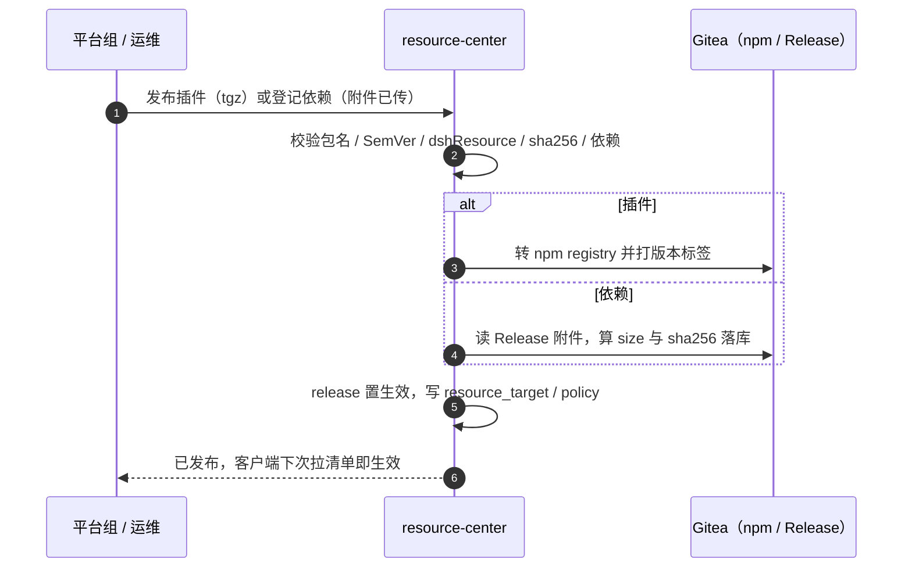
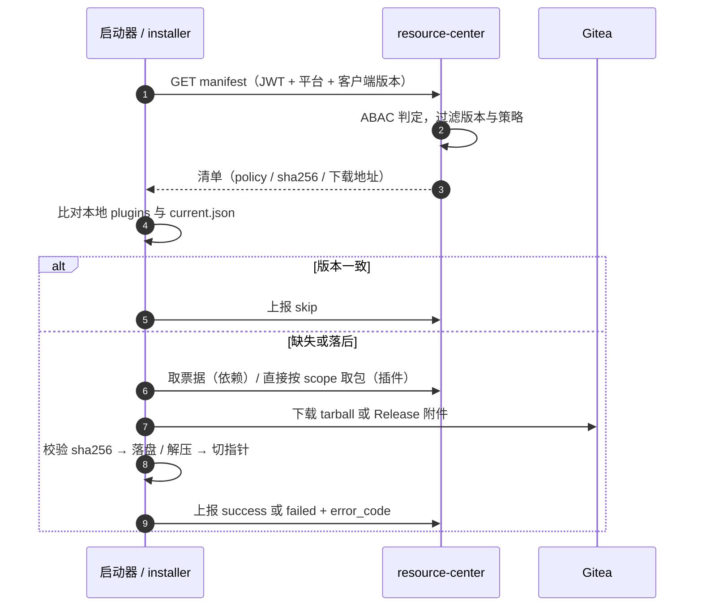
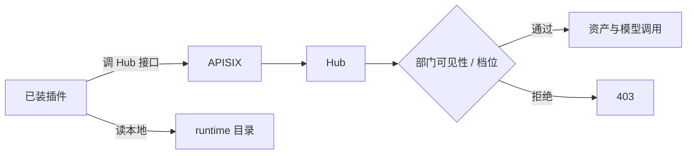

# 公共资源中心方案

- 日期：2026-11-11
- 状态：讨论稿，只定方向与边界
- 跟进人：邹鑫鹏、刘严、覃浩
- 范围：插件库（Harness 公共插件）、依赖库（exe 包、操作系统依赖环境、补丁）

## 定位

平台**运行底座**的分发中心。资产中心发的是业务资产（部门可见、走审批、候选版本到生效版本），这里发的是运行底座（全平台、平台方发布、发布即生效、只升不降）。插件内部的业务数据仍归资产中心，资源中心只管一件事：**能不能装到这台机器上**。

---

## 零、现在实际是什么

先把话说在前面：**公共资源中心这个服务端不存在**。`server/src` 下没有 resource 相关模块，没有 `/client/resources/**` 路由，没有 exe 存储，也没有依赖元数据表。下面这张表是逐条查代码核对过的现状。

| 组件 | 现在的实际状态 | 依据 |
| --- | --- | --- |
| 服务端资源中心 | **没有**。Hub 现有模块只有 asset / approval / audit / auth / cache / dept-access / gateway / gitea / knowledge-base / metering / model / org / remote-agents / session / startup / tier | `server/src/` 目录 |
| 插件分发 | **不走服务端**。启动器只从本机找包：带 `--dev` 用旁边的源码目录，否则用 `npm run pack:plugins` 打在 `plugins/` 里的 tgz。`hub-client.js` 只拿账号与环境，不拿插件 | `client/integrations/anzhi-launcher/lib/plugin-locator.js`、仓库根 README |
| 依赖分发 | **不存在，靠打包固化**。`node.exe` 从打包机的 `process.execPath` 复制，Git 从 `C:\Program Files\Git` 整份复制进 `runtime/`，跟着 NSIS 安装包一起发 | `client-electron/scripts/prepare-payload.mjs:139-170` |
| 唯一的取包链路 | **已有，但只服务业务资产**。`gateway/npm` 做 packument 过滤（按生效版本砍掉高版本、重指 dist-tags、tarball 地址改写回网关）+ tarball 代理（边读边转，不落盘），Hub 用平台服务账号去 Gitea registry 取 | `server/src/gateway/npm/`（controller 70 行 + service 191 行） |
| 客户端安装能力 | **断的**。安装按钮从没点亮过（组织名没有注入点）、本机连接器未实现、跳过版本清单自己拼地址、拿到包不校验、按资产编号猜包名 | `客户端问题记录.md` 第 7–12 条 |

所以不存在"插件先上、依赖后上"这种排序。真实情况是**两件都还没开始**，而且是同一块地基：服务端的制品分发 + 客户端的安装执行。地基里最缺的不是服务端表，是**客户端那一环**——上面第 5 行那五条不修，服务端做完了也装不上去。

本方案要补的，就是这块地基，加上依赖这一类制品。

---

## 一、技术选型

| 层 | 选型 | 现状 |
| --- | --- | --- |
| 统一入口 | APISIX，新增 `/client/resources/**`、`/admin/resources/**` 两条路由 | 网关在跑，路由新增 |
| 业务服务 | Hub 内新模块 `resource-center`，与 `asset` 平级，不独立部署 | 模块不存在，新建 |
| 插件制品 | Gitea npm registry，复用现有 packument 过滤与 tarball 代理（`gateway/npm`） | 链路已跑通，只服务业务资产 |
| 依赖制品 | Gitea Release 附件，Hub 流式转发（支持 Range 断点续传，不落盘）。包体积或并发上来再换 MinIO + 预签名直连 | 未接 |
| 元数据 | MySQL 8，4 张表 | 库在，表新建 |
| 缓存 / 锁 | Redis：清单缓存 60 秒、发布操作锁 | 在用 |
| 完整性 | `size` + `sha256` + 清单签名（Ed25519，公钥内置客户端） | 未做 |
| 客户端执行 | 启动器 + 本地 bridge 扩 `installer` 能力；回滚靠本地 `current.json` 指针 | 半成品，见第零节第 5 条 |
| 异步 | 不加 MQ，发布是低频人工动作，走同步 HTTP | 沿用现有选型 |

### 四条取舍

1. **插件不另造协议**。它本来就是 npm 包，复用现有 packument 过滤与 tarball 代理，只把"资产可见性"换成"资源 ABAC 判定"。省掉一整套版本、依赖、校验逻辑。
2. **exe 与补丁不发 npm**。走清单 + 直链下载 + 本地解压，硬塞进 npm 只会把版本语义搞乱。
3. **先不上 MinIO**。现在连 Gitea Release 附件都没接，再加一个对象存储只是多一份运维；附件已经支持 Range，Hub 流式转发不落盘就够。
4. **回滚不靠重新上传旧包**。客户端本地留 `current.json` 指针，指向上一版目录，切指针即回滚，避开资产那套审批链的重量。

### 数据模型（4 张表）

| 表 | 作用 |
| --- | --- |
| `resource` | 资源主档：`code`、`kind`（plugin/dependency）、`category`、`status`、`owner_staff_id` |
| `resource_release` | 版本与制品：`version`、`size`、`sha256`、`storage_kind`、`object_ref`、`os`、`arch`、`min_client_version` |
| `resource_target` | 适用范围：平台、客户端版本区间、终端分组 |
| `resource_policy` | ABAC 规则与下发策略（`required` / `recommended` / `optional`） |

插件与依赖的字段差异全部塞进 `manifest_json`，不另开表 —— 两类资源 80% 的字段是重合的，拆表只会让列表页要 union。

### 一条硬约束，先说清楚

**补丁类现在装不上**。客户端以普通用户权限运行，静默安装必须提权，而现场 UAC 与杀软会拦，这不是代码能绕过的。所以依赖库的范围只能做到**绿色免安装运行时**（解压即用、不写注册表、不要管理员），补丁只做**检测 + 提示 + 运维通道**，不承诺自助安装。这条直接决定了依赖库能覆盖到哪。

---

## 二、上下游交互

### 上游：谁产、怎么进

| 来源 | 动作 | 落点 |
| --- | --- | --- |
| 平台组（插件） | 推 Gitea → 调 Hub 发布接口，带 tgz 与版本说明 → Hub 校验后转 registry | `resource_release` + Gitea npm |
| 运维（依赖） | 打 zip/msi → 上传 Gitea Release 附件 → Hub 登记元数据（size、sha256、检测规则、解压结构） | `resource_release` + Release 附件 |
| 平台负责人 | 轻量确认后置为生效，**不进逐级审批链** | `resource.status` |

Hub 入库校验：包名必须 `@anzhi/*`、版本 SemVer 且大于当前生效版、`dshResource` 完整、`id + version` 唯一、`size` 与 `sha256` 按最终文件算、依赖精确匹配。

### 下游：客户端怎么拿

1. 启动器启动时（或登录成功后）带 JWT 拉一次清单，参数带 `platform / arch / clientVersion`。
2. Hub 做 ABAC 判定，过滤出一份**只含该终端该拿的版本**的清单。
3. 插件：与本地 `plugins/` 目录比对，不一致就按 `@anzhi` scope 取 tgz，校验后落盘，下次启动生效。
4. 依赖：先跑本地检测（文件哈希 / 版本命令），已满足跳过；缺失则取 Release 附件，校验 `sha256` 后解压到 `runtime/<code>/<version>/`，切 `current.json` 指针。
5. 全部动作写上报表，管理端出装机率与失败码分布。

### ABAC 三条

| 规则 | 为什么 |
| --- | --- |
| 规则**不下发**，只在 Hub 判 | 规则落到客户端就等于给了人一份绕过说明书 |
| 判在**清单**，不判在**下载** | 清单已经过滤过，下载再判一次只会两边口径不一致 |
| 下载票据**短时、一次性、绑终端指纹** | 防链接外传，也防拿到链接的人替别人装机 |

### 接口清单

| 方法与路径 | 作用 |
| --- | --- |
| `GET /client/resources/manifest` | 拉清单（已按 ABAC 过滤，带签名） |
| `GET /client/resources/plugins/{name}/versions` | 安装依赖信息，沿用现有过滤 |
| `GET /client/resources/plugins/{name}/-/{file}.tgz` | 插件 tarball 字节流 |
| `POST /client/resources/ticket` | 换依赖制品的短时下载票据 |
| `POST /client/resources/report` | 上报检测 / 下载 / 安装 / 回滚结果 |
| `GET /admin/resources` | 列表、版本、装机统计 |
| `POST /admin/resources/{code}/release` | 发布插件或登记依赖 |
| `POST /admin/resources/{code}/releases/{rid}/{action}` | `publish` / `deprecate` / `rollback` |

---

## 三、业务流程图

### 3.1 发布流

### 3.2 客户端启动安装流

### 3.3 运行期消费与权限收口

这张图要说明的是：**装得上不等于用得了**。资源中心只保证制品落到了这台机器；插件运行期要用的资产、模型、知识库，仍然回到资产中心的可见性与部门档位去判。两条链路的判定点不合并，避免出现"装了插件就绕开了权限"的口子。
