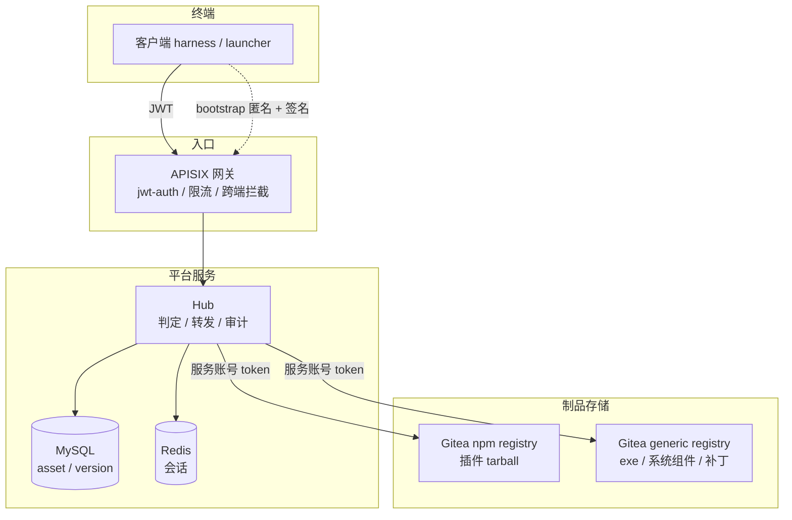
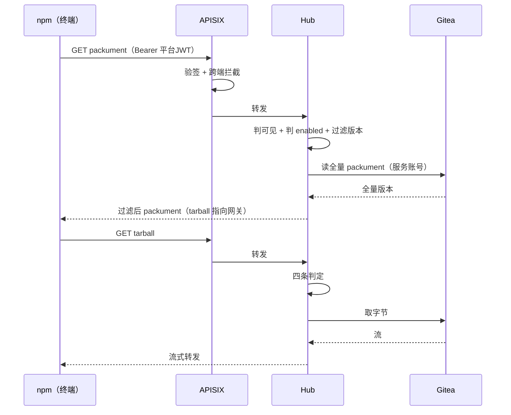
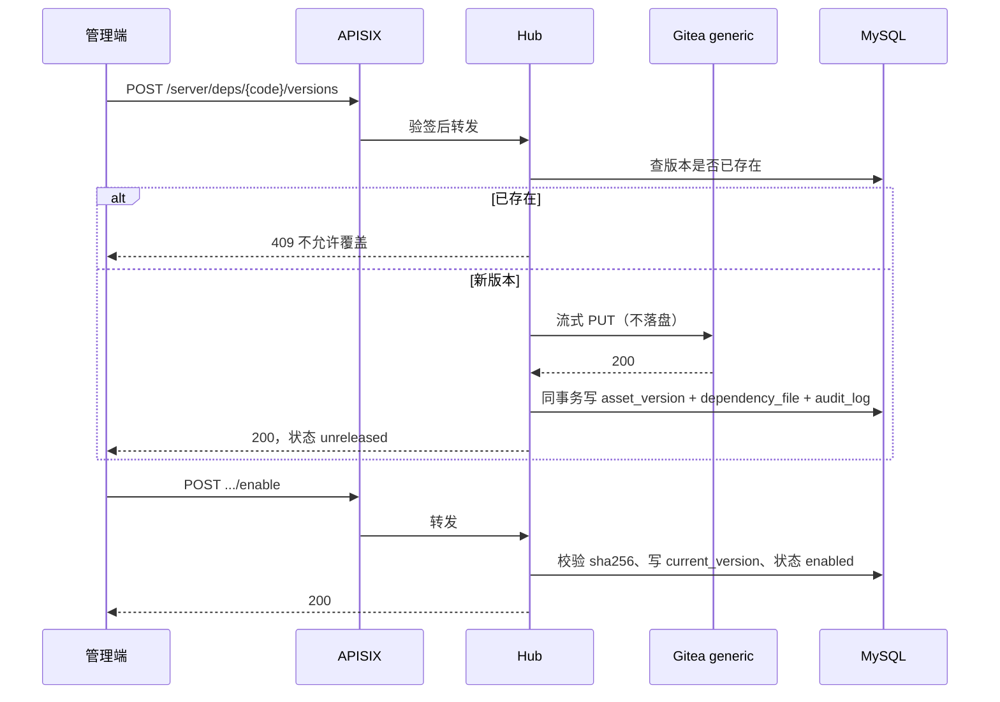
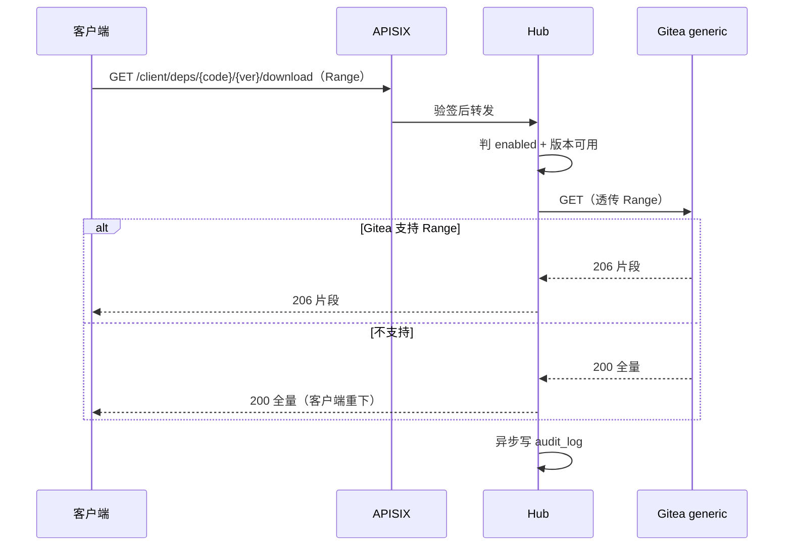
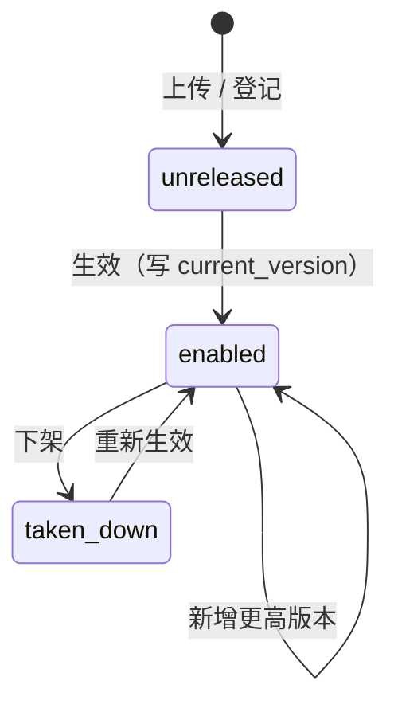

# 公共资源中心设计方案

覆盖两个模块：**插件库**（Harness 公共插件）与**依赖库**（exe、操作系统依赖环境、补丁）。

本方案的三处前置结论已定，后面各节都以它们为前提：

| 前置问题 | 结论 |
| --- | --- |
| 是否鉴权 | 做认证、不做细粒度授权。公共资源 = 登录即用，audit 保留主体 |
| 存储 | 两个模块都用 Gitea：插件库用 npm registry，依赖库用 generic registry |
| 依赖库形态 | 散件：exe、系统依赖组件、补丁，单个独立上传与下载 |

---

## 1 技术选型

### 1.1 组件总表

**不新增任何中间件。**全部复用现有栈：

| 组件 | 版本 | 在本方案里的职责 | 是否新增 |
| --- | --- | --- | --- |
| APISIX | 现有 | 唯一入口，验签，限流 | 否 |
| Hub（NestJS） | 现有 | 清单、权限、转发、审计 | 否（新增模块） |
| Gitea | 现有 | 制品存储：npm registry + generic registry | 否 |
| MySQL 8.0.36 | 现有 | 资产、版本、审计元数据 | 否（新增表） |
| Redis 7.2.7 | 现有 | 登录会话 | 否 |

Hub 内部新增两个模块，与现有 `AssetModule`、`NpmModule`、`GiteaModule` 平级：

- `PluginModule`：插件目录（读 `asset` 表，type = `Plugin`）
- `DependencyModule`：依赖制品

### 1.2 插件库：复用 npm 链路

插件就是 npm 包，**不新建分发通道**，完全沿用现状：

- 客户端 `.npmrc` 把 `@anzhi` 指向网关，`_authToken` 是平台 JWT，不是 Gitea 凭证
- APISIX 路由 `/api/packages/**` 验签后转发 Hub
- Hub 的 `NpmService.packument()` 判可见性与状态、按 `current_version` 过滤版本、改写 tarball 地址
- `NpmService.tarball()` 四条判定全过，用平台服务账号去 Gitea 取字节，边读边转，不落盘

本方案对插件库只做两件事：

1. `ASSET_TYPES` 增加 `Plugin`（现有 `['MCP','Skill','Agent','Wiki']`，见 `server/src/asset/shared.ts`）
2. 注册时强制 `scope.all = true`

可见性不写新逻辑：`asset_scope` 里 `department_id = 0 AND staff_id = 0` 那一行就是「全平台开放」，`scopeHit()` 已经支持，无需改动。

### 1.3 依赖库：Gitea generic registry + Hub 门面

依赖库不是 npm 包，套不上 npm 协议，但 Gitea 有 generic registry，可以存任意文件。

**存储路径约定**：

```
组织:      GITEA_ORG
包名:      <asset.code>
版本:      <asset_version.version>
文件名:    原始文件名（如 VC_redist.x64.exe）
Gitea API: PUT /api/packages/{org}/generic/{pkg}/{version}/{file}
           GET /api/packages/{org}/generic/{pkg}/{version}/{file}
```

**三条硬约束**：

1. **客户端永不直连 Gitea**，与插件库一致。下载地址一律是网关地址，Hub 用服务账号取字节再转发。
2. **Gitea 只存字节，不做判定**。可见性、启用状态、版本可用性、下架全在 Hub 判，与 `asset` / `asset_version` 同一套口径。
3. **版本不可变**。上传前先查 `asset_version` 是否已存在，存在即拒（409），不允许覆盖。

**上传路径**：管理端 → 网关 `/server/**` → Hub → 流式写 Gitea。Hub 全程不缓冲到内存、不落本地盘，只是管道。依赖库上传频率低，双倍流量可以接受，换取「唯一入口」不被破坏。

**下载路径**：客户端 → 网关 `/client/**` → Hub → 流式读 Gitea → 客户端。Hub 透传 `Range` 头，尽力支持断点续传（是否真正生效取决于 Gitea，见 1.7）。

### 1.4 数据模型

复用现有表，只新增一张：

| 表 | 变化 | 说明 |
| --- | --- | --- |
| `asset` | 复用 | `type` 增加 `Plugin` / `Dependency` |
| `asset_scope` | 复用 | 公共资源写一行 `(0,0)` |
| `asset_version` | 复用 | 存版本、`sha256`、`size`、状态 |
| `dependency_file` | **新增** | 依赖制品与版本一对一，存原始文件名与 content-type |

`dependency_file` 单独建表而不往 `asset_version` 加列，是为了不污染插件库那条已经定稿的路径：

```sql
CREATE TABLE dependency_file (
  id               INT UNSIGNED AUTO_INCREMENT PRIMARY KEY,
  asset_version_id INT UNSIGNED NOT NULL,
  file_name        VARCHAR(255) NOT NULL,
  content_type     VARCHAR(100) NOT NULL DEFAULT 'application/octet-stream',
  sha256           CHAR(64)     NOT NULL,
  size             BIGINT UNSIGNED NOT NULL,
  create_time      DATETIME(0)  NOT NULL DEFAULT CURRENT_TIMESTAMP,
  UNIQUE KEY uk_dep_version (asset_version_id)
) ENGINE=InnoDB DEFAULT CHARSET=utf8mb4;
```

### 1.5 接口清单

**插件库**（沿用现有，不改）

| 方法 | 路径 | 说明 |
| --- | --- | --- |
| GET | `/api/packages/{org}/npm/{pkg}` | packument |
| GET | `/api/packages/{org}/npm/{pkg}/-/{file}` | tarball |

**依赖库 · 管理端**（落在 `/server/**`，网关零改动）

| 方法 | 路径 | 说明 |
| --- | --- | --- |
| POST | `/server/deps/{code}/versions` | 上传制品，multipart，流式转 Gitea |
| POST | `/server/deps/{code}/versions/{version}/enable` | 生效，写 `current_version` |
| POST | `/server/deps/{code}/take-down` | 下架 |
| GET | `/server/deps` | 依赖列表 |

**依赖库 · 客户端**（落在 `/client/**`，网关零改动）

| 方法 | 路径 | 说明 |
| --- | --- | --- |
| GET | `/client/deps/catalog?os=&arch=` | 可用依赖清单，只含 enabled |
| GET | `/client/deps/{code}/versions/{version}/download` | 下载，透传 Range |

网关不新增路由的原因：`/server/**` 与 `/client/**` 已经挂了 `jwt-auth`、跨端拦截、IP 限流，新接口挂在这两个前缀下即可继承全部策略。唯一需要评估的是大文件下载会不会被 `limit-req` 误伤——若会，单开一条 `anzhi-deps` 路由，`uri` 为精确前缀，去掉限流插件。

### 1.6 不引入的组件与切换条件

| 候选 | 不选的理由 | 什么情况下换 |
| --- | --- | --- |
| Verdaccio | 与 Gitea 仓库解耦后要多维护一份权限映射 | 需要完整 dist-tag / deprecate，或 Gitea 退役 |
| MinIO | 现阶段体量用不上对象存储 | 制品总量 > 50 GB、单文件 > 500 MB、需要多副本 |
| Nexus / Artifactory | 第二套账号体系，与平台判可见性的原则冲突 | 不换，除非合规强制 |
| 自建 registry | 增量只剩发布侧，收益不足以先做 | 插件库与依赖库要合并成一套机制时 |

迁移成本可控的原因：Hub 始终是客户端唯一入口，换后端只动 Hub 内部取字节那一段，客户端、鉴权、清单接口都不变。

### 1.7 五项待实测

| # | 待验证 | 影响 | 不满足时的兜底 |
| --- | --- | --- | --- |
| 1 | Gitea generic 下载是否支持 `Range` | 断点续传 | Hub 侧做临时文件缓存，自行切片 |
| 2 | 上传大小限制（Gitea / APISIX / Hub 三处） | 大 exe 能否上传 | 调大限制，或改分片上传 |
| 3 | 同版本同文件重复上传的行为 | 版本不可变 | Hub 先查后写，应用层拒绝覆盖 |
| 4 | generic API 与 Gitea 版本的绑定程度 | 升级风险 | 固定 Gitea 镜像 tag，不再用 `latest` |
| 5 | 大文件流式转发时 `giteaPackageTimeoutMs` 是否够 | 中途断流 | 依赖库单独一组超时，且全链路流式 |

第 4 条是现实问题：当前 `docker-compose.yml` 用的是 `gitea/gitea:latest`，公共资源中心上线后 Gitea 变成制品总仓，升级不再能「拉最新」。

---

## 2 上下游交互

### 2.1 边界

| 角色 | 与公共资源中心的关系 | 交互方式 |
| --- | --- | --- |
| 客户端（harness / launcher） | 下游消费者 | 带 JWT，经网关 |
| 管理端控制台 | 上游生产者 | 带 admin JWT，经网关 |
| APISIX | 前置 | 验签、限流、跨端拦截 |
| Hub | 本体 | 判定、转发、审计 |
| Gitea | 存储后端 | 服务账号 token，仅 Hub 可达 |
| UC 用户中心 | 不接 | 身份仍由 Hub 登录签发 |
| 资产中心 / 权限规则 | 不接 | 判定在 Hub 内部，不是独立服务 |

**关于图里的两条虚线**：架构图上 `APISIX → 权限规则` 与 `资产中心（资产审批、获取）` 是既有平台的画法，实际实现里没有独立的「权限规则」服务——可见性判定就是 `visibleTo()` 里那句 SQL 加一次 Gitea 协作者查询。公共资源中心沿用这个做法，不新增服务间调用。

**关于鉴权**：图上 harness 旁标注的「需不需要做鉴权」，结论是认证必做、授权不做。落到交互上只有一条差别——公共资源中心的所有接口都要求 JWT，但 Hub 内部不做部门判定，只看 `enabled`。

### 2.2 插件库读路径（安装）

```
npm → GET /api/packages/{org}/npm/{pkg}
    → APISIX 验签 → Hub.packument()
    → visibleTo(actor) + status == enabled + version <= current_version
    → 返回过滤后的 packument，tarball 已改写为网关地址
npm → GET /api/packages/{org}/npm/{pkg}/-/{file}
    → APISIX 验签 → Hub.tarball()
    → 四条判定 → Gitea 取字节 → 流式回终端
```

### 2.3 插件库写路径（发布）

沿用既有资产提交流程，本方案不改：开发者用本人 Gitea 账号推代码到仓库，Hub 用服务账号建标签、发布到 Gitea npm registry、更新 `asset_version` 与 `current_version`。开发者 token 由 Hub 加密存服务端，客户端不接触。

### 2.4 依赖库写路径（上传与生效）

```
管理端 → POST /server/deps/{code}/versions  (multipart, 带 sha256)
       → APISIX 验签 → Hub
       → 查 asset_version 是否已存在 → 存在即 409
       → 流式 PUT 到 Gitea generic
       → 同事务写 asset_version + dependency_file + audit_log
       → 返回 version，状态 unreleased

管理端 → POST /server/deps/{code}/versions/{version}/enable
       → Hub 校验 sha256 与文件存在
       → 写 asset.current_version，状态转 enabled
       → 写 audit_log
```

### 2.5 依赖库读路径（清单 / 下载）

```
客户端 → GET /client/deps/catalog?os=&arch=
       → Hub 返回 enabled 的依赖，含 code、version、size、sha256、下载路径

客户端 → GET /client/deps/{code}/versions/{version}/download
       → Hub 判 enabled + 版本存在 + 不在停用列表
       → 带 Range 透传 Gitea，流式回终端
       → 写 audit_log（异步、不阻塞流）
```

### 2.6 契约与错误语义

| 场景 | 状态码 | 文案 |
| --- | --- | --- |
| 未登录 / 令牌失效 | 401 | 沿用平台统一文案 |
| 依赖未启用 | 403 | 资产还未启用 |
| 依赖已下架 | 403 | 资产已下架 |
| 版本不存在 | 404 | 沿用现有 |
| 版本已存在（重复上传） | 409 | 版本已存在，不允许覆盖 |
| 校验和不匹配 | 422 | 制品校验失败 |
| Gitea 不可达 | 500 | 存储不可用，请稍后重试 |

依赖库不引入新的错误码体系，全部复用 `common/http.ts` 里已有的 `MSG` 与状态码约定。

### 2.7 bootstrap 例外

客户端拿到 JWT 之前要先下载自身与内置运行时，这段必然匿名。处理方式：

- 单独一条路由 `/bootstrap/**`，不挂 `jwt-auth`，只挂 IP 限流
- 制品白名单写死（客户端本体、内置 Node、内置 Git），不可通过配置扩展
- 靠**清单签名 + 制品 sha256** 保证完整性，不靠身份

除这几个固定制品外，全部要求 JWT。

---

## 3 业务流程图

### 3.1 总体架构



要点：客户端只认网关；Gitea 的内网地址不出现在终端上；Hub 是唯一的判定点。

### 3.2 插件安装流程



### 3.3 依赖上传与生效



### 3.4 依赖下载（含 Range）



### 3.5 状态机

资产（插件与依赖共用）：



规则：

- 只有 `enabled` 对客户端可见
- 版本不可变，任何状态都不允许覆盖已有版本

---

## 4 风险与降级

| 风险 | 影响 | 应对 |
| --- | --- | --- |
| Gitea 单点 | 插件与依赖同时不可用 | 数据卷定期备份并演练恢复；上线前明确 RTO |
| Gitea 升级破坏 generic API | 依赖库全挂 | 固定镜像 tag，升级前在测试环境跑通五项实测 |
| 大文件上传撑爆 Hub | 内存或连接耗尽 | 全链路流式，禁止整体读入；单独超时 |
| Range 不支持 | 大文件重下 | Hub 侧临时文件缓存最近版本 |
| 版本被覆盖 | 供应链投毒 | Hub 先查后写 + sha256 记录 + 审计 |
| 限流误伤下载 | 大文件下载中断 | 需要时单开 `anzhi-deps` 路由，去掉 limit-req |

## 5 分期

| 阶段 | 内容 | 依赖 |
| --- | --- | --- |
| P0 | 插件库上线：`ASSET_TYPES` 加 `Plugin`，注册强制 `all` | 无，链路已具备 |
| P1 | 依赖库：上传、生效、下架、清单、下载、审计 | 完成 1.7 的五项实测 |
| P2 | 优化：断点续传、缓存、独立限流路由 | P1 稳定 |
